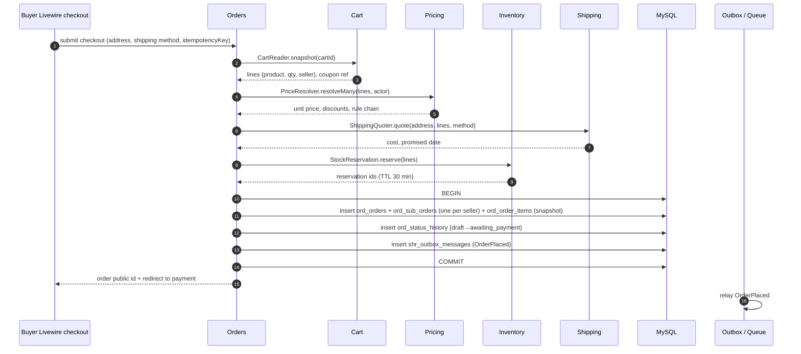
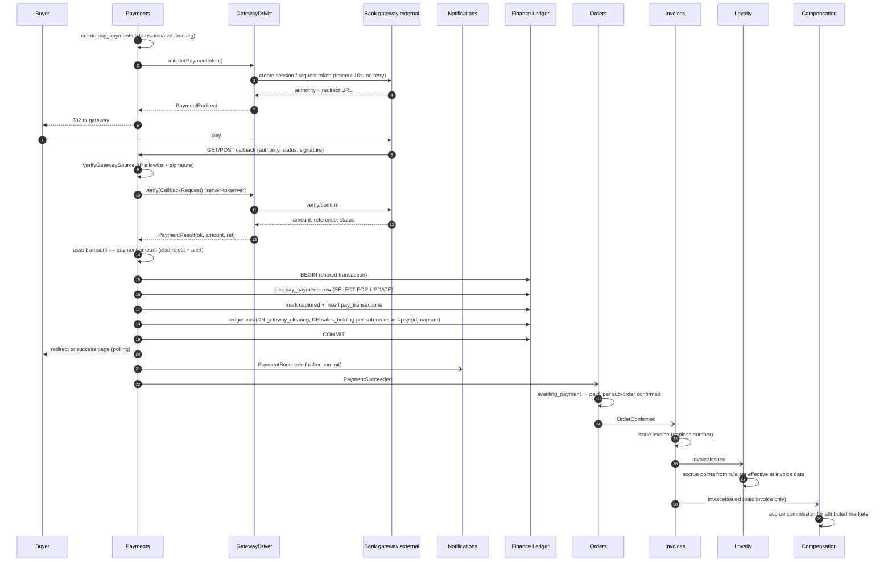
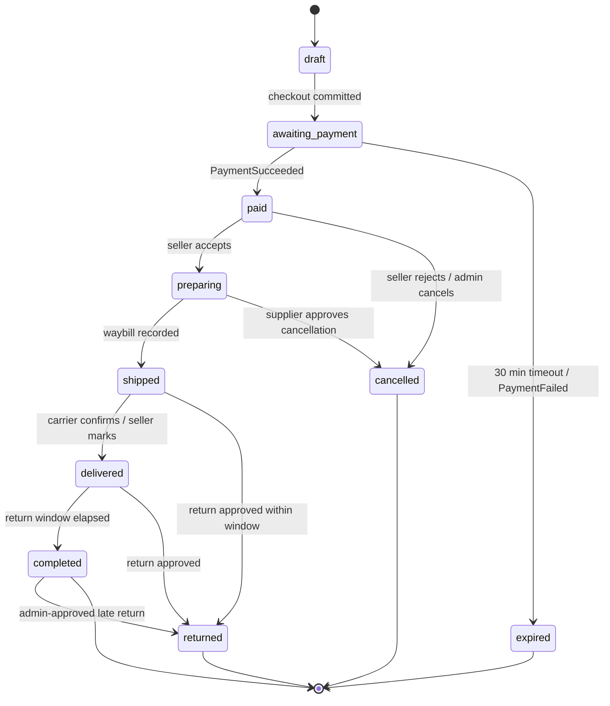
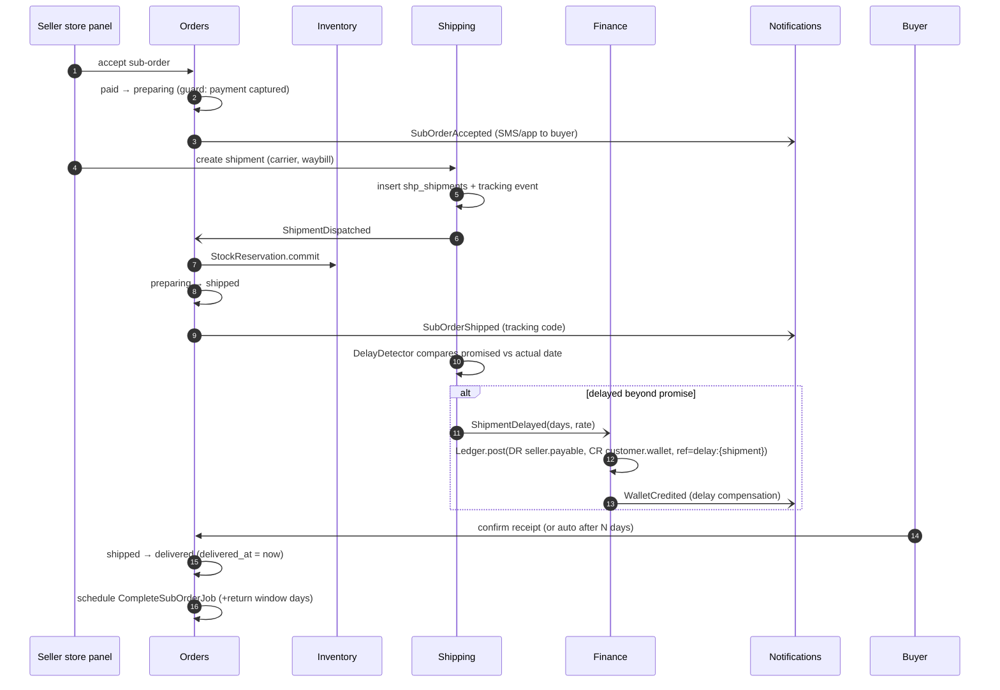
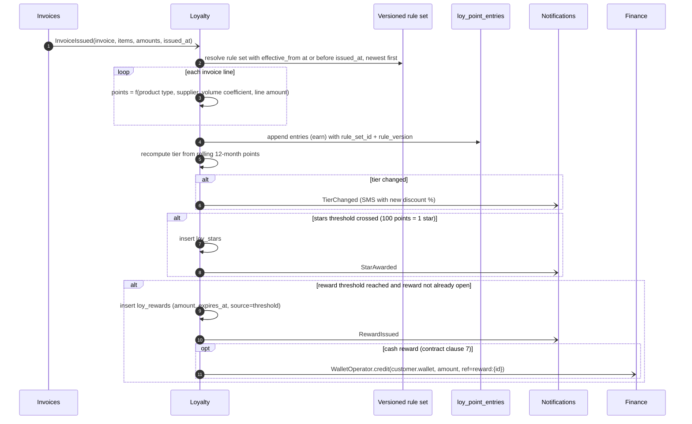
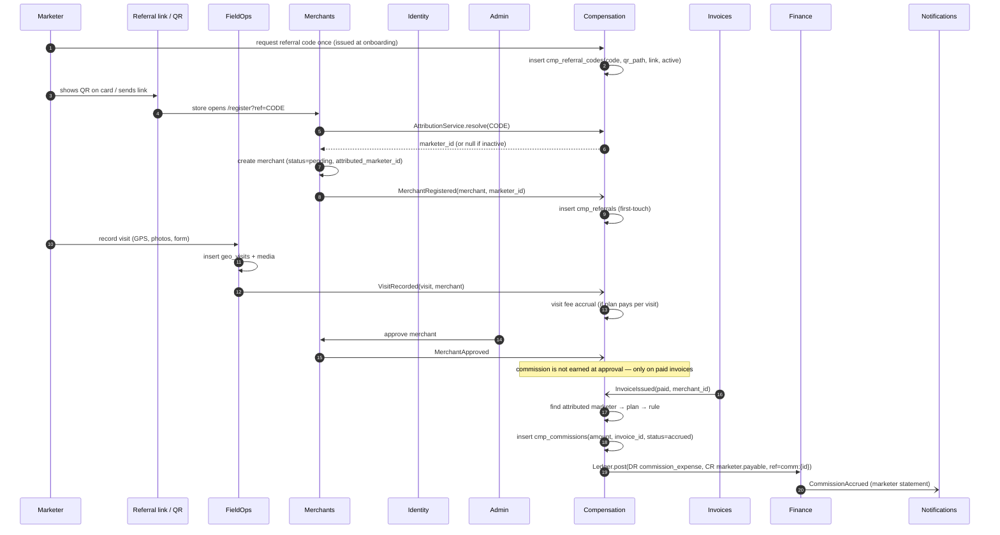
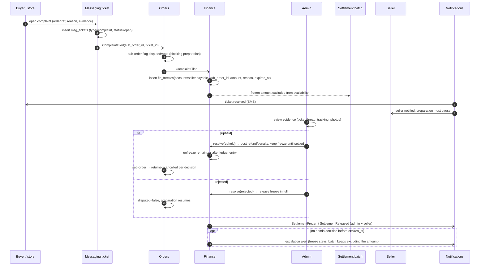

# Data Flow — six critical sequences

| | |
|---|---|
| **Purpose** | Show, step by step, how the money and state actually move through the modules for the six flows that carry the most risk: checkout→payment→ledger, the order lifecycle, the loyalty loop, marketer attribution→commission, complaint→settlement freeze, and settlement→bank export. |
| **Audience** | Backend engineers implementing these flows, QA writing acceptance scenarios, the client's finance reviewer. |
| **Status** | Baseline v1.0 — describes intended behaviour; each sequence has invariants that tests must assert. |
| **Owner** | Agent C (architecture). |

**Source:** contract `DK-1405-01` page 5 / پیوست ۱ clauses 5, 10; page 6–7 / پیوست ۴ clauses 1–21; page 7–8 / پیوست ۵ clauses 1–2, 15, 18; page 10–11 / پیوست ۱۱ clauses 12–15; page 11 / پیوست ۱۳ clauses 1–7; `docs/canonical-context.md` §5.

---

## 0. Notation and shared rules

- Every command carries an `idempotencyKey`; `shr_idempotency_keys` stores `(scope, key) → response` for 24 hours. A retry returns the stored result and writes nothing.
- Every state change writes `ord_status_history` (or the module's equivalent history table) with actor, reason and `request_id`.
- Domain events dispatch **after commit**. Cross-module fan-out goes through `shr_outbox_messages` and the `outbox:relay` command, so a crash between commit and dispatch cannot lose the event.
- External calls (gateway HTTP, SMS, maps) never happen inside a database transaction.
- All amounts are integer Toman. Ledger accounts used below:

| Account | Type | Meaning |
|---|---|---|
| `platform.gateway_clearing:{gateway}` | asset | Money received at the gateway, not yet swept to the bank |
| `platform.sales_holding:{order}` | liability | Buyer money held for a specific order, not yet earned by sellers |
| `seller.payable:{merchant}` | liability | Amount owed to a seller, settleable |
| `marketer.payable:{user}` | liability | Commission owed to a marketer |
| `customer.wallet:{user}` | liability | Spendable store credit / cash reward |
| `platform.revenue_commission` | income | Platform commission |
| `platform.revenue_shipping` | income | Shipping margin |
| `platform.promo_expense` | expense | Platform-funded discounts |
| `platform.commission_expense` | expense | Marketer commissions |
| `platform.penalty_income` | income | Delay/incomplete-order penalties |
| `bank.settlement` | asset/liability | Cleared through the payout file |

---

## 1. Checkout → payment callback → ledger

### 1.1 Checkout (order creation)



Invariants:

1. The order total is recomputed server-side from the price snapshot; any client-supplied amount is ignored (a negative test asserts this on every endpoint).
2. One `ord_orders` row, N `ord_sub_orders` rows — one per distinct seller, including the platform's own stock if any.
3. Line rows store `unit_price_amount`, `quantity`, `line_total_amount`, `discount_amount`, `applied_rules` (JSON: rule id, version, amount) — enough to re-explain the price a year later.
4. Stock is reserved before commit; a failed reservation aborts the transaction and no order exists.
5. The order number (`DK-` + Jalali year + sequence) is generated inside the same transaction from `inv_sequences`-style counters to avoid duplicates under concurrency.

### 1.2 Payment initiation and callback



Invariants:

1. **Exactly one** capture per payment. The payment row is locked, and `pay_transactions` has a unique index on `(gateway, gateway_reference, type)`; a duplicate callback is answered `200 OK` with no state change.
2. The posting reference is deterministic (`pay:{payment_id}:capture`), so even a race that gets past the lock cannot double-post — the unique index on `fin_postings.reference` rejects the second insert, and the buyer's three sub-orders become one posting with four lines.
3. The ledger posting and the payment status update commit **together**. A ledger failure rolls back the payment to `initiated`, and the reconciliation job re-queries the gateway.
4. Amount mismatch (gateway says 4,900,000, we expect 5,000,000) never marks paid: the payment goes to `mismatch`, an alert fires, and the case lands in the admin reconciliation queue.
5. Verification is retried up to 5 times with 2s/10s/30s/120s backoff; retries reuse the same reference.
6. Nothing is posted to a seller's payable at payment time — money sits in `sales_holding` until the sub-order is delivered and the return window closes (`§2`). This is the conservative model recorded in `AMB-FIN-001`.
7. On failure (`PaymentFailed`), the order stays `awaiting_payment`; the expiry job (`§2`) cancels it after 30 minutes and releases stock.

### 1.3 Settlement of the hold (context for §6)

When a sub-order reaches `completed` (delivered + return window elapsed):

```
DR platform.sales_holding:{order}      (sub-order gross, the amount held for it)
CR seller.payable:{merchant}           (gross − commission − seller-funded discounts − penalties)
CR platform.revenue_commission         (platform commission for this sub-order)
```

The hold was posted gross at capture (`§1.2`), so commission is recognised here, when the money becomes the seller's — not at payment. That keeps the seller payable equal to what the seller can actually withdraw, and puts the revenue line in the same period as the settlement report. This is one posting (`reference=sub:{sub_order_id}:earn`) with three lines, so the posting sums to zero and the commission is attributable to the exact sub-order that earned it.

---

## 2. Order lifecycle including sub-orders

### 2.1 State machine



Parent order status is **derived**, never set directly: if all sub-orders are `cancelled`/`expired` → parent `cancelled`; if all `completed` → `completed`; if any `shipped`/`delivered` → parent `partially_shipped`/`partially_delivered`; otherwise the minimum progress across children. `ord_orders.status` caches the derived value and is recomputed by `OrderStateMachine::deriveParent()` inside the transaction that changed a child.

### 2.2 Seller acceptance, shipping, delivery



Invariants:

1. Illegal transitions throw `IllegalOrderTransition` — no status is ever written by a controller or a job without going through the state machine.
2. A sub-order cannot move to `preparing` unless its parent payment is `captured`; a partly paid order never ships.
3. Delivering one sub-order does not complete the parent; the parent completes when its last child completes.
4. The delay penalty is computed once per shipment (`reference=delay:{shipment_id}`), deducted from the seller's payable and credited to the buyer's wallet — the contract's "کسر خودکار درصد خسارت از فاکتور و واریز به کیف پول خریدار" (پیوست ۱۱ بند ۱۵).
5. Cancellation after payment requires a reason; the refund path is `§5`/Returns, never a direct wallet credit by a controller.
6. `OrderExpired` releases stock reservations and voids any pending payment intent.

---

## 3. Points accrual → reward → next-invoice discount

### 3.1 Accrual



Invariants:

1. Coefficients come from the rule set effective **at invoice issue time**, not at accrual run time. A rule change never rewrites history.
2. `(invoice_id, line_id, rule_set_id)` is unique in `loy_point_entries`; re-running accrual for the same invoice is a no-op.
3. Points are a ledger: balance = `SUM(points)`, never a mutable counter. Reversals on return are negative entries with a reason.
4. Tier windows use `Asia/Tehran` day boundaries and are computed, not stored as a flag on the user.
5. Stars are unbounded and derived from lifetime earned points (100 → 1), so they survive tier drops.

### 3.2 Reward applied to the next invoice

```mermaid
sequenceDiagram
    autonumber
    participant B as Buyer at checkout
    participant P as Pricing pipeline
    participant L as Loyalty discount contributor
    participant O as Orders
    participant DB as loy_reward_redemptions

    B->>P: price basket
    P->>L: contribute(basket, actor)
    L->>L: pick oldest non-expired reward
    alt invoice_total >= 4 × reward_amount
        L-->>P: discount = full reward
    else invoice_total is less than 4 × reward_amount
        L-->>P: discount = reward / 2 (integer, rounded down)
    end
    P-->>B: total with reward line item
    B->>O: place order
    O->>O: snapshot applied_rules (reward id, applied amount, rule applied)
    O-)L: OrderPlaced(reward_id, applied_amount)
    L->>DB: insert redemption (reward_id, order_id, applied_amount)
    L->>L: consumed = applied_amount; remainder stays open if any
```

Invariants:

1. The 4× rule and the half-reward fallback are the contract's wording (پیوست ۴ بند ۴) and are implemented as one pure function with table-driven tests at the boundaries (exactly 4×, 4×−1, zero total).
2. Rounding is integer floor in the customer's favour; the remainder of a half-applied reward stays available — this split behaviour is recorded as `AMB-LOY-002` because the clause does not say whether the unused half is forfeited.
3. A reward is consumed at order placement, not at payment; an expired or cancelled order returns the reward to `open` (a compensation entry, not a deletion).
4. Reward expiry runs daily and writes `RewardExpired`; expired rewards never appear in the contributor.

---

## 4. Marketer QR registration → commission



Invariants:

1. **First-touch attribution wins** inside the configured window; reassignment requires an admin decision, is written to `cmp_referrals` as a superseding row, and is audited (پیوست ۴ بند ۲۴ — admin must see store ownership changes).
2. A QR code is never re-used across marketers; deactivating a marketer marks the code inactive but keeps its history.
3. Commission accrues only on a **paid** invoice, once per invoice (`unique(invoice_id, marketer_id, rule_id)`), and only if the plan's conditions (minimum activity/points — پیوست ۶ بند ۶) are met against the loyalty snapshot at accrual time.
4. A return creates a clawback (`CommissionVoided` / negative `cmp_adjustments`), never a silent edit of the original commission.
5. Admin "disable commission / change level" (پیوست ۴ بند ۲۲) creates a dated plan assignment; historical accruals are untouched.
6. Marketer scope: their queries filter on `cmp_referrals.marketer_id = actor.id`; the negative test asserts a marketer cannot read another's referrals even by guessing ids.

---

## 5. Complaint → settlement freeze



Invariants:

1. A freeze is a **row**, not a status on the settlement. Availability = `SUM(payable) − SUM(active freezes) − SUM(already batched)`.
2. Freezing never mutates the ledger; it withholds availability. Only a resolution posts money.
3. The complaint window (up to one week after dispatch — پیوست ۴ بند ۱۵ و ۳۲) is enforced when opening the ticket; a late complaint goes to the admin queue but does not auto-freeze.
4. Only one active freeze per sub-order; a second complaint attaches to the existing freeze with a link, not a second amount.
5. Expiry does not release the freeze — it escalates. Money is never released by a timer.
6. All resolution actions are audited with the deciding admin, the evidence reference, and the before/after amounts.

---

## 6. Settlement batch → Excel export

```mermaid
sequenceDiagram
    autonumber
    participant A as Admin
    participant F as Finance
    participant R as Reporting
    participant B as BankExportBuilder
    participant ST as Private storage
    participant BK as Bank

    A->>F: open settlement period (from, to, seller filter)
    F->>F: build fin_settlements per seller: sum of payable lines in period − active freezes − already batched
    F->>F: status=draft, items snapshot ledger posting ids
    A->>F: approve batch (2FA re-check, audit)
    F->>F: status=approved, amounts locked (no edits; adjustments create a new batch)
    F->>B: build export (xlsx)
    B->>B: header row, one row per IBAN, totals row, control checksum
    B->>ST: store reports/settlements/{batch}.xlsx (private disk)
    F->>F: insert fin_bank_exports(file, sha256, rows, total)
    A->>ST: download via 5-minute signed URL
    A->>BK: upload to bank portal (manual step)
    BK-->>A: bank reference / result file
    A->>F: mark batch paid (bank ref, paid_at)
    F->>F: Ledger.post(DR seller.payable, CR bank.settlement, ref=batch:{id})
    F-)R: SettlementPaid
    R->>R: refresh settlement report + daily payment report email
    A->>R: download settlement report (xlsx/csv)
```

Invariants:

1. Batch amounts are computed from ledger entries, not from order rows — the export can always be reconciled line by line.
2. After approval, a batch is immutable. A correction is a new batch with a reason, linked to the original (`fin_settlement_items.correction_of`).
3. The export stores `sha256`, row count and total; marking the batch paid requires the total on the bank result to match, otherwise the batch goes to `mismatch` and the reconciliation queue.
4. One row per payout account (IBAN), never per order; the seller's statement (in the panel) shows the order-level detail that produced the row.
5. Export files are private, expire from the public URL after 5 minutes, and are retained for the contract's audit horizon (7 years suggested; subject to `AMB-FIN-003`).
6. The whole flow is idempotent: re-running the batch builder for the same period returns the same batch id and does not duplicate items.

---

## 7. Failure and recovery matrix

| Flow | Failure | Behaviour | Recovery |
|---|---|---|---|
| Checkout | Stock contention | Transaction retries 3× on deadlock, then 409 `STOCK_UNAVAILABLE` | Buyer retries; stock released by reservation TTL |
| Checkout | Price changed between cart and checkout | New price shown with a diff notice, buyer must confirm | No silent charge |
| Payment | Gateway timeout on initiate | No retry; user sees "try again", previous intent voided | New intent with new key |
| Payment | Callback never arrives | `pay:reconcile` re-queries after 15 min | Reconciliation job or admin action |
| Payment | Duplicate callback | 200 OK, no state change | — |
| Payment | Amount mismatch | `mismatch` status + alert | Admin reconciliation |
| Order | Seller never accepts | Auto-cancel after admin-configured SLA, full refund | Refund orchestrator |
| Loyalty | Rule set missing for invoice date | Fall back to the oldest active set, alert admin, do not accrue silently | `RuleSetReplayer` |
| Loyalty | Duplicate accrual | Unique constraint rejects | Relay retry is safe |
| Compensation | Attribution ambiguous (two codes) | First valid code wins, both recorded, admin alerted | Admin supersede |
| Settlement | Bank rejects a row | Batch `partially_paid`, failed rows into next batch | Admin reissues |
| Settlement | Frozen amount included by mistake | Batch builder recomputes availability at build time | Batch blocked, alert |

## 8. What each flow proves about the architecture

| Flow | Architectural property exercised |
|---|---|
| §1 | Money movement is a single transaction; external I/O is outside it; gateway abstraction holds |
| §2 | Explicit state machine with derived parent status; sub-order independence |
| §3 | Versioned rules and ledger-style points make history reproducible |
| §4 | Attribution is a module concern with admin-visible overrides, not a marketing afterthought |
| §5 | Freezes are availability, not ledger mutations — the ledger stays append-only |
| §6 | Settlement is computed from the ledger and reconciled to an external artifact |
