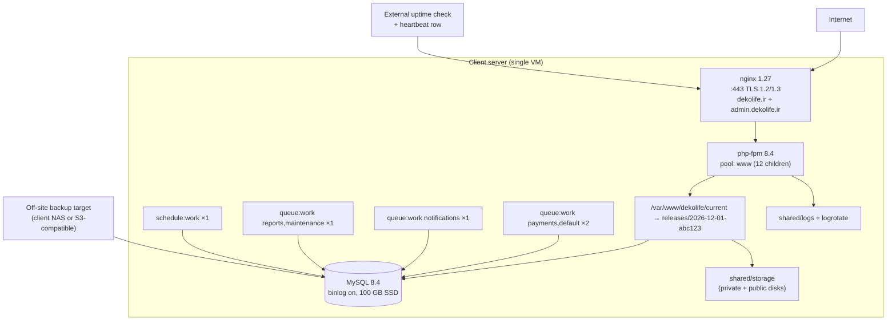

# Deployment Topology

| | |
|---|---|
| **Purpose** | Define the four environments, the exact production topology on the client's server, the environment matrix, the deploy and rollback procedure, and the backup/restore runbook. |
| **Audience** | DevOps, the engineer who deploys, the operator on call, the client's IT contact. |
| **Status** | Baseline v1.0. Production is a **single host** by contract (the client provides hosting); this document is explicit about what that costs. |
| **Owner** | Agent C (architecture). |

**Source:** contract `DK-1405-01` page 1 / ماده ۱ (full deployment on the client's server, domain and SSL setup, performance test in the operational environment); page 3 / ماده ۵ clause 3 (client provides host, domain, SSL and gateway); page 5 / پیوست ۱ clauses 7, 9 (admin panel on a dedicated domain/path with 2FA; automatic daily database backup with restore); page 10 / پیوست ۹ clause 2 (GTmetrix B/A target), پیوست ۱۰ clause 1 (test deployment on the client's server for acceptance).

---

## 1. Environments

| | Local | CI | Staging | Production |
|---|---|---|---|---|
| Purpose | Development | Gate every PR | Acceptance rehearsal, client demo | Live |
| Host | Developer machine (Docker Desktop) | GitHub Actions runner | One VPS, same topology as production | Client's server |
| PHP | 8.4 fpm container | 8.4 CLI | 8.4 fpm | 8.4 fpm |
| MySQL | 8.4 container | 8.4 service container | 8.4 | 8.4 |
| Queue | `database`, 1 worker | `sync` for most tests, `database` for queue tests | `database`, 2 workers | `database`, 5 workers |
| Gateways | `fake` driver | `fake` driver | Sandbox credentials | Live credentials |
| SMS/WhatsApp | log driver | fake driver | Sandbox / test numbers | Live |
| Mail | Mailpit | array/log | SMTP (client's or a test mailbox) | Client's SMTP |
| Debug | on | n/a | off | off |
| Data | Seeded factories | Factories per test | Imported sample catalogue (پیوست ۹ بند ۴) | Real |
| Access | developer | — | team + client, basic auth in front | public + admin host |

Staging must be a **structural** copy of production: same nginx config, same PHP ini, same MySQL major, same queue topology. Anything that only works on staging because it is different is a production incident waiting to happen.

## 2. Local development

```yaml
# compose.yaml (repo root) — services, not a full file
services:
  app:        # php:8.4-fpm, bind-mounts the repo, xdebug optional
  web:        # nginx:1.27, listens 8080, proxies to app:9000
  worker:     # same image as app, command: php artisan queue:work
  scheduler:  # same image as app, command: php artisan schedule:work
  mysql:      # mysql:8.4, volume mysql-data, port 3307
  mailpit:    # axllent/mailpit, UI on 8025
  node:       # node:22, only for `npm run dev` (HMR), optional profile
```

Bootstrap:

```bash
cp .env.example .env
docker compose up -d
docker compose exec app composer install
docker compose exec app php artisan key:generate
docker compose exec app php artisan migrate --seed
docker compose exec app php artisan storage:link
npm ci && npm run dev        # host or the node service
```

Local defaults: `APP_ENV=local`, `PAYMENTS_FAKE_ENABLED=true`, `PAYMENTS_FAKE_SCENARIO=success`, `MAIL_MAILER=smtp` → Mailpit, `QUEUE_CONNECTION=database`, `CACHE_STORE=database`, `SESSION_DRIVER=database`, `DB_PORT=3307`. Tests run against a separate schema (`dekolife_test`) created by the Pest bootstrap.

## 3. CI (GitHub Actions)

`.github/workflows/ci.yml`, triggered on push and pull request:

| Stage | Command | Fails the build when |
|---|---|---|
| 1. Static | `composer validate --strict`, `vendor/bin/pint --test` | lockfile out of sync, style drift |
| 2. Analysis | `vendor/bin/phpstan analyse --memory-limit=1G` | any error at level 6 |
| 3. Tests | `php artisan test --parallel` with a `mysql:8.4` service | any failure, including architecture and negative-auth tests |
| 4. Frontend | `npm ci && npm run build` | build error, missing manifest entry |
| 5. Security | `composer audit --locked`, `npm audit --audit-level=high`, `gitleaks detect` | high/critical advisory, any secret |
| 6. Package | `tar` release artifact: code + `vendor/` (no dev) + `public/build` + `composer.lock` hash | — |

No deploy from a laptop. The artifact built in stage 6 is the only thing that ever reaches staging or production; its SHA-256 is recorded with the release.

## 4. Production topology (client's server)



### 4.1 Sizing assumptions

| Resource | Minimum | Recommended | Why |
|---|---|---|---|
| vCPU | 4 | 8 | 12 fpm children + 5 workers + MySQL on one box |
| RAM | 8 GB | 16 GB | MySQL buffer pool 4 GB, fpm ~40 MB/child, workers ~80 MB each |
| Disk | 100 GB SSD | 200 GB NVMe | DB growth, uploads (images/video for suppliers), 7-day backups |
| Bandwidth | 10 Mbps | 100 Mbps | Catalogue images dominate |

If the budget allows one change, split MySQL onto its own host. The document assumes co-location but flags it as the primary scaling risk (`RB-OPS-02`).

### 4.2 nginx

Two server blocks, one certificate (or two, if the client prefers separate certs):

```nginx
# storefront + api
server {
    listen 443 ssl http2;
    server_name dekolife.ir www.dekolife.ir;
    root /var/www/dekolife/current/public;

    client_max_body_size 24m;
    index index.php;

    add_header Strict-Transport-Security "max-age=31536000; includeSubDomains" always;
    add_header X-Content-Type-Options nosniff always;
    add_header Referrer-Policy strict-origin-when-cross-origin always;

    location / { try_files $uri $uri/ /index.php?$query_string; }

    location ~ \.php$ {
        include fastcgi_params;
        fastcgi_pass unix:/run/php/php8.4-fpm.sock;
        fastcgi_param SCRIPT_FILENAME $realpath_root$fastcgi_script_name;
        fastcgi_read_timeout 60s;
    }

    location ~* ^/(storage|uploads)/.*\.php$ { deny all; }
    location ~ /\.(?!well-known) { deny all; }

    location ~* \.(jpg|jpeg|png|webp|css|js|woff2)$ {
        expires 30d;
        access_log off;
    }

    limit_req zone=general burst=40 nodelay;
}

# admin
server {
    listen 443 ssl http2;
    server_name admin.dekolife.ir;
    root /var/www/dekolife/current/public;

    add_header Strict-Transport-Security "max-age=31536000" always;
    add_header X-Frame-Options SAMEORIGIN always;

    location / { try_files $uri $uri/ /index.php?$query_string; }
    location ~ \.php$ { include fastcgi_params; fastcgi_pass unix:/run/php/php8.4-fpm.sock;
                        fastcgi_param SCRIPT_FILENAME $realpath_root$fastcgi_script_name; }

    # optional operator allowlist
    # allow 203.0.113.0/24; deny all;

    limit_req zone=admin burst=10 nodelay;
}
```

`limit_req_zone` definitions live in `http {}`: `general` 10 r/s per IP, `admin` 3 r/s per IP, `login` 1 r/s per IP (applied on `/login`).

PHP-FPM pool (`www.conf`): `pm=dynamic`, `pm.max_children=12`, `pm.start_servers=4`, `pm.min_spare=2`, `pm.max_spare=6`, `request_terminate_timeout=65s`, `catch_workers_output=yes`, `php_admin_value[error_log]` to the shared log dir. `opcache.validate_timestamps=0` in production; every deploy reloads fpm.

Supervisor units (one file per group, `autostart=true`, `autorestart=true`, `stopwaitsecs=3600` for graceful drains):

```ini
[program:dekolife-queue-default]
command=php /var/www/dekolife/current/artisan queue:work --queue=payments,default --tries=3 --timeout=120 --max-jobs=500 --max-time=3600
numprocs=2
process_name=%(program_name)s_%(process_num)02d

[program:dekolife-queue-notifications]
command=php /var/www/dekolife/current/artisan queue:work --queue=notifications --tries=3 --timeout=60 --max-jobs=500

[program:dekolife-queue-reports]
command=php /var/www/dekolife/current/artisan queue:work --queue=reports,maintenance --tries=2 --timeout=900 --max-jobs=50

[program:dekolife-scheduler]
command=php /var/www/dekolife/current/artisan schedule:work
```

## 5. Environment matrix

| Variable | Local | CI | Staging | Production | Notes |
|---|---|---|---|---|---|
| `APP_ENV` | `local` | `testing` | `staging` | `production` | drives fake drivers and debug |
| `APP_DEBUG` | `true` | `true` | `false` | `false` | must be false anywhere reachable |
| `APP_URL` | `http://localhost:8080` | `http://127.0.0.1` | `https://staging.dekolife.ir` | `https://dekolife.ir` | |
| `ADMIN_DOMAIN` | `admin.localhost:8080` | `admin.test` | `https://admin.staging.dekolife.ir` | `https://admin.dekolife.ir` | used by route registration and cookie domain |
| `APP_TIMEZONE` | `UTC` | `UTC` | `UTC` | `UTC` | display timezone is a separate config |
| `DB_CONNECTION` / `DB_HOST` | `mysql` / `mysql` | `mysql` / `127.0.0.1` | `mysql` / `127.0.0.1` | `mysql` / `127.0.0.1` | |
| `DB_DATABASE` | `dekolife` | `dekolife_test` | `dekolife_staging` | `dekolife` | |
| `SESSION_DRIVER` | `database` | `array` | `database` | `database` | |
| `QUEUE_CONNECTION` | `database` | `sync`* | `database` | `database` | *queue tests override to `database` |
| `CACHE_STORE` | `database` | `array` | `database` | `database` | |
| `SESSION_SECURE_COOKIE` | `false` | `false` | `true` | `true` | |
| `MAIL_MAILER` | `smtp` (Mailpit) | `array` | `smtp` | `smtp` | |
| `PAYMENTS_FAKE_ENABLED` | `true` | `true` | `false` | `false` | provider throws if true in production |
| `PAYMENTS_DEFAULT` | `fake` | `fake` | `zarinpal` (sandbox) | owner-confirmed key | `AMB-PAY-002` |
| `BACKUP_DISK` | `local` | — | `local` | `s3`/`nas` | off-site |
| `PII_HASH_KEY` | generated | fixed test key | generated | generated | never reuse across envs |
| `GOOGLE_MAPS_KEY` | empty (OSM fallback) | empty | test key | live key | restrict by referrer + IP |
| `SMS_DRIVER` | `log` | `fake` | `kavenegar` (test) | live | |
| `LOG_CHANNEL` | `stack` | `stderr` | `daily` | `daily` (14 days) | |

Secrets are set on the server (`.env` owned by the deploy user, mode 600) and never in the repo, CI logs, or the database.

## 6. Domains, DNS, TLS

| Record | Points to | Purpose |
|---|---|---|
| `A dekolife.ir` | server IPv4 | storefront |
| `A www.dekolife.ir` | server IPv4 | canonical redirect to apex or vice versa (decided with the owner) |
| `A admin.dekolife.ir` | server IPv4 | admin panel (separate host, پیوست ۱ بند ۷) |
| `AAAA` | optional | only if the client's host has IPv6 |
| `CAA` | the CA used | prevents mis-issuance |

TLS: Let's Encrypt via `certbot --nginx` with auto-renew (`systemd` timer), or the client's commercial certificate. Renewal is monitored by the external uptime check (it fails loudly on an expired cert). HSTS is enabled only after the certificate is confirmed stable.

`ADMIN_DOMAIN` is what makes the admin panel "separate" in the contract's sense: its own host, its own cookie, its own rate limits, its own nginx block. If the client's DNS cannot support a subdomain, the fallback is `dekolife.ir/admin` with a **distinct session cookie name and `path=/admin`**, and this trade-off is recorded in the delivery notes: cookie isolation is weaker and a storefront XSS has a larger blast radius.

## 7. Deploy procedure

CI builds a tarball; the server never runs `composer install` against the network during a deploy.

```
/var/www/dekolife/
├── releases/
│   ├── 2026-12-01-abc123/
│   └── 2026-12-08-def456/
├── shared/
│   ├── .env
│   ├── storage/            (app, framework, logs, reports)
│   └── bootstrap-cache/    (optional)
└── current -> releases/2026-12-08-def456
```

Steps (scripted in `deploy.sh`, idempotent, aborts on first failure):

1. **Preflight**: `df -h` above 15 % free, `mysqladmin ping`, current release healthy (`/health` 200), no running migration lock (`SELECT GET_LOCK('dekolife_migrate', 0)`).
2. **Upload & extract** the artifact to `releases/{release}`; `chown -R deploy:www-data`; symlink `shared/.env` and `shared/storage` into the release.
3. **Migrate**: `php artisan migrate --force` (see the expand-contract rule below). A failed migration aborts the deploy and the symlink never moves.
4. **Warm**: `php artisan config:cache && php artisan route:cache && php artisan view:cache && php artisan event:cache`.
5. **Swap**: `ln -sfn releases/{release} current.tmp && mv -T current.tmp current` (atomic rename).
6. **Reload**: `systemctl reload php8.4-fpm` (graceful), `php artisan queue:restart` (workers finish the current job and restart on the new code), `systemctl restart dekolife-scheduler`.
7. **Smoke**: `/health` returns 200 with db+queue checks; `/` returns 200 and contains the site name; `admin.{domain}/login` returns 200; a fake-gateway payment on staging only.
8. **Record**: release id, commit, artifact sha256, migration list, operator, in `deployments.log` and the admin release screen.
9. **Prune**: keep the last 5 releases, delete older ones plus their logs after 30 days.

Expected downtime: zero for HTTP (fpm reload is graceful, the symlink swap is atomic); a few seconds of queue latency while workers restart.

### 7.1 Expand–contract rule for migrations

Because old workers may still serve requests during the swap, a single release may never:

- drop or rename a column the running code still reads;
- add a `NOT NULL` column without a default to a large table;
- change a column type in place.

Do it in two releases: **expand** (add nullable column / new table, write both, backfill) then **contract** (drop the old column) after the new code is live. This rule is what makes the "zero downtime" claim true rather than aspirational.

### 7.2 Rollback

| Failure | Action | Time |
|---|---|---|
| Smoke test fails after swap | `ln -sfn releases/{previous} current` + fpm reload + queue restart | < 1 min |
| Migration is backward-compatible (additive) | Keep the schema, roll back code only | < 1 min |
| Migration is destructive (should not happen under §7.1) | `php artisan migrate:rollback --step=1`, then roll back code | 5–15 min, needs a window |
| Data corruption from a bad job | Restore from the last backup into a scratch DB, extract the affected rows, reconcile manually | 1–4 h |

Rollback never touches `shared/storage` or the database unless the migration requires it. Every rollback is recorded with the reason, and the release is marked bad so it is not redeployed.

## 8. Backup and restore

| Aspect | Decision |
|---|---|
| What | Full MySQL dump (`mysqldump --single-transaction --routines --triggers --events`), plus `shared/storage/app` (private uploads) and `shared/storage/app/public` |
| When | Daily 01:00 Asia/Tehran (`backup:run`), plus a binlog-based point-in-time option if the client's MySQL has binlogs (it does by default in our install) |
| Where | Off-site: client NAS over SSH/SMB, or an S3-compatible bucket; encrypted with `age`/GPG before upload; the key is held by the operator and the client, not in the repo |
| Retention | 7 daily, 4 weekly, 12 monthly; audit exports 7 years (`AMB-FIN-003`) |
| Verification | `backup:verify` weekly restores into `dekolife_verify` and compares table counts + a checksum of `fin_ledger_entries` and `ord_orders`; the scratch schema is dropped |
| RPO | 24 h (or minutes if binlog shipping is enabled) |
| RTO | 4 h for a full restore on the same host; 8 h on a replacement host including DNS and TLS |
| Restore drill | Monthly, by the operator, timed and logged; the result is reported to the client |

Restore runbook (short form):

```bash
systemctl stop dekolife-queue-* dekolife-scheduler
php artisan down --retry=60
mysql -e "CREATE DATABASE dekolife_restore"
age -d -i /root/backup.key backup.sql.age | mysql dekolife_restore
# verify: ledger checksum, order count, latest invoice number
mv shared/storage shared/storage.bak && tar -xzf storage.tar.gz -C shared/
# repoint DB_DATABASE or dump/restore into the live schema
php artisan migrate --force
php artisan up
systemctl start dekolife-queue-* dekolife-scheduler
```

## 9. Observability and logs

| Signal | Where | Retention |
|---|---|---|
| Application log | `shared/storage/logs/laravel-YYYY-MM-DD.log`, daily channel | 14 days |
| Access/error log | nginx `access.log`, `error.log`, logrotate | 30 days |
| PHP-FPM slow log | `request_slowlog_timeout=5s` | 14 days |
| Queue failures | `failed_jobs` + admin screen | 30 days |
| Audit | `adm_audit_logs` | 7 years (configurable) |
| Heartbeats | `shr_heartbeats` + external uptime check every 5 min | 30 days |
| Backups | `fin`-independent log + off-site listing | per retention |

Health endpoint `/health` checks: DB connectivity, queue depth (warn above 500), scheduler heartbeat freshness (< 10 min), storage writability, and the last backup age (< 26 h). It returns JSON and is used by the deploy smoke test and the uptime monitor; it never exposes versions or paths.

## 10. Acceptance and performance

Contract requires a test deployment on the client's server for acceptance (پیوست ۱۰ بند ۱) and a GTmetrix B/A target (پیوست ۹ بند ۲).

| Check | Target | Tool |
|---|---|---|
| Home, category, PDP, cart, checkout TTFB | < 600 ms server-side at p95, warm cache | `ab`/`k6` against staging with a seeded catalogue |
| GTmetrix grade | B or better on home / category / PDP | GTmetrix on the production URL after DNS cutover |
| Largest Contentful Paint | < 2.5 s on a 4G profile | Lighthouse |
| Payment round trip | < 3 s to redirect | manual + logs |
| Report export of 50k rows | < 3 min, memory < 512 MB | `reports:generate` benchmark |
| Concurrent checkout | 50 concurrent users, no oversell, < 2 % errors | k6 script |

A failed performance gate is a release blocker, not a nice-to-have: the contract ties the GTmetrix grade to acceptance.

## 11. Known limitations

| Limitation | Consequence | Mitigation / tracking |
|---|---|---|
| Single host, app + DB co-located | A CPU spike from reports affects checkout; no failover | Separate queues and workers, report throttling; `RB-OPS-02` recommends splitting the DB |
| Single point of failure | Host loss = downtime until restore | 4 h RTO, off-site backups, documented replacement-host procedure |
| No load balancer | "Zero downtime" means graceful reload, not N+1 redundancy | Expand-contract migrations; `RB-OPS-01` if a second node is ever added |
| Scheduler is single-instance | Two scheduler containers would double-run jobs | `withoutOverlapping` + deployment pins one scheduler |
| No WAF | Layer-7 abuse limited to nginx + app limits | `RB-SEC-03` |
| Acceptance window | No major upgrades during it | `technology-stack.md` §9 |
