# Domain Boundaries — the 28 contexts

| | |
|---|---|
| **Purpose** | The authoritative map of what each module owns, what it exposes, what it emits, what it consumes, and what must be tested — the document reviewers use to reject a misplaced table or a smuggled dependency. |
| **Audience** | Backend engineers, reviewers, data-layer authors, test authors, the client's technical reviewer. |
| **Status** | Baseline v1.0. Table names are design-level; the physical schema is authored in the data layer and must not contradict this document. Where they diverge, this document's ownership and prefix rules win. |
| **Owner** | Agent C (architecture). |

**Source:** `docs/canonical-context.md` §3 (module list, paths, prefixes), §5 (baseline decisions); contract `DK-1405-01` appendices 1–14. Requirement-area tags (IAM, USR, MER, …) refer to the requirement matrix produced by the parallel requirements workstream.

---

## 1. Index

| # | Module | Layer | Prefix | One-line responsibility |
|---|---|---|---|---|
| 1 | Identity | L1 | `iam_` | Authentication, roles, permissions, 2FA, sessions, tokens |
| 2 | Users | L1 | `usr_` | Profiles, addresses, favorites, identity documents, preferences |
| 3 | Merchants | L2 | `mer_` | Store/supplier records, branches, agencies, partner terms, payout accounts |
| 4 | Catalog | L2 | `cat_` | Categories, brands, products, variants, attributes, media, SEO meta |
| 5 | Pricing | L2 | `pri_` | Price lists per role/tier, volume tiers, price resolution pipeline |
| 6 | Inventory | L2 | `stk_` | Stock items, reservations, movements, availability |
| 7 | Cart | L3 | `crt_` | Shopping carts, line management, abandonment |
| 8 | Orders | L3 | `ord_` | Parent orders, seller sub-orders, state machine, notes and attachments |
| 9 | Invoices | L3 | `inv_` | Invoices, credit notes, supplementary invoices, numbering |
| 10 | Payments | L3 | `pay_` | Gateways, payment intents, transactions, callbacks, refunds |
| 11 | Finance | L3 | `fin_` | Ledger, wallets, settlements, payout batches, bank exports, freezes |
| 12 | Marketing | L4 | `mkt_` | Campaigns, coupons, banners, segments, polls |
| 13 | Compensation | L4 | `cmp_` | Marketer plans, referral attribution, commissions, penalties |
| 14 | Loyalty | L4 | `loy_` | Rule sets, point ledger, tiers, stars, rewards, inactivity deduction |
| 15 | Promotions | L4 | `prm_` | Promotions, festivals, discount allocation between platform and supplier |
| 16 | Shipping | L3 | `shp_` | Methods, zones, rates, free-shipping rules, shipments, tracking |
| 17 | Returns | L3 | `rtn_` | Return requests, inspections, refund orchestration |
| 18 | Tenders | L5 | `tnd_` | Tenders, bids, questions, awards |
| 19 | Classifieds | L5 | `cls_` | دیوار-style listings, categories, moderation, reports |
| 20 | Patogh | L5 | `ptg_` | Local service providers, requests, quotes |
| 21 | Samples | L5 | `smp_` | Sample/catalogue requests and dispatch |
| 22 | Messaging | L5 | `msg_` | Threads, messages, attachments, tickets |
| 23 | Notifications | L5 | `ntf_` | Templates, fan-out, channel routing, push subscriptions, paid broadcasts |
| 24 | Cms | L1 | `cms_` | Pages, blocks, articles, menus, FAQs, site settings, sitemap |
| 25 | Reviews | L4 | `rvw_` | Product/merchant reviews, score parameters, violation reports, aggregates |
| 26 | FieldOps | L5 | `geo_` | Visits, geolocation, live tracking, territories, offline capture |
| 27 | Admin | L1 | `adm_` | Audit log, settings, feature flags, approvals, announcements |
| 28 | Reporting | L6 | — | Read-only reports, dashboards, Excel/CSV exports |
| — | Shared | L0 | `shr_` | Money, Jalali, audit trait, event bus, idempotency, files, outbox, external-call log, heartbeats, runtime flags |

Modules in the same layer may call each other only through contracts (E2 in `modular-monolith.md` §4.3). Every module also owns `Http/` surfaces for its own admin screens — the Admin module is cross-cutting infrastructure, not the home of every admin page.

---

## 2. Cross-module read register

Read-only joins across prefixes are exceptional. Each one is listed here with its reason; a new one requires an entry.

| Reader | Reads | Reason | Constraint |
|---|---|---|---|
| Reporting | all business tables | Reporting owns no tables and must not fan out 28 service calls per report | `SELECT` only, no ORM models outside `Reporting\Infrastructure\Queries`, reviewed indexes |
| Orders (checkout summary) | `pri_`, `stk_`, `shp_` via contracts, not joins | — | no direct join |
| Admin (audit viewer) | `adm_audit_logs` + actor display fields from `iam_users` | An audit row must be readable even if the user is deleted | snapshot of actor label stored on the audit row; no join required |
| Catalog (PDP) | `rvw_aggregates` via `ReviewSummary` contract | Rating badge on product cards | contract only |
| Loyalty (inactivity) | `inv_invoices` via `InvoiceHistory` contract | Inactivity is defined as "no invoice in period" | contract only |
| Merchants (activity) | `inv_invoices` via `InvoiceHistory` contract | Active/inactive store determination (پیوست ۴ بند ۲۳) | contract only |

Anything not in this table and not a contract call is a defect.

---

## 3. Module specifications

### 3.1 Identity — `iam_`

| | |
|---|---|
| **Responsibility** | Authenticate a principal, decide what it may do, and prove that the decision happened. Owns the user record, roles, permissions, role grants (including secondary-level approval), 2FA secrets, login attempts, sessions and API tokens. |
| **Owned tables** | `iam_users`, `iam_roles`, `iam_permissions`, `iam_role_user`, `iam_permission_role`, `iam_role_grants`, `iam_two_factor_secrets`, `iam_recovery_codes`, `iam_login_attempts`, `iam_sessions`, `iam_personal_access_tokens`, `iam_password_resets`, `iam_invitations` |
| **Public services** | `Authenticator` (attempt, logout, regenerate), `RoleAssigner` (grant/revoke, secondary-level rules), `TwoFactorService` (enroll, verify, recovery), `AccessScope` (query scopes for own-network/own-catalog/own-orders), `TokenIssuer` |
| **Emits** | `UserRegistered`, `UserAuthenticated`, `AuthenticationFailed`, `RoleAssigned`, `RoleRevoked`, `SecondaryRoleApproved`, `TwoFactorEnabled`, `TwoFactorDisabled`, `PasswordChanged`, `SessionRevoked` |
| **Consumes** | — (foundation; it depends on nothing but Shared) |
| **Depends on** | Shared, Notifications (OTP delivery via contract), Admin (audit via contract) |
| **UI surfaces** | Login, registration with SMS verification (پیوست ۲ بند ۸), OTP challenge, password reset, 2FA challenge/enrolment, admin user/role screens, "change password on first login" for marketer-registered stores (پیوست ۵ بند ۲; پیوست ۶ بند ۸) |
| **Critical tests** | Login throttling and lockout after N failures; admin guard rejects non-admin principals; 2FA challenge cannot be skipped by direct route access; a second role is only active when `iam_role_grants.status = approved`; password change revokes other sessions and API tokens; every failed login is recorded and (after threshold) captcha-gated |

Roles are rows, not a column (`ADR-0007`): `consumer`, `store`, `supplier`, `marketer`, `admin` (پیوست ۳). The secondary level (پیوست ۷ بند ۶) is a second `iam_role_user` row gated by an admin grant. Scope helpers live here because "own network" and "own catalog" are IAM concepts, not per-module inventions.

### 3.2 Users — `usr_`

| | |
|---|---|
| **Responsibility** | Everything about a person that is not authentication: profile, addresses, favorites, uploaded identity documents, consents, notification preferences, activity feed, account closure. |
| **Owned tables** | `usr_profiles`, `usr_addresses`, `usr_favorites`, `usr_documents`, `usr_consents`, `usr_preferences`, `usr_activity_feed`, `usr_account_requests` |
| **Public services** | `ProfileService`, `AddressBook` (create/update, default address), `FavoriteList`, `IdentityDocumentService` (upload, verify status), `UserDirectory` (display name, masked phone for other modules) |
| **Emits** | `ProfileUpdated`, `AddressAdded`, `AddressUpdated`, `FavoriteAdded`, `IdentityDocumentUploaded`, `IdentityVerified`, `AccountClosureRequested`, `AccountClosed` |
| **Consumes** | `UserRegistered` (create empty profile), `OrderCompleted` (activity feed), `MerchantApproved` (link profile to merchant) |
| **Depends on** | Identity, Shared (files, PII encryption) |
| **UI surfaces** | Customer panel: orders, addresses, favorites, wallet, points (پیوست ۲ بند ۷); profile edit with SMS confirmation (پیوست ۳ بند ۱۰); admin member view; registration photo capture (پیوست ۵ بند ۳۱) |
| **Critical tests** | National ID / mobile / postal code uniqueness through blind indexes; PII columns are encrypted at rest and masked in every read model; user cannot read another user's address (negative test); document URLs are signed and expire; account closure anonymises PII but keeps financial records |

PII design: `national_id`, `mobile`, `phone_secondary`, `iban`, `postal_code` are stored as `encrypted` casts plus a deterministic hash column (`*_hash`) with a unique or index constraint for exact-match search — the contract requires duplicate detection by national ID, postal code and mobile (پیوست ۵ بند ۳). See `security-architecture.md` §5.

### 3.3 Merchants — `mer_`

| | |
|---|---|
| **Responsibility** | The commercial identity of a seller: store or supplier record, branches, country-wide agencies with location, partner-purchase terms, payout account, verification state, activity tier. |
| **Owned tables** | `mer_merchants`, `mer_branches`, `mer_agencies`, `mer_partner_terms`, `mer_documents`, `mer_status_history`, `mer_payout_accounts`, `mer_specialties`, `mer_activity_snapshots` |
| **Public services** | `MerchantDirectory` (public profile, by id/slug/city), `MerchantOnboarding` (register, submit documents, approve/reject), `PartnerTermsResolver` (خرید همکار discount — پیوست ۱۱ بند ۲), `PayoutAccountService`, `MerchantActivityEvaluator` |
| **Emits** | `MerchantRegistered`, `MerchantApproved`, `MerchantRejected`, `MerchantSuspended`, `MerchantDeactivated`, `MerchantTierChanged`, `AgencyAdded`, `PayoutAccountChanged` |
| **Consumes** | `VisitRecorded` (attribution at onboarding), `OrderCompleted`/`InvoiceIssued` (activity snapshot), `ReturnApproved` |
| **Depends on** | Identity, Users, Catalog (own product ownership), FieldOps (visit attribution), Admin (approval, audit), Notifications |
| **UI surfaces** | Store panel (dashboard, products, orders, settlement requests, statements); supplier panel (inventory, pricing, tenders, samples, banners, notifications — پیوست ۱۱); public merchant profile with map, gallery, history (پیوست ۱۱ بند ۳); admin merchant review and activation |
| **Critical tests** | A merchant can only be activated after document approval and an admin decision; scope test: merchant A cannot read merchant B's orders or products; supplier-to-partner conversion applies the admin-defined percentage only to eligible product types; inactivity evaluation uses the admin-defined window and never deactivates a merchant with an open settlement; payout IBAN change requires re-verification and is audited |

"Active/inactive" is **derived** (no invoice in the admin-defined window → `MerchantDeactivated`, hidden from lists — پیوست ۴ بند ۲۳; پیوست ۶ بند ۴) but stored as a snapshot with the reason and the window used, because admin screens must explain *why* a store disappeared.

### 3.4 Catalog — `cat_`

| | |
|---|---|
| **Responsibility** | The product tree and everything needed to render it: categories (multi-level), brands, products, variants, attribute schemas for filtering, media, SEO metadata, related products, bulk import. |
| **Owned tables** | `cat_categories`, `cat_category_product`, `cat_brands`, `cat_products`, `cat_product_variants`, `cat_attributes`, `cat_attribute_options`, `cat_product_attribute_values`, `cat_media`, `cat_seo_meta`, `cat_product_relations`, `cat_import_batches`, `cat_import_rows` |
| **Public services** | `ProductCatalog` (read models: card, detail, comparison), `ProductWriter`, `CategoryTree`, `AttributeSchema`, `ProductImporter` (initial data load — پیوست ۹ بند ۴), `ProductSearch` |
| **Emits** | `ProductCreated`, `ProductPublished`, `ProductUpdated`, `ProductArchived`, `CategoryCreated`, `CategoryUpdated`, `ImportCompleted` |
| **Consumes** | `MerchantApproved` (publish seller's drafts), `StockDepleted` (availability badge), `ReviewRatingChanged` (card rating) |
| **Depends on** | Merchants, Pricing (display price via contract), Inventory (availability via contract), Reviews (summary), Cms (SEO settings), Shared (media storage) |
| **UI surfaces** | Category page with dynamic filters and sorting (پیوست ۲ بند ۳), product detail with gallery/video/specs/reviews/related/compare (بند ۴), compare up to five products (بند ۵), admin product form with per-level pricing and attribute builder (پیوست ۷ بند ۴), supplier product manager |
| **Critical tests** | Filter query returns correct counts for attribute combinations; unpublished/archived products never appear in storefront queries (negative); a product cannot be published without at least one price list entry and one image; comparison caps at five; import rejects rows with unknown category/brand and reports them per row; slug changes create a redirect |

Extensibility (پیوست ۱ بند ۸) lives here: a new product **type** is a category subtree plus attribute definitions, not a code change. Attributes carry `filterable`, `comparable`, `variant_defining` flags so the UI can be generated from schema.

### 3.5 Pricing — `pri_`

| | |
|---|---|
| **Responsibility** | Decide the price. One server-side pipeline: base → role/tier price list → volume tier → promotion → coupon → loyalty discount. Owns price lists per user level, volume tiers and the consumer markup rule. |
| **Owned tables** | `pri_price_lists`, `pri_price_list_entries`, `pri_volume_tiers`, `pri_consumer_markups`, `pri_price_history`, `pri_resolution_logs` |
| **Public services** | `PriceResolver` (single + batch), `PriceListManager`, `ConsumerMarkupService` (پیوست ۱۲ بند ۱), `PriceHistory` |
| **Emits** | `PriceChanged`, `PriceListActivated`, `PriceListExpired`, `MarkupChanged` |
| **Consumes** | `ProductPublished` (ensure a price exists), `MerchantTierChanged` (re-resolve list membership), `PromotionActivated` (contributor cache) |
| **Depends on** | Catalog, Merchants, Identity (role → list mapping), Shared (Money); discount steps are contributed by Promotions and Loyalty through `DiscountContributor` (inversion, no import) |
| **UI surfaces** | Admin price lists and volume tiers; supplier price editing (پیوست ۱۱ بند ۱); price display on PDP/cart per role; consumer price preview (پیوست ۵ بند ۴۲); price-change audit rows |
| **Critical tests** | Resolution order is fixed and tested step by step; a client-supplied price is never accepted (negative test on every add-to-cart endpoint); all arithmetic is integer Toman and uses `Money`; changing a list price bumps `pri_price_history` and writes an audit row; consumer markup applies the admin percentage or the manual override, never both; deleting a list entry that is referenced by an open cart falls back to base price and logs a warning |

Prices are **snapshotted** onto order lines with the applied rule chain (JSON) so an invoice can always be explained and re-derived.

### 3.6 Inventory — `stk_`

| | |
|---|---|
| **Responsibility** | How much of a variant exists, where, and who has claimed it. Reservation on order placement, release on expiry/cancel, movement history for audit, low-stock alerts. |
| **Owned tables** | `stk_warehouses`, `stk_stock_items`, `stk_reservations`, `stk_movements`, `stk_supplier_feeds`, `stk_alerts` |
| **Public services** | `StockLedger` (adjust, receive, move), `StockReservation` (reserve, release, commit), `AvailabilityReader` |
| **Emits** | `StockReserved`, `StockReleased`, `StockCommitted`, `StockAdjusted`, `StockDepleted`, `StockLow` |
| **Consumes** | `OrderPlaced` (reserve), `OrderCancelled`/`OrderExpired` (release), `SubOrderShipped` (commit), `ReturnReceived` (restock), `ProductArchived` |
| **Depends on** | Catalog, Merchants, Shared |
| **UI surfaces** | Supplier inventory panel with per-warehouse counts and movements; availability on PDP and cart; admin stock adjustment with reason; low-stock list |
| **Critical tests** | Concurrent reservation of the last unit succeeds exactly once (`SELECT ... FOR UPDATE` inside a transaction); reservation expiry releases exactly the reserved quantity; committed stock cannot be released twice (idempotent); overselling is impossible even under 50 parallel requests (load test in CI is a nightly job); adjustments require a reason and are audited |

Reservation TTL is 30 minutes, aligned with the unpaid-order timeout in `background-jobs.md`.

### 3.7 Cart — `crt_`

| | |
|---|---|
| **Responsibility** | The pre-order basket: lines, quantities, applied coupon reference, shipping estimate, abandonment tracking, merge on login. |
| **Owned tables** | `crt_carts`, `crt_cart_items`, `crt_cart_events`, `crt_saved_for_later` |
| **Public services** | `CartService` (add/update/remove/clear/merge), `CartReader` (snapshot for checkout), `CouponApplication`, `AbandonmentTracker` |
| **Emits** | `CartCreated`, `CartUpdated`, `CouponApplied`, `CouponRemoved`, `CartAbandoned`, `CartConverted` |
| **Consumes** | `PriceChanged` (mark stale), `StockDepleted` (flag line), `ProductArchived` (remove line), `OrderPlaced` (convert) |
| **Depends on** | Catalog, Pricing, Inventory (soft availability), Notifications (abandoned-cart SMS), Promotions (E1 coupon validation) |
| **UI surfaces** | Cart page with per-seller grouping, coupon field, shipping estimate (پیوست ۲ بند ۶); mini-cart; saved-for-later; admin abandoned-cart report |
| **Critical tests** | Prices are re-resolved at checkout, never trusted from the cart; quantity changes below 1 are rejected; a cart with lines from three sellers produces three sub-orders; coupon application re-validates on every mutation; guest cart merges into the user cart on login without duplicating lines; cart expiry runs after the configured idle window |

### 3.8 Orders — `ord_`

| | |
|---|---|
| **Responsibility** | The order aggregate: one parent order per checkout, one sub-order per seller, an explicit state machine, line snapshots, notes/attachments, cancellation, incomplete-order flagging, delay reporting. |
| **Owned tables** | `ord_orders`, `ord_sub_orders`, `ord_order_items`, `ord_status_history`, `ord_notes`, `ord_attachments`, `ord_cancellations`, `ord_incomplete_flags` |
| **Public services** | `OrderService` (place, cancel, complete), `OrderStateMachine`, `SubOrderWorkflow` (accept, reject, ship, deliver), `OrderReader` (for other modules), `OrderPayability` |
| **Emits** | `OrderPlaced`, `OrderConfirmed`, `OrderCancelled`, `OrderExpired`, `OrderCompleted`, `SubOrderAccepted`, `SubOrderRejected`, `SubOrderShipped`, `SubOrderDelivered`, `SubOrderDelayed`, `OrderIncompleteFlagged` |
| **Consumes** | `PaymentSucceeded` (confirm), `PaymentFailed` (allow retry), `ShipmentDelivered` (deliver), `ReturnApproved`, `SettlementFrozen` |
| **Depends on** | Cart (snapshot), Pricing (snapshot), Inventory (reserve), Shipping (quote), Payments (initiate), Shared |
| **UI surfaces** | Checkout wizard (address → shipping → payment), order tracking by code (پیوست ۲ بند ۱۱), customer order list, seller order queue with accept/reject/ship, "ثبت ناقص سفارش" button (پیوست ۱۱ بند ۱۲), admin order desk |
| **Critical tests** | Every illegal transition throws `IllegalOrderTransition` (table-driven test over all status pairs); a sub-order cannot ship before payment confirmation; cancelling one sub-order does not cancel its siblings; totals equal the sum of line snapshots plus shipping minus discounts; double "place order" with the same idempotency key creates one order; order numbers are unique and human-readable; attachments are private and owner-scoped |

The state machine is the contract for the whole commerce flow and is documented separately in `docs/data/order-state-machine.md` (data layer). Statuses: `draft → awaiting_payment → paid → preparing → shipped → delivered → completed`, with `cancelled`, `expired`, `returned`, `partially_returned` as terminal/side branches at sub-order level and a parent status derived from its children.

### 3.9 Invoices — `inv_`

| | |
|---|---|
| **Responsibility** | The legal document. Issue invoices on payment, credit notes on refund, supplementary invoices for extra costs, gapless numbering per fiscal year. |
| **Owned tables** | `inv_invoices`, `inv_invoice_lines`, `inv_credit_notes`, `inv_supplementary_invoices`, `inv_sequences` |
| **Public services** | `InvoiceIssuer`, `CreditNoteIssuer`, `SupplementaryInvoiceIssuer`, `InvoiceReader` (for Loyalty, Compensation, Reporting) |
| **Emits** | `InvoiceIssued`, `CreditNoteIssued`, `SupplementaryInvoiceIssued`, `InvoiceVoided` |
| **Consumes** | `PaymentSucceeded` (issue), `ReturnApproved` (credit note), `SubOrderCostAdded` (supplementary), `OrderCancelled` |
| **Depends on** | Orders, Pricing (snapshot source), Finance (ledger reference), Shared (Jalali formatting, PDF) |
| **UI surfaces** | Invoice view/PDF, customer invoice list, seller invoice list, admin manual invoice creation (پیوست ۷ بند ۲), supplementary invoice from supplier (پیوست ۱۱ بند ۱۷) |
| **Critical tests** | Numbering is gapless and resets per Jalali fiscal year; a credit note can never exceed the invoice total; invoice lines match the order snapshot to the Toman; re-issuing for the same payment is idempotent; voiding requires an admin reason and an audit entry |

### 3.10 Payments — `pay_`

| | |
|---|---|
| **Responsibility** | Move money in: gateway registry and activation, payment intent per order/sub-order, redirect and callback handling, verification, refunds, reconciliation against gateway reports. |
| **Owned tables** | `pay_gateways`, `pay_payments`, `pay_payment_legs`, `pay_transactions`, `pay_callbacks`, `pay_refunds`, `pay_reconciliations` |
| **Public services** | `PaymentIntents` (initiate, verify, cancel), `GatewayRegistry` (active gateway, driver resolution), `RefundService`, `ReconciliationService` |
| **Emits** | `PaymentInitiated`, `PaymentSucceeded`, `PaymentFailed`, `PaymentCancelled`, `PaymentRefunded`, `CallbackReceived`, `ReconciliationMismatch` |
| **Consumes** | `OrderPlaced` (create intent), `OrderCancelled` (void pending), `ReturnApproved` (refund), `SettlementFrozen` (block payouts, not payments) |
| **Depends on** | Orders, Invoices, Finance (ledger posting via contract), Notifications, gateway drivers (`integrations.md`) |
| **UI surfaces** | Gateway choice at checkout (single active gateway in v1), hosted redirect, return page with polling, admin gateway activation and transaction browser, failed/returned transaction report (پیوست ۱۳ بند ۶) |
| **Critical tests** | A duplicated callback produces exactly one `PaymentSucceeded` and one ledger entry; a callback with a mismatched amount is rejected and alerted; verify is retried with backoff and never double-posts; an inactive gateway cannot be initiated even by direct URL; refunds require an admin-approved return or cancellation; every callback is persisted with raw headers and body (redacted) for dispute evidence |

`pay_payment_legs` exists now, unused in v1, so split payment (`RB-PAY-01`) is a feature flag and a driver capability rather than a migration.

### 3.11 Finance — `fin_`

| | |
|---|---|
| **Responsibility** | The single source of financial truth: append-only ledger, derived balances, wallets, settlement periods, payout batches, bank export files, freezes on disputed amounts. |
| **Owned tables** | `fin_accounts`, `fin_postings`, `fin_ledger_entries`, `fin_wallets`, `fin_settlements`, `fin_settlement_items`, `fin_payout_batches`, `fin_bank_exports`, `fin_freezes`, `fin_reconciliation_issues` |
| **Public services** | `Ledger` (post, balance, statement), `WalletOperator` (credit, debit, freeze, unfreeze), `SettlementService` (request, approve, batch, mark paid), `BankExportBuilder`, `FreezeService` |
| **Emits** | `LedgerPosted`, `WalletCredited`, `WalletDebited`, `WalletFrozen`, `WalletUnfrozen`, `SettlementRequested`, `SettlementApproved`, `SettlementPaid`, `BankExportGenerated` |
| **Consumes** | `PaymentSucceeded`, `PaymentRefunded`, `InvoiceIssued`, `CreditNoteIssued`, `CommissionAccrued`, `RewardIssued`, `ReturnApproved`, `ShipmentDelayed` (penalty credit), `ComplaintFiled`/`ComplaintResolved` |
| **Depends on** | Payments, Orders, Invoices, Compensation, Loyalty, Admin (approval, audit) |
| **UI surfaces** | Wallet balance and statement (customer/store/marketer), settlement request form, admin settlement queue with approve/pay, bank Excel export (پیوست ۱۳ بند ۳), ledger drill-down, reconciliation issue list |
| **Critical tests** | Balance equals `SUM(amount)` over the account's lines — no stored balance is trusted; every posting has a unique `reference` and posting twice is a no-op; every posting's lines sum to zero; corrections are reversal postings, never updates or deletes (a DB trigger rejects `UPDATE`/`DELETE` on `fin_postings` and `fin_ledger_entries`); debit cannot take a wallet below zero unless the account is flagged `overdraft_allowed`; settlement approval is idempotent; a frozen amount is excluded from settlement availability; bank export totals equal the batch total to the Toman |

Money-ownership model: the platform collects funds and settles with sellers per period — the conservative reading of an ambiguous contract, recorded as `AMB-FIN-001` and argued in `ADR-0004`. The 15% profit-share clause (ماده ۱۶) is an owner decision, not modelled here; it needs `AMB-FIN-002` before any code touches it.

### 3.12 Marketing — `mkt_`

| | |
|---|---|
| **Responsibility** | Demand generation mechanics that are not loyalty: campaigns, coupons/بن, banners and banner requests, audience segments, polls. |
| **Owned tables** | `mkt_campaigns`, `mkt_coupons`, `mkt_coupon_redemptions`, `mkt_banners`, `mkt_banner_requests`, `mkt_segments`, `mkt_polls`, `mkt_poll_votes` |
| **Public services** | `CouponValidator` (E1), `CouponRedeemer`, `CampaignService`, `BannerScheduler`, `SegmentBuilder`, `PollService` |
| **Emits** | `CouponCreated`, `CouponRedeemed`, `CouponExhausted`, `CampaignStarted`, `CampaignEnded`, `BannerApproved`, `BannerScheduled`, `PollPublished` |
| **Consumes** | `OrderCompleted` (redemption confirmation), `MerchantApproved` (banner requester eligibility), `InvoiceIssued` (بن allocation — پیوست ۱۲ بند ۴) |
| **Depends on** | Pricing, Orders, Cms, Notifications, Admin |
| **UI surfaces** | Admin coupon/campaign builder, home banners and festival strips, supplier banner request form (پیوست ۱۱ بند ۵), polls on home/product pages (پیوست ۵ بند ۱۰) |
| **Critical tests** | Coupon eligibility (per-user limit, total limit, date window, minimum basket, product/category scope, first-invoice-only — پیوست ۴ بند ۱۰); stacking policy is explicit and tested; a coupon cannot reduce a total below zero; redemption is idempotent per order; exhausted coupons fail closed; poll votes are one per user per poll |

### 3.13 Compensation — `cmp_`

| | |
|---|---|
| **Responsibility** | Pay the field network: marketer plans (A/B/C/D), referral codes/QR/links, attribution of a registered store to a marketer, commission accrual on paid invoices, penalties and clawbacks, payables into Finance. |
| **Owned tables** | `cmp_plans`, `cmp_plan_assignments`, `cmp_referral_codes`, `cmp_referrals`, `cmp_commission_rules`, `cmp_commissions`, `cmp_adjustments`, `cmp_periods`, `cmp_penalties` |
| **Public services** | `AttributionService` (resolve code/QR at registration), `CommissionCalculator`, `CommissionAccrual`, `PlanAssignment`, `PenaltyService` |
| **Emits** | `ReferralCodeIssued`, `ReferralCaptured`, `CommissionAccrued`, `CommissionAdjusted`, `CommissionVoided`, `PenaltyApplied`, `CommissionPeriodClosed` |
| **Consumes** | `MerchantRegistered` (link to marketer), `InvoiceIssued`/`PaymentSucceeded` (accrual basis), `ReturnApproved` (clawback), `VisitRecorded` (visit fee), `OrderCancelled` |
| **Depends on** | Merchants, Orders, Invoices, Finance (payable), Identity (marketer role), FieldOps (visit evidence), Admin |
| **UI surfaces** | Marketer panel: own code, QR, link, referred stores, earnings, statements (پیوست ۳ بند ۲; پیوست ۵ بند ۱); admin plan builder and commission report with Excel (پیوست ۷ بند ۱۰); "disable commission / change level" action (پیوست ۴ بند ۲۲) |
| **Critical tests** | Attribution is first-touch within the configured window and cannot be stolen by a later marketer (پیوست ۴ بند ۲۴ requires admin-visible change, not silent reassignment); commission is accrued only on paid invoices; a return creates a clawback, never a negative commission row without a reason; the same invoice cannot accrue commission twice; plan conditions (minimum points/activity — پیوست ۶ بند ۶) are evaluated against the loyalty snapshot; a marketer's scope query returns only their own stores |

### 3.14 Loyalty — `loy_`

| | |
|---|---|
| **Responsibility** | Points, tiers, stars and rewards, computed from invoices by a **versioned** rule set so historical accruals stay reproducible. Also the monthly inactivity deduction, reward expiry, and the next-invoice reward discount. |
| **Owned tables** | `loy_rule_sets`, `loy_point_rules`, `loy_point_entries`, `loy_tiers`, `loy_tier_history`, `loy_stars`, `loy_rewards`, `loy_reward_redemptions`, `loy_inactivity_runs` |
| **Public services** | `PointAccrual` (accrue for invoice), `TierEvaluator`, `StarAwarder`, `RewardIssuer`, `RewardRedemption`, `InactivityDeductor`, `RuleSetReplayer` (test/repair), `LoyaltySnapshot` (for Compensation) |
| **Emits** | `PointsAccrued`, `PointsDeducted`, `TierChanged`, `StarAwarded`, `RewardIssued`, `RewardRedeemed`, `RewardExpired`, `LoyaltyRuleSetActivated` |
| **Consumes** | `InvoiceIssued` (accrual), `OrderCompleted` (stars/eligibility), `ReturnApproved` (point reversal), `PaymentSucceeded` |
| **Depends on** | Invoices, Orders, Pricing (offers a `DiscountContributor`), Finance (cash reward into wallet), Notifications, Identity |
| **UI surfaces** | Points and stars in profile and customer panel (پیوست ۴ بند ۹; پیوست ۲ بند ۷), reward list with expiry, admin rule-set editor with `effective_from`, tier configuration, inactivity run log, replay tool |
| **Critical tests** | Volumetric coefficients 0.75 / 0.5 / 0.25 / 0.2 percent apply per the admin rule (پیوست ۴ بند ۳); invoice points = sum of per-item points (بند ۲); next-invoice reward is fully deducted only when the invoice is at least 4× the reward, otherwise exactly half (بند ۴); points accrue on every invoice even if the reward is never claimed (بند ۵); monthly inactivity deducts the configured points, once per period, even if the run is retried (بند ۶); 100 points = 1 star, unlimited (بند ۹); tier discount 1–100 → 4%, 100–200 → 5%, >200 → fixed n Toman (بند ۲۰–۲۱); replay of a historical rule set reproduces the same ledger |

Rule sets are immutable once `effective_from` has passed; changing a coefficient creates a new version. Points are a ledger (`loy_point_entries`), never a single mutable column, for the same reason money is.

### 3.15 Promotions — `prm_`

| | |
|---|---|
| **Responsibility** | Time-boxed price reductions with an explicit funding party: platform-funded or supplier-funded discounts, festivals (جشنواره), and allocation of the discount to the right ledger account. |
| **Owned tables** | `prm_promotions`, `prm_promotion_rules`, `prm_promotion_targets`, `prm_festivals`, `prm_discount_allocations` |
| **Public services** | `PromotionEngine` (eligible promotions for a basket), `DiscountAllocator` (who pays), `FestivalScheduler`; implements `Pricing\Domain\Contract\DiscountContributor` |
| **Emits** | `PromotionActivated`, `PromotionApplied`, `PromotionExpired`, `DiscountAllocated` |
| **Consumes** | `OrderCompleted` (allocation settlement), `ProductArchived`, `MerchantSuspended` |
| **Depends on** | Catalog, Pricing (as contributor), Finance (allocation posting), Admin |
| **UI surfaces** | Admin promotion builder (scope, window, funding party, stackability), festival landing strips on home, discount badges on PDP/cards, supplier request for festival inclusion (پیوست ۱۱ بند ۴) |
| **Critical tests** | Windows are evaluated in `Asia/Tehran` and stored in UTC; priority and stackability are explicit and tested pairwise; a supplier-funded discount creates a receivable from that supplier, not a platform cost; expired promotions never apply even with a cached page; discount cannot exceed line total |

### 3.16 Shipping — `shp_`

| | |
|---|---|
| **Responsibility** | How goods get to the buyer: methods (post, courier, freight, pickup), zone/rate table, free-shipping rules, shipment records with waybill numbers, tracking events, delay detection. |
| **Owned tables** | `shp_methods`, `shp_zones`, `shp_rates`, `shp_shipments`, `shp_tracking_events`, `shp_carriers`, `shp_free_shipping_rules` |
| **Public services** | `ShippingQuoter` (E2), `ShipmentService` (create, dispatch, deliver), `TrackingService`, `DelayDetector` |
| **Emits** | `ShipmentCreated`, `ShipmentDispatched`, `ShipmentDelivered`, `ShipmentDelayed`, `ShippingRateChanged` |
| **Consumes** | `OrderConfirmed` (create shipment), `SubOrderAccepted` (prepare), `ReturnApproved` (return shipment) |
| **Depends on** | Orders, Merchants, Notifications, Shared |
| **UI surfaces** | Shipping selection with cost at checkout, free-shipping badges (پیوست ۱۲ بند ۱۲), tracking page by code, seller dispatch form with waybill (پیوست ۱۱ بند ۱۵), admin shipping configuration and delay list |
| **Critical tests** | Zone resolution for city/province/country; free-shipping rule wins over rate without creating a negative charge; delay days computed against the promised date and converted into the admin-approved penalty percentage (پیوست ۱۱ بند ۱۵); delivery after a delay still credits the buyer, once; tracking events are append-only |

### 3.17 Returns — `rtn_`

| | |
|---|---|
| **Responsibility** | The reverse flow: eligibility window, request, inspection, restock, refund orchestration to wallet or bank, and the credit note trigger. |
| **Owned tables** | `rtn_requests`, `rtn_items`, `rtn_reasons`, `rtn_inspections`, `rtn_refunds` |
| **Public services** | `ReturnWorkflow` (request, approve, reject, receive, complete), `RefundOrchestrator` |
| **Emits** | `ReturnRequested`, `ReturnApproved`, `ReturnRejected`, `ReturnReceived`, `RefundIssued` |
| **Consumes** | `SubOrderDelivered` (start window), `PaymentSucceeded` (refundable amount), `ComplaintFiled` (hold) |
| **Depends on** | Orders, Payments, Finance, Inventory, Notifications, Admin |
| **UI surfaces** | Customer return request from order detail, seller/admin review queue, wallet refund receipt, admin return-window setting (پیوست ۱۲ بند ۱۴) |
| **Critical tests** | Window enforcement uses delivery date, not order date; refund never exceeds captured amount minus prior refunds; restock happens only after inspection passes; a rejected return keeps the money where it is and records the reason; refund to wallet posts one ledger entry with a unique reference |

### 3.18 Tenders — `tnd_`

| | |
|---|---|
| **Responsibility** | Large-project procurement: publish a tender, collect sealed bids from suppliers, answer questions, award, and hand the winner into the order flow. |
| **Owned tables** | `tnd_tenders`, `tnd_tender_items`, `tnd_bids`, `tnd_bid_lines`, `tnd_awards`, `tnd_questions` |
| **Public services** | `TenderService`, `BidService`, `AwardService` |
| **Emits** | `TenderPublished`, `BidSubmitted`, `BidWithdrawn`, `TenderAwarded`, `TenderClosed`, `TenderQuestionAnswered` |
| **Consumes** | `MerchantApproved` (eligibility), `OrderCompleted` (award fulfilment) |
| **Depends on** | Merchants, Catalog, Notifications, Admin |
| **UI surfaces** | Tender list and detail, bid form for suppliers and stores (پیوست ۳ بند ۶; پیوست ۵ بند ۶; پیوست ۱۱ بند ۱۰), consumer tender request form, admin award screen |
| **Critical tests** | Bids after the deadline are rejected server-side; a bidder cannot see competitors' amounts before opening; award is atomic and only one bid wins; award creates a draft order with snapshotted prices; withdrawal is only allowed before the deadline |

### 3.19 Classifieds — `cls_`

| | |
|---|---|
| **Responsibility** | The دیوار section: classified ads with title, body, images, category, search, moderation and reporting. |
| **Owned tables** | `cls_categories`, `cls_listings`, `cls_listing_media`, `cls_listing_reports`, `cls_listing_views` |
| **Public services** | `ListingService`, `ListingModeration`, `ListingSearch` |
| **Emits** | `ListingSubmitted`, `ListingApproved`, `ListingRejected`, `ListingExpired`, `ListingReported` |
| **Consumes** | `MerchantApproved` (publisher eligibility), `UserDeactivated` |
| **Depends on** | Identity, Cms (admin-defined taxonomy), Notifications, Admin |
| **UI surfaces** | Listing grid and search, listing detail with publisher profile, post-ad form, "my ads", admin moderation queue and report list (پیوست ۵ بند ۴) |
| **Critical tests** | Posting is impossible until an admin defines at least one category (پیوست ۵ بند ۴); only the owner can edit/delete (negative test); media limits and mime validation; reported listing is hidden pending review; expiry job removes listings after the configured lifetime |

### 3.20 Patogh — `ptg_`

| | |
|---|---|
| **Responsibility** | Local services directory (پتوق): tradespeople and service providers by city/trade, service requests with local cost quotes, acceptance. |
| **Owned tables** | `ptg_providers`, `ptg_services`, `ptg_service_areas`, `ptg_requests`, `ptg_quotes` |
| **Public services** | `ProviderDirectory`, `ServiceRequestService`, `QuoteService` |
| **Emits** | `ProviderRegistered`, `ServiceRequested`, `QuoteSubmitted`, `QuoteAccepted`, `ServiceCompleted` |
| **Consumes** | `MerchantApproved`, `VisitRecorded` (on-site provider onboarding) |
| **Depends on** | Identity, Users, FieldOps (geo), Reviews, Notifications |
| **UI surfaces** | Patogh landing with city/trade filters, provider profile, request form, provider inbox with quote submission (پیوست ۵ بند ۵ و ۱۳) |
| **Critical tests** | Provider contact details are masked until a quote is accepted (PII); radius/city filter correctness; a request can accept exactly one quote and auto-rejects the rest; provider cannot quote its own request |

### 3.21 Samples — `smp_`

| | |
|---|---|
| **Responsibility** | Sample and catalogue requests from stores/consumers to suppliers: request, approve, dispatch, deliver. |
| **Owned tables** | `smp_requests`, `smp_request_items`, `smp_dispatches` |
| **Public services** | `SampleRequestService`, `SampleDispatchService` |
| **Emits** | `SampleRequested`, `SampleApproved`, `SampleRejected`, `SampleDispatched`, `SampleDelivered` |
| **Consumes** | `MerchantApproved`, `ProductPublished` |
| **Depends on** | Catalog, Merchants, Shipping, Notifications |
| **UI surfaces** | "درخواست سمپل" form on PDP and supplier page (پیوست ۳ بند ۹; پیوست ۵ بند ۳۸; پیوست ۱۱ بند ۹), supplier inbox, admin sample report |
| **Critical tests** | Per-supplier monthly quota enforced; address is snapshotted at request time; a request cannot be dispatched twice; dimensions/notes are required per the contract's "ذکر ابعاد" |

### 3.22 Messaging — `msg_`

| | |
|---|---|
| **Responsibility** | Persistent conversations (buyer ↔ seller ↔ admin ↔ marketer) with text, image, voice and file attachments, read receipts, plus the support-ticket flavour used for complaints and reports. |
| **Owned tables** | `msg_threads`, `msg_participants`, `msg_messages`, `msg_attachments`, `msg_reads`, `msg_tickets`, `msg_ticket_replies`, `msg_blocks` |
| **Public services** | `ThreadService` (open, list, archive), `MessageSender`, `TicketService` (open, reply, close), `UnreadCounter` |
| **Emits** | `ThreadOpened`, `MessageSent`, `MessageRead`, `TicketOpened`, `TicketReplied`, `TicketClosed` |
| **Consumes** | `OrderPlaced` (order thread), `ComplaintFiled`, `MerchantApproved` |
| **Depends on** | Identity, Notifications (fan-out), Shared (private files), Admin (moderation) |
| **UI surfaces** | Inbox, thread chat with attachments and voice notes (پیوست ۵ بند ۲۸), admin ticket desk, message-to-user from any panel (پیوست ۳ بند ۳) |
| **Critical tests** | A non-participant gets 403 on every thread endpoint (negative, table-driven); attachment mime/size limits; blocked user cannot message; unread counts are correct after read; ticket close prevents further replies except by admin |

### 3.23 Notifications — `ntf_`

| | |
|---|---|
| **Responsibility** | Turn events into delivered messages on the right channel: templates, preferences, routing (SMS / WhatsApp / email / web push / in-app), retries, paid broadcasts with audience and schedule. |
| **Owned tables** | `ntf_templates`, `ntf_notifications`, `ntf_deliveries`, `ntf_preferences`, `ntf_push_subscriptions`, `ntf_broadcasts` |
| **Public services** | `NotificationDispatcher` (event → notifications), `TemplateRenderer`, `ChannelRouter`, `BroadcastScheduler`, `PushSubscriptions` |
| **Emits** | `NotificationQueued`, `NotificationDelivered`, `NotificationFailed`, `BroadcastScheduled`, `BroadcastSent` |
| **Consumes** | `OrderPlaced`, `PaymentSucceeded`, `PaymentFailed`, `SubOrderShipped`, `SubOrderDelivered`, `ShipmentDelayed`, `PointsAccrued`, `TierChanged`, `RewardIssued`, `RewardExpired`, `SettlementPaid`, `CommissionAccrued`, `TicketReplied`, `ComplaintFiled`, `InvoiceIssued`, `ListingApproved`, `QuoteAccepted` |
| **Depends on** | Identity, Users (preferences, contact data), channel adapters (`integrations.md` §3), Admin |
| **UI surfaces** | Bell and notification centre, preferences screen, admin template editor with variable validation, broadcast composer with cost estimate and approval (پیوست ۵ بند ۹ و ۱۲), paid-notification purchase |
| **Critical tests** | One event produces at most one notification per user per channel (idempotency key); preferences are respected except for transactional security messages; template variables are validated at save time, not send time; quiet hours defer but never drop; retry/backoff per channel; a broadcast never exceeds the admin-configured cap |

### 3.24 Cms — `cms_`

| | |
|---|---|
| **Responsibility** | Editable content and site chrome: static pages, home-page composition, blog, menus, FAQ, footer, top notification bar, SEO settings, sitemap and redirects. |
| **Owned tables** | `cms_pages`, `cms_blocks`, `cms_articles`, `cms_article_categories`, `cms_menus`, `cms_menu_items`, `cms_faqs`, `cms_settings`, `cms_redirects` |
| **Public services** | `PageRenderer`, `ContentRepository`, `MenuBuilder`, `SettingsStore`, `SitemapBuilder`, `SeoMetaResolver` |
| **Emits** | `PagePublished`, `ArticlePublished`, `MenuUpdated`, `SiteSettingsUpdated`, `SitemapRebuilt` |
| **Consumes** | `ProductPublished`/`ProductArchived` (sitemap), `MerchantApproved` (sitemap), `CategoryCreated` |
| **Depends on** | Admin, Catalog (home widgets), Shared (media) |
| **UI surfaces** | Home page (search bar, categories, banner slider, special offers, best sellers, newest — پیوست ۲ بند ۲), static pages, blog list/article with SEO meta (بند ۱۰), about/contact (بند ۱۱), admin content editor and widget arrangement (بند ۱۲), `sitemap.xml`, `robots.txt` |
| **Critical tests** | Only published content is public (negative); stored HTML is sanitised against XSS; sitemap includes active products/categories/articles and excludes drafts; slug change writes a redirect; settings cache invalidates on save; every page exposes title/description/canonical/OG tags (پیوست ۹ بند ۱) |

### 3.25 Reviews — `rvw_`

| | |
|---|---|
| **Responsibility** | Buyer feedback: product and merchant reviews with 5–10 admin-defined score parameters, verified-purchase rules, the one-week post-delivery window, aggregate ratings, and violation/warning reports (وارن) that other buyers see. |
| **Owned tables** | `rvw_reviews`, `rvw_review_scores`, `rvw_parameters`, `rvw_reports`, `rvw_aggregates` |
| **Public services** | `ReviewService` (submit, moderate), `RatingAggregator`, `ViolationReporter`, `ReviewSummary` (for Catalog cards) |
| **Emits** | `ReviewSubmitted`, `ReviewApproved`, `ReviewRejected`, `ReviewRatingChanged`, `ViolationReported`, `ViolationConfirmed` |
| **Consumes** | `SubOrderDelivered` (opens window), `ReturnApproved` (invalidate review), `MerchantSuspended` |
| **Depends on** | Orders (verified purchase), Catalog, Merchants, Admin (moderation), Notifications, Users |
| **UI surfaces** | PDP reviews with parameter breakdown (پیوست ۲ بند ۴; پیوست ۴ بند ۱۷), post-delivery review prompt, supplier violation badge at checkout (پیوست ۴ بند ۱۹), warning button on invoices (بند ۱۸), admin moderation queue |
| **Critical tests** | Only a buyer of that product with a delivered sub-order may review (negative test); review window closes one week after delivery (configurable by admin); one review per item per buyer; aggregate recomputation is idempotent and matches the mean of approved scores; a confirmed violation shows for the admin-defined visibility period (e.g. two months) and then stops; rejected reviews never affect aggregates |

### 3.26 FieldOps — `geo_`

| | |
|---|---|
| **Responsibility** | The field reality: who visited which store, when, where, with what evidence; live tracking of marketers; territories; offline capture with later sync. |
| **Owned tables** | `geo_visits`, `geo_visit_media`, `geo_agent_positions`, `geo_assignments`, `geo_territories`, `geo_offline_batches` |
| **Public services** | `VisitRecorder` (check-in, photos, location), `LiveTracker` (position pings, trail), `TerritoryResolver`, `OfflineSync` |
| **Emits** | `VisitRecorded`, `VisitVerified`, `LocationPinged`, `AgentAssigned`, `TerritoryChanged` |
| **Consumes** | `MerchantRegistered` (attach visit evidence), `UserRegistered` (marketer onboarding), `MerchantDeactivated` (revisit task) |
| **Depends on** | Identity, Users, Merchants, Shared (media), Admin |
| **UI surfaces** | Mobile-first visit form with camera and GPS (پیوست ۶ بند ۱–۲; پیوست ۱۴ بند ۱), five-minute edit window then admin approval (پیوست ۶ بند ۹), admin live map and marketer trail (پیوست ۱۴ بند ۲), inactive-store revisit list (پیوست ۶ بند ۴), registration photos by marketer or customer (پیوست ۵ بند ۳۱) |
| **Critical tests** | A marketer can read only their own visits (negative scope test); coordinates are validated and stored as `DECIMAL(10,7)`; the five-minute edit window is enforced server-side with the admin override audited; offline batches replay idempotently (same client UUID → one visit); location pings are rate-limited and retention-limited |

### 3.27 Admin — `adm_`

| | |
|---|---|
| **Responsibility** | Cross-cutting administration infrastructure: the admin guard's audit trail, global settings, feature flags, a generic approval queue (profile fields, merchant edits, post-five-minute visit edits, payout changes), and operator announcements. **Not** the home of every admin page — those live in the owning module's `Http/Controller/Admin`. |
| **Owned tables** | `adm_audit_logs`, `adm_settings`, `adm_feature_flags`, `adm_approvals`, `adm_announcements` |
| **Public services** | `AuditLogger`, `ApprovalQueue` (request, decide), `SettingsRegistry` (typed get/set with cache), `FeatureFlags`, `Impersonation` |
| **Emits** | `AuditRecorded`, `ApprovalRequested`, `ApprovalDecided`, `SettingChanged`, `FeatureFlagToggled`, `ImpersonationStarted` |
| **Consumes** | every sensitive event: `UserAuthenticated`, `AuthenticationFailed`, `PasswordChanged`, `RoleAssigned`, `RoleRevoked`, `PriceChanged`, `SettlementApproved`, `SettlementPaid`, `PayoutAccountChanged`, `IdentityVerified`, `GatewayActivated`, `RefundIssued`, `LedgerAdjustmentPosted`, `ImpersonationStarted` |
| **Depends on** | Identity, Shared; consumed by every module through contracts |
| **UI surfaces** | Admin dashboard, audit log viewer with filters and export, settings screens (general, gateways, shipping, loyalty coefficients, notification caps), approval inbox, impersonation with a visible banner |
| **Critical tests** | Every event in the sensitivity list produces exactly one audit row with actor, before/after (redacted), IP, request id; audit rows are append-only (no update/delete path, DB-level guard); impersonation is audited at start and end and blocks money-moving routes; settings are typed and validated on save; a feature flag change is audited and cache-busted |

### 3.28 Reporting — read-only

| | |
|---|---|
| **Responsibility** | Answer questions across modules without owning data: sales, tax, product-level sales, marketer performance, settlement status, failed/returned transactions, KPIs for the admin dashboard, and Excel/CSV exports (پیوست ۷ بند ۱۰; پیوست ۱۳ بند ۱–۳ و ۶). |
| **Owned tables** | **None.** Generated files go to the `reports` disk; caches are namespaced keys (`rpt:*`) with TTL. Summary tables are explicitly out of v1 (`RB-RPT-01`). |
| **Public services** | `SalesReport`, `ProductSalesReport`, `MarketerPerformanceReport`, `SettlementReport`, `FailedTransactionReport`, `DashboardMetrics`, `ExportBuilder` |
| **Emits** | `ReportGenerated`, `ExportFailed` |
| **Consumes** | `OrderCompleted`, `InvoiceIssued`, `PaymentSucceeded`, `PaymentRefunded`, `SettlementPaid`, `CommissionAccrued`, `VisitRecorded` (cache invalidation only) |
| **Depends on** | read access to Orders, Invoices, Payments, Finance, Compensation, FieldOps, Catalog (documented in §2) |
| **UI surfaces** | Admin report centre with filters (date range, amount, product type — پیوست ۱۳ بند ۱), supplier sales report, daily payment report email (بند ۲), settlement Excel export (بند ۳), dashboard tiles |
| **Critical tests** | Report totals reconcile with `fin_ledger_entries` for the same period; date filters are inclusive/exclusive by `Asia/Tehran` day boundaries; export row count equals the on-screen count; permission scoping (a store sees only its own sales); a 100k-row export streams and does not exhaust memory |

---

## 4. Ownership of contested concepts

Ambiguity is resolved once, here, so two modules do not both claim a field.

| Concept | Owner | Others |
|---|---|---|
| "Who is this person" | Identity (`iam_users`) | Everyone references `user_id`; display data via `Users\UserDirectory` |
| "Who is this seller" | Merchants | Catalog references `merchant_id`; Orders stores a snapshot of the seller name at placement |
| "What does it cost" | Pricing | Orders store a price **snapshot**, never a live price |
| "How many are left" | Inventory | Catalog shows availability via contract; Cart does soft checks only |
| "Is it paid" | Payments | Orders reacts to `PaymentSucceeded`; Finance posts the ledger entry |
| "How much money does anyone have" | Finance | Wallets are Finance's; Loyalty and Compensation only ask Finance to credit |
| "How many points" | Loyalty | Compensation reads a loyalty snapshot; Pricing consumes a discount contribution |
| "Who brought this store" | Compensation | FieldOps records the visit; Merchants stores the current attribution id for display |
| "Is this store active" | Merchants | Derived from invoices via `InvoiceHistory`; snapshotted with reason |
| "What did the customer see" | Reviews | Catalog reads `ReviewSummary`; Merchants reads its own aggregate through Reviews |
| "What was audited" | Admin | Every module calls `AuditLogger`; nobody writes `adm_audit_logs` directly |
| "What content is on the home page" | Cms | Catalog supplies product widgets through a query contract |

## 5. Event flow at a glance

```mermaid
flowchart TD
    OrderPlaced --> Inventory
    OrderPlaced --> Invoices
    OrderPlaced --> Payments
    OrderPlaced --> Notifications
    PaymentSucceeded --> Orders
    PaymentSucceeded --> Invoices
    PaymentSucceeded --> Finance
    PaymentSucceeded --> Compensation
    PaymentSucceeded --> Notifications
    InvoiceIssued --> Loyalty
    InvoiceIssued --> Promotions
    InvoiceIssued --> Reporting
    PointsAccrued --> Notifications
    RewardIssued --> Finance
    RewardIssued --> Notifications
    OrderCompleted --> Compensation
    OrderCompleted --> Loyalty
    OrderCompleted --> Reporting
    SubOrderShipped --> Shipping
    ShipmentDelayed --> Finance
    ShipmentDelayed --> Notifications
    ReturnApproved --> Finance
    ReturnApproved --> Inventory
    ReturnApproved --> Loyalty
    ComplaintFiled --> Finance
    ComplaintResolved --> Finance
    SettlementApproved --> Admin
    SettlementPaid --> Notifications
    SettlementPaid --> Reporting
    VisitRecorded --> Compensation
    MerchantRegistered --> Compensation
```

Read as "producer → consumer". Every arrow is an event, not a synchronous call, except the contract calls listed in `modular-monolith.md` §4.3.

## 6. Deferred and out-of-scope contexts

| Context | Status | Reference |
|---|---|---|
| Reservation / appointment (نوبت‌دهی) | Out of scope — separate contract no. 2 | page 9 note; `RB-CTR-01` |
| Native Android/iOS apps, APK, store publishing | Deferred | `RB-MOB-01` |
| Split payment across two gateways | Deferred, data model prepared | `RB-PAY-01`, `ADR-0008` |
| Real-time websocket tracking | Deferred — polling satisfies the clause | `RB-GEO-01` |
| Dedicated search engine | Deferred | `RB-CAT-01` |
| Read replicas / reporting warehouse | Deferred | `RB-OPS-02`, `RB-RPT-01` |
| 15% profit-share accounting (ماده ۱۶) | Unmodelled — owner decision required | `AMB-FIN-002` |
