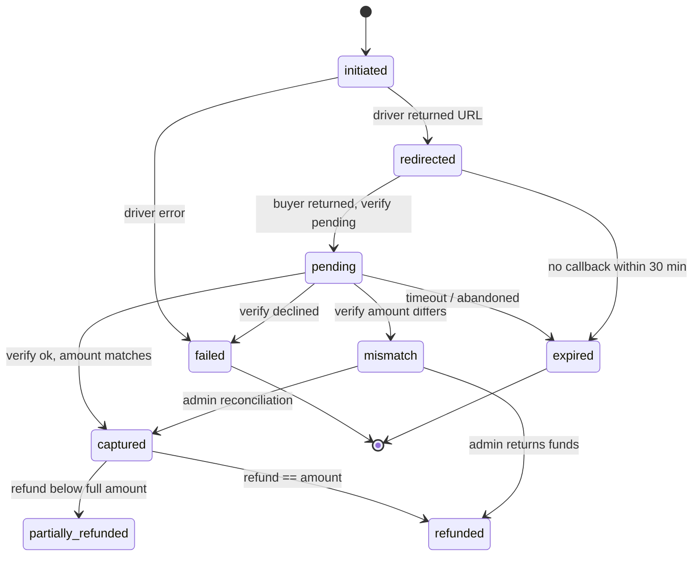

# Integrations

| | |
|---|---|
| **Purpose** | Define every boundary to the outside world — 12 payment gateways, four messaging channels, maps/geocoding, the bank settlement file — as an adapter behind a contract, with activation, idempotency, retry and fake-driver rules that make local development and CI deterministic. |
| **Audience** | Backend engineers implementing drivers, QA writing integration tests, the operator who has to configure a gateway at 11 p.m. |
| **Status** | Baseline v1.0. The 12 gateway *names* are not enumerated in the contract; driver scaffolding and one fully implemented driver are in scope for v1 (`AMB-PAY-002`). |
| **Owner** | Agent C (architecture). |

**Source:** contract `DK-1405-01` page 5 / پیوست ۱ clauses 5, 10; page 7–8 / پیوست ۵ clauses 26–28; page 11 / پیوست ۱۳ clauses 3, 6, 7; page 10 / پیوست ۱۱ clauses 6–7; `docs/canonical-context.md` §5.

---

## 1. Principles

1. **Ports and adapters.** No module outside `Payments`, `Notifications`, `FieldOps` and `Shipping` may import a vendor SDK, a vendor HTTP client, or a vendor DTO. Callers use the module contract; the vendor lives in `Infrastructure/`.
2. **Config, not code, decides what is on.** Activating a gateway or switching an SMS provider is an admin action plus config, not a deploy.
3. **Every external call is bounded.** Explicit connect/read timeouts, a retry policy per call class, and no external call inside a database transaction.
4. **Every external call is evidenced.** Request id, duration, outcome and a redacted payload are logged to `pay_callbacks` / `ntf_deliveries` / `shr_external_calls`, enough to answer "what did the bank actually say".
5. **Fakes are first-class.** Local and CI never touch a real gateway, SMS provider or map API.

## 2. Payment gateways

### 2.1 The driver contract

```php
namespace App\Modules\Payments\Domain\Contract;

interface GatewayDriver
{
    /** Stable key used in config, URLs and the admin UI: 'zarinpal', 'sadad', ... */
    public function key(): string;

    /** Human label for the admin panel (Persian). */
    public function label(): string;

    /** Capability flags — the UI and the refund flow read these. */
    public function capabilities(): GatewayCapabilities;

    /**
     * Create a payment session at the gateway and return where to send the buyer.
     * Must be idempotent on $intent->idempotencyKey: a retry returns the same redirect.
     * Must never throw for a business decline — return a failed PaymentRedirect instead.
     */
    public function initiate(PaymentIntent $intent): PaymentRedirect;

    /**
     * Server-to-server verification of a callback. This is the only source of truth;
     * the browser's return page is never trusted.
     */
    public function verify(CallbackEnvelope $callback): PaymentResult;

    /** Full or partial refund, if supported. */
    public function refund(RefundRequest $refund): RefundResult;

    /** Optional: pull a day's transactions for reconciliation. */
    public function statement(DateRange $range): GatewayStatement;
}
```

Supporting value objects (all immutable, no vendor types):

| Type | Fields |
|---|---|
| `PaymentIntent` | `paymentId`, `amount` (int Toman), `currency` (`IRT`), `description`, `callbackUrl`, `mobile`, `orderReference`, `idempotencyKey`, `metadata[]` |
| `PaymentRedirect` | `url`, `authority`, `expiresAt`, `status` (`pending|failed`), `errorCode` |
| `CallbackEnvelope` | `rawQuery[]`, `rawBody`, `headers[]`, `receivedAt`, `sourceIp`, `httpMethod` |
| `PaymentResult` | `status` (`captured|failed|cancelled|pending`), `gatewayReference`, `amount`, `paidAt`, `cardMask`, `rawPayload` (redacted) |
| `RefundRequest` | `paymentId`, `gatewayReference`, `amount`, `reason`, `idempotencyKey` |
| `GatewayCapabilities` | `refund`, `partialRefund`, `multiLeg`, `callbackMethod` (`GET|POST|both`), `signature` (`hmac|ip-allowlist|none`), `supportsStatement` |

### 2.2 Registry and activation

```
pay_gateways
  key            varchar unique      -- 'zarinpal'
  driver_class   varchar             -- resolved from a whitelist, never from user input
  label_fa       varchar
  is_active      bool                -- exactly one true in v1 (DB partial unique index)
  mode           enum(sandbox,live)
  config         json encrypted      -- terminal id, merchant id, keys (encrypted cast)
  sort_order     int
  activated_at, activated_by         -- audited
```

`GatewayRegistry::active()` returns the single active driver; `GatewayRegistry::driver($key)` returns a driver only if it is active **and** its required config keys are present. An inactive gateway cannot be reached even by crafting the initiate URL — the controller resolves through the registry, not through a route parameter.

Selection rules (v1):

- One active gateway per payment. The buyer does not choose; the operator does (`ADR-0008`).
- The driver key is stored on `pay_payments.gateway` at intent creation, so a mid-flight activation change cannot move money to a different gateway.
- `pay_payment_legs` exists but holds exactly one leg in v1. The schema and the driver capability `multiLeg` are the preparation for `RB-PAY-01`.

### 2.3 The 12 drivers

The contract requires "12 separate bank gateways" and "the ability to use two gateways simultaneously in one transaction" (پیوست ۱ بند ۵; پیوست ۱۳ بند ۷) but never names them. `AMB-PAY-002` records that gap. Until the owner confirms the list, the platform ships:

- **12 driver classes** in `app/Modules/Payments/Infrastructure/Gateway/`, each with its key, capability flags and config schema — so adding a real credential is configuration, not architecture.
- **One fully implemented and exercised driver** (the first gateway the owner confirms) plus the fake driver.
- The remaining drivers implemented against each provider's documented REST API in the phase where the owner supplies credentials; a driver without credentials is registered but unactivatable.

| # | Driver key | Label (fa) | Callback | Signature | Refund | Notes |
|---|---|---|---|---|---|---|
| 1 | `zarinpal` | زرین‌پال | GET | verify-by-authority | full + partial | Most common starting point; sandbox available |
| 2 | `idpay` | آیدی‌پی | POST | HMAC header | full | Sandbox available |
| 3 | `payir` | پی‌آی‌آر | GET | verify-by-token | full | Sandbox available |
| 4 | `zibal` | زیبال | GET | verify-by-trackId | full | Sandbox available |
| 5 | `nextpay` | نکست‌پی | POST | verify-by-trans_id | full | |
| 6 | `sadad` | سداد (بانک ملی) | POST | signed token | full | Bank-issued terminal |
| 7 | `saman` | سامان (سپ) | POST | signed token | full | Bank-issued terminal |
| 8 | `behpardakht` | به‌پرداخت (ملت) | POST | signed token | full | Bank-issued terminal |
| 9 | `parsian` | پارسیان | POST | signed token | full | Bank-issued terminal |
| 10 | `pasargad` | پاسارگاد | POST | signed token | full | Bank-issued terminal |
| 11 | `asanpardakht` | آسان‌پرداخت | POST | signed token | full | |
| 12 | `sepehr` | سپهر (صادرات) | POST | signed token | full | Bank-issued terminal |

The list is a **candidate set**, not a commitment: it covers the providers a platform of this shape in Iran would realistically use, and it is the set the admin activation screen renders. The owner's confirmed list replaces rows here one-for-one; the driver count stays 12.

Every driver gets the same contract test suite (`GatewayDriverContractTest`) parameterised over the fake driver's scenario matrix, so a new driver is "done" only when it passes the same behaviours as the others.

### 2.4 Payment states



Transitions are guarded by `PaymentStateMachine`; `captured` is terminal for capture purposes and can only move to refund states.

### 2.5 Callback handling

- One route per gateway: `POST|GET /payments/callback/{gateway}` under the `gateway` middleware group (no session, no CSRF, `throttle:gateway-callback`).
- `VerifyGatewaySource` checks: source IP against the gateway's published ranges (config, with a documented bypass toggle for providers behind CDNs), signature/HMAC where the provider supports it, and the presence of the expected parameters. A failure is logged with the raw payload and returns 403.
- `CallbackEnvelope` is persisted to `pay_callbacks` (raw query/body, headers, IP, `received_at`) **before** verification, so a disputed transaction always has evidence.
- Verification is server-to-server. The browser's `status=OK` query string is never trusted.
- Duplicate callbacks: the handler locks the payment row, sees `captured`, and returns the same success response. No second ledger entry (`reference=pay:{id}:capture` is unique).
- The browser return page polls `/payments/{publicId}/status` every 2 s for 30 s and then offers "check again", because Iranian gateway callbacks and browser redirects frequently arrive in either order.

### 2.6 Timeouts, retries, circuit breaking

| Call | Connect / read | Retries | Backoff | On final failure |
|---|---|---|---|---|
| `initiate` | 5 s / 10 s | 0 (user-facing; a retry could create two sessions) | — | Show "try another gateway / try again"; void the intent |
| `verify` | 5 s / 15 s | 5 | 2 s, 10 s, 30 s, 120 s, 300 s | Payment stays `pending`; reconciliation job and admin alert |
| `refund` | 5 s / 20 s | 3 | 30 s, 120 s, 600 s | Refund `pending_manual`; finance queue |
| `statement` | 10 s / 60 s | 2 | 60 s | Reconciliation marked incomplete, retried nightly |

Circuit breaker: a driver with 5 consecutive transport failures opens for 10 minutes (`Cache::lock`-backed counter). While open, `initiate` fails fast with a Persian message naming no internal detail; the admin dashboard shows the gateway as degraded. Business declines do not open the circuit — only transport/5xx failures do.

### 2.7 Refunds

Refund is a separate flow, never a side effect of a status change:

1. A return, cancellation, or admin decision creates a `RefundRequest` (module contract).
2. `RefundService` validates the refundable amount (`captured − already refunded`), then calls the driver.
3. Success posts a reversal ledger entry (`reference=pay:{id}:refund:{n}`), emits `PaymentRefunded`, and notifies the buyer.
4. Failure leaves a `pay_refunds` row in `pending_manual` with the provider's error, and puts the case in the finance queue — no silent retry loop against a bank.

### 2.8 Reconciliation

Nightly `pay:reconcile` (and an hourly sweep for `pending` older than 15 minutes):

- For each `pending` payment older than 15 minutes, call `verify` again with the stored authority.
- For each gateway with `supportsStatement`, pull the day's statement and diff against `pay_transactions` by gateway reference and amount.
- Differences become `pay_reconciliations` rows with a type (`missing_here`, `missing_there`, `amount_diff`, `status_diff`) and appear in the admin report required by پیوست ۱۳ بند ۶.
- The job never changes a payment to `captured` without a successful verify; a statement line alone creates a `mismatch` for human review.

## 3. Messaging channels

Four channels behind one port; `Notifications` decides *what*, the adapter decides *how*.

```php
namespace App\Modules\Notifications\Domain\Contract;

interface MessageChannel
{
    public function key(): string;                 // sms | whatsapp | email | push
    public function supports(MessageKind $kind): bool;   // transactional | marketing | otp
    public function send(OutboundMessage $message): DeliveryReceipt;
    public function costPerMessage(): ?int;        // Toman, for the paid-broadcast estimate
}
```

| Channel | Providers (config-selected) | Local / CI | Notes |
|---|---|---|---|
| SMS | Kavenegar, SMS.ir, or the client's panel | `log` driver writes to `storage/logs/sms.log` + Mailpit | OTP uses a dedicated template and line; marketing SMS requires an approved template id |
| WhatsApp | WhatsApp Cloud API (Meta) | fake driver | Only for users who opted in and have a WhatsApp-capable number (پیوست ۶ بند ۱ captures that flag) |
| Email | SMTP (client's mail host) | Mailpit | Transactional only in v1; used for invoices and reports |
| Push | Web Push / VAPID (`minishlink/web-push`) | fake driver, records payloads | Requires PWA installation and permission; subscription rows in `ntf_push_subscriptions` |

Rules that apply to all channels:

- **Template-first.** No free-text outbound message from code; every message resolves a template key (`order.shipped`, `otp.login`, `settlement.paid`) with named variables. Variables are validated at template-save time.
- **Idempotency.** `ntf_deliveries` has a unique key on `(notification_id, channel, recipient_hash)`; a retry does not send twice.
- **Retry/backoff.** 3 attempts (10 s, 60 s, 300 s) for transient provider errors (5xx, timeout, rate limit); permanent errors (invalid number, blocked, template rejected) fail immediately and are surfaced to the admin.
- **Cost control.** `ntf_deliveries.cost_amount` is recorded per send; the paid broadcast flow (پیوست ۵ بند ۱۲; پیوست ۱۱ بند ۶) shows an estimate before purchase and refuses to send beyond the purchased quantity or the admin cap.
- **Opt-out.** Marketing channels respect `ntf_preferences`; transactional security messages (OTP, password reset, order paid) bypass marketing preferences but never bypass a hard block on the number.
- **Delivery receipts.** Provider webhooks (DLR) update `ntf_deliveries.status`; a nightly job marks stale `sent` rows as `unknown` rather than pretending success.

## 4. Maps and geolocation

Contract needs: store location and Google Maps address on registration (پیوست ۶ بند ۲), agency locations (پیوست ۱۱ بند ۱۹), visit location capture and live tracking (پیوست ۱۴ بند ۱–۲), service-area filtering for Patogh.

| Concern | Decision |
|---|---|
| Display | Google Maps embed (iframe with `loading="lazy"`) on public profiles; Leaflet + OSM tiles as the fallback when no API key is configured (local/CI) |
| Geocoding | Google Geocoding API behind `Geocoder` contract, called only on save (not per page view), result cached by rounded address hash for 30 days |
| Reverse geocoding | Same contract, used to turn a marketer's GPS ping into a readable address |
| Storage | `DECIMAL(10,7)` latitude/longitude on `mer_merchants`, `mer_agencies`, `geo_visits`, `geo_agent_positions`; plus a `geohash` generated column (precision 7) with an index for radius queries |
| Radius queries | Bounding box on lat/lng indexes + `ST_Distance_Sphere` refinement; no GIS extension required |
| Privacy | Marketer trails are visible to the marketer and to admins with `geo.track.view`; retained 90 days; never shown to merchants or buyers |
| Failure | If geocoding fails, the address is saved without coordinates and flagged `needs_geocode`; a nightly job retries and the admin sees the backlog |
| Offline | The visit form captures coordinates client-side and queues the payload; the server validates plausibility (accuracy ≤ 100 m, timestamp within 24 h) before accepting |

## 5. Bank settlement file

The contract asks for an Excel export for group payment to suppliers (پیوست ۱۳ بند ۳). Real banks often want a fixed-width text file instead, which is `AMB-FIN-004`.

```php
namespace App\Modules\Finance\Domain\Contract;

interface SettlementFileFormat
{
    public function key(): string;                  // 'xlsx-generic' | 'bank-fixed-width-{bank}'
    public function extension(): string;            // xlsx | txt | csv
    public function build(PayoutBatch $batch, Collection $rows): GeneratedFile;
    public function validate(GeneratedFile $file, PayoutBatch $batch): ValidationResult;
}
```

v1 ships `xlsx-generic`:

| Column | Source | Format |
|---|---|---|
| `ردیف` | sequence | integer |
| `شماره شبا` | `mer_payout_accounts.iban` (decrypted at build time) | `IR` + 24 digits, no spaces |
| `نام صاحب حساب` | account holder | as registered |
| `کد ملی` | encrypted field, decrypted for the file only | 10 digits |
| `مبلغ (تومان)` | `fin_settlement_items.amount` | integer, no separators |
| `شناسه پرداخت` | batch id + sequence | `PAY-{batch}-{n}` |
| `توضیحات` | batch label | max 40 chars |

Plus a header block (batch id, period in Jalali and Gregorian, seller count, total amount) and a totals row. The file is accompanied by a `.sha256` sidecar and a manifest JSON (row count, total, generated_at, generated_by) stored in `fin_bank_exports`.

Validation before the batch can be marked paid: row count matches, total matches to the Toman, IBAN checksum valid (mod-97), no duplicate IBANs unless the seller has explicitly split accounts, and the bank's confirmation total matches. A mismatch blocks the batch and opens a reconciliation issue.

## 6. Fake drivers

Local development and CI must never depend on an external service being reachable, and must be able to reproduce every awkward case on demand.

```php
final class FakeGatewayDriver implements GatewayDriver
{
    public function key(): string { return 'fake'; }

    public function initiate(PaymentIntent $intent): PaymentRedirect
    {
        $scenario = config('payments.fake.scenario', 'success');

        return new PaymentRedirect(
            url: route('fake-gateway.show', ['payment' => $intent->paymentId, 'scenario' => $scenario]),
            authority: 'FAKE-'.$intent->paymentId,
            expiresAt: now()->addMinutes(30),
            status: 'pending',
        );
    }

    public function verify(CallbackEnvelope $callback): PaymentResult { /* reads scenario */ }
}
```

Scenarios (selectable per test, per request via a query param in local, or via `PAYMENTS_FAKE_SCENARIO`):

| Scenario | Behaviour |
|---|---|
| `success` | verified, amount matches, reference `FAKE-{id}` |
| `decline` | verified, status failed |
| `timeout` | `verify` throws a transport exception twice, then succeeds (tests retry) |
| `amount_mismatch` | verified but amount differs by 1,000 |
| `duplicate_callback` | sends the callback twice with 200 ms between |
| `no_callback` | nothing arrives; the reconciliation job must resolve it |
| `refund_ok` / `refund_fail` | refund outcomes |
| `multi_leg` | two legs, exercises the deferred split-payment path |

Bindings: `PaymentServiceProvider` binds `FakeGatewayDriver` as the `fake` key always (so tests can activate it) and as the **default** when `app()->environment(['local','testing'])` and `config('payments.fake.enabled')`. Production refuses to boot the fake driver: the provider throws if `app()->isProduction() && config('payments.fake.enabled')`.

Equivalent fakes for `MessageChannel` (record to an in-memory store + `storage/logs/outbound.log`), `Geocoder` (deterministic coordinates from a hash of the address), and `SettlementFileFormat` (same builder, no bank-specific quirks).

## 7. Outbound call observability

Every adapter call writes one row to `shr_external_calls`: `provider`, `operation`, `request_id`, `correlation_id`, `duration_ms`, `http_status`, `outcome` (`ok|business_error|transport_error|timeout`), `retry_attempt`, redacted `request_summary`, redacted `response_summary`. Secrets, tokens, and full card data are never stored; `cardMask` is the only card data retained.

Metrics the admin dashboard reads: gateway success rate (last 15 min / 24 h), p95 verify latency, SMS delivery rate, queue depth per channel. Alerts: gateway success rate below 90 % for 10 minutes, any `mismatch` payment, any circuit open, SMS failure rate above 20 %.

## 8. Failure playbook (operator)

| Symptom | First check | Action |
|---|---|---|
| Buyers report "payment not confirmed" | `pay_payments` pending count, gateway dashboard | Run `pay:reconcile --gateway={key}`; if the gateway shows captured, admin marks captured with reference |
| All payments failing on one gateway | Circuit state, gateway status page | Activate the alternate gateway (audited, step-up 2FA) |
| SMS OTP not arriving | `ntf_deliveries` for the last hour, provider credit | Switch provider in admin settings; OTP falls back to the secondary line |
| Bank rejects the export | `fin_bank_exports` validation result | Regenerate with the corrected format; never edit the xlsx in place |
| WhatsApp blocked | Provider console | Disable the channel; notifications fall back to SMS per preference order |
| Map key quota exhausted | Google console | Fallback to OSM tiles; geocoding queues for retry |
