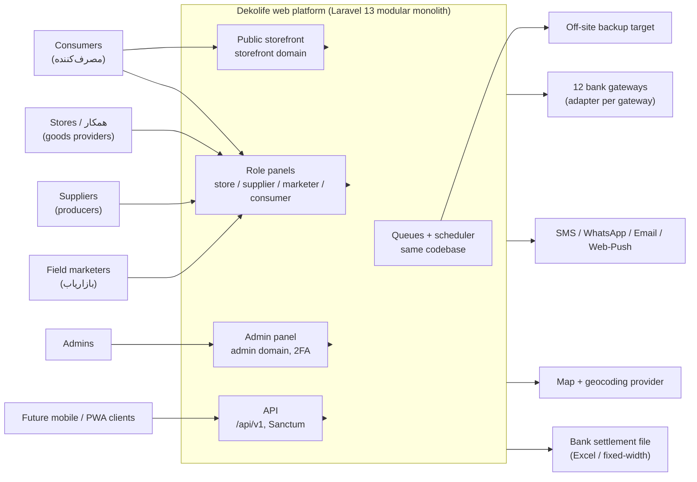

# Dekolife — Architecture Overview

| | |
|---|---|
| **Purpose** | One-page mental model of the Dekolife platform: what the system is made of, how a request travels through it, and which layering rules keep the 28 modules from collapsing into a ball of mud. |
| **Audience** | Backend engineers, frontend engineers, DevOps, the client's technical reviewer, and any agent writing code against this architecture. |
| **Status** | Baseline v1.0 — reflects the contract baseline, not yet exercised by production traffic. |
| **Owner** | Agent C (architecture). |

**Source:** contract `DK-1405-01` page 5 / پیوست ۱ (clauses 1–10), page 10 / پیوست ۹ (clauses 1–6), page 9 / پیوست ۸; `docs/canonical-context.md` §§2–5, §7.

---

## 1. System context

Dekolife is a multi-vendor marketplace with a field-sales network. Five actor groups use one web application through different surfaces; external systems are payment gateways, messaging providers, and the client's own server/infrastructure.



Contract anchors for the externals: 12 separate bank gateways and simultaneous use of two gateways in one transaction (پیوست ۱ بند ۵; پیوست ۱۳ بند ۷), SMS/WhatsApp/email/push as interchangeable notification channels (پیوست ۵ بند ۲۶–۲۸), map location capture for store visits (پیوست ۶ بند ۲; پیوست ۱۴ بند ۱), bank-grouped payment export in Excel (پیوست ۱۳ بند ۳), daily automatic database backup with restore (پیوست ۱ بند ۹).

## 2. Containers

| Container | Runtime | Responsibility | Notes |
|---|---|---|---|
| `web` | nginx 1.27 (stable) | TLS termination, static assets, fastcgi to `app` | Two server blocks: storefront/api host and admin host. |
| `app` | PHP 8.4 FPM | HTTP handling, Livewire rendering, scheduled console | No PHP on the host; everything container-first. |
| `worker` | PHP 8.4 CLI | `queue:work` on the `database` queue | Same image as `app`, different command. |
| `scheduler` | PHP 8.4 CLI | `schedule:work` (single instance) | Runs the inventory in `background-jobs.md`. |
| `mysql` | MySQL 8.4 | System of record | Same major version local, CI, staging, production. |
| `mailpit` | mailpit | Local SMTP sink | Local only; staging/production use the client's SMTP. |
| `assets` | Node 22 build stage | Vite + Tailwind build output | Built in CI, shipped as an artifact; no Node in production. |

There is no Redis, no message broker, no search engine, and no separate API service in v1. The reasoning is in `ADR-0006-database-queue-and-cache.md`; the extraction path is in `modular-monolith.md` §8.

Numbers in this document set that the contract does not fix — the 30-minute payment timeout, 24-hour cart expiry, 7-day return window, 90-day inactivity and location-retention windows, 5-second slow-log threshold, 90 % gateway success alert — are **agent decisions**: configurable through `adm_settings`/config, marked `(config)` where they appear, and tracked in the ambiguity register so the owner can change them without a code change.

## 3. Layering

Three layers per module, plus an HTTP adapter. Detailed anatomy and rules: `modular-monolith.md`.

```
Http  ──────────────►  Application  ──────────►  Domain
(Blade/Livewire/API)     (use cases, tx)          (rules, VOs, events)
                              │                        ▲
                              ▼                        │
                        Infrastructure ────────────────┘
                        (Eloquent, gateways, files)
```

Hard rules, enforced by `tests/Architecture/LayeringTest.php` (Pest `arch()`):

1. `Domain` may not reference `Illuminate\Http`, `Illuminate\Support\Facades\DB`, Eloquent, or any other module's namespace. It is plain PHP plus the Shared kernel value objects.
2. `Application` may reference its own `Domain`, the Shared kernel, and other modules' `Application/Contracts` only — never another module's `Infrastructure` or `Domain`.
3. `Http` may not contain business rules: no Eloquent queries, no arithmetic on money, no state transitions. Controllers and Livewire components translate HTTP input into a command and render the result.
4. `Infrastructure` implements interfaces declared in `Domain`/`Application`. It may not be referenced from outside its module except through the module's service provider.
5. Cross-module **writes** are forbidden. A module reads another module's tables only through that module's query contract; joins in read-only reporting queries are allowed and documented (see `domain-boundaries.md` §2).

## 4. Request lifecycle

A storefront page render, end to end:

```mermaid
sequenceDiagram
    autonumber
    participant B as Browser
    participant N as nginx
    participant F as php-fpm (app)
    participant M as Middleware stack
    participant R as Route + FormRequest
    participant C as Livewire component / Controller
    participant A as Application action
    participant D as Domain
    participant DB as MySQL
    participant Q as Queue (database)

    B->>N: GET /product/parquet-1201
    N->>F: fastcgi_pass
    F->>M: public/index.php → HTTP kernel
    M->>M: TrustProxies, HandleCors, maintenance, TrimStrings,<br/>ConvertEmptyStringsToNull, StartSession, VerifyCsrfToken,<br/>SecurityHeaders, SetLocale (fa), ShareFlash
    M->>R: route match (web.php), throttle:storefront
    R->>C: ProductPage@__invoke(ProductSlug $slug)
    C->>A: GetProductPageQuery (actor = guest|user)
    A->>D: PriceResolver.resolve(product, tier)
    D->>DB: read cat_, pri_, stk_, rvw_ aggregates
    DB-->>A: rows
    A-->>C: ProductPageData DTO
    C-->>B: Blade + Livewire payload (HTML, RTL, Tailwind)
    Note over C,Q: User actions (add to cart, review) dispatch<br/>commands; side effects are queued after commit.
```

Write path (checkout) is diagrammed in `data-flow.md` §1 and §2.

Middleware groups:

| Group | Applied to | Contents (order matters) |
|---|---|---|
| `web` | storefront, role panels | `EncryptCookies`, `AddQueuedCookiesToResponse`, `StartSession`, `ShareErrorsFromSession`, `ValidateCsrfToken`, `SubstituteBindings`, `SecurityHeaders`, `SetLocale` |
| `admin` | admin host routes | `web` + `Authenticate:admin` + `RequireTwoFactor` + `EnsureAdminIpAllowlist` (config-gated) + `AuditAdminAccess` |
| `api` | `/api/v1/*` | `EnsureFrontendRequestsAreStateful` (off), `throttle:api`, `auth:sanctum`, `ForceJsonResponse`, `IdempotencyKey` (write verbs) |
| `gateway` | payment callback routes | `throttle:gateway-callbacks`, `VerifyGatewaySource` (IP + signature where the gateway supports it), no CSRF, no session |

`SecurityHeaders` sets HSTS, `X-Content-Type-Options`, `Referrer-Policy: strict-origin-when-cross-origin`, `X-Frame-Options: SAMEORIGIN`, and a nonce-based CSP (see `security-architecture.md` §9).

## 5. One application layer, two (later three) clients

The web UI and the future API are adapters over the same actions. No business rule exists in a controller, a Livewire component, or an API Resource. This is what makes the deferred mobile apps (`RB-MOB-01`) an adapter project rather than a rewrite.

```php
// app/Modules/Orders/Application/Commands/PlaceOrderHandler.php
final readonly class PlaceOrderHandler
{
    public function __construct(
        private CartReader $cart,          // Cart\Application\Contracts
        private PriceResolver $prices,     // Pricing\Application\Contracts
        private StockReservation $stock,   // Inventory\Application\Contracts
        private OrderRepository $orders,   // Orders\Domain\Contracts
        private EventDispatcher $events,
    ) {}

    public function handle(PlaceOrder $command): OrderResult
    {
        // one transaction; returns a DTO, never an Eloquent model
    }
}
```

```php
// HTTP adapter (web, Livewire)
public function checkout(PlaceOrder $placeOrder): void
{
    $result = $placeOrder(new PlaceOrder(
        actor: ActorContext::fromAuth(),
        cartId: $this->cartId,
        shippingMethodId: $this->shippingMethodId,
        idempotencyKey: $this->idempotencyKey,
    ));

    $this->redirectRoute('orders.pay', ['order' => $result->publicId]);
}

// HTTP adapter (API, same action)
public function __invoke(PlaceOrderRequest $request, PlaceOrder $placeOrder): JsonResponse
{
    $result = $placeOrder(PlaceOrder::fromRequest($request, ActorContext::fromAuth()));

    return OrderResource::make($result)->response()->setStatusCode(201);
}
```

Consequences of this rule:

- Authorization is *policy-first*: an `ActorContext` (user id, active roles, scopes) is part of every command, and each action re-asserts permission through `Gate::forUser()`. Hiding a button is never authorization (`canonical-context.md` §5).
- Every action is idempotent or explicitly non-idempotent. Write commands accept an `idempotencyKey`; duplicates return the original result (`shr_idempotency_keys`).
- Validation lives in FormRequests at the adapter boundary and in domain invariants. Domain code never trusts an adapter.

## 6. Cross-cutting concerns

| Concern | Mechanism | Where defined |
|---|---|---|
| Money | `App\Shared\Money\Money` (integer Toman), `BIGINT *_amount` columns | `ADR-0004` |
| Time | store UTC (`DATETIME`), display `Asia/Tehran`, Jalali at presentation only | `technology-stack.md` §6 |
| Identity | `iam_users` + many-to-many roles + policies + scopes | `ADR-0007`, `security-architecture.md` |
| Audit | `adm_audit_logs` via `Auditable` trait and explicit `AuditLogger` calls | `security-architecture.md` §8 |
| Events | domain events after commit + transactional outbox for fan-out | `modular-monolith.md` §6 |
| Files | `App\Shared\Files\FileStorage` over Laravel disks, private disk + signed URLs | `security-architecture.md` §6 |
| Errors | typed domain exceptions → one envelope per adapter | §7 below |
| Feature flags | `adm_feature_flags`, resolved per role and per environment | `domain-boundaries.md` (Admin) |
| Localization | Persian UI, RTL layout, Jalali calendar, Toman formatting | `technology-stack.md` §6 |

## 7. Response contracts

API (and any JSON surface) uses one envelope:

```json
{
  "data": { "...": "..." },
  "meta": { "request_id": "01JCV8...", "pagination": { "page": 1, "per_page": 20, "total": 431 } }
}
```

```json
{
  "error": {
    "code": "ORDER_STOCK_UNAVAILABLE",
    "message": "موجودی کافی نیست",
    "details": { "product_id": 8812, "requested": 12, "available": 4 },
    "request_id": "01JCV8..."
  }
}
```

Domain exceptions implement `App\Shared\Errors\HasErrorCode` and carry a stable `code`; the HTTP adapter maps them to status codes (409 for state conflicts, 422 for validation, 402/409 for payment conflicts, 403 for authorization). Persian `message` for UI-facing errors, English `code` for machines and tests.

Web surfaces render errors as Blade partials with the same `code` in a `data-error-code` attribute so acceptance tests can assert on codes rather than on copy.

## 8. Non-goals for v1

| Item | Why | Tracking |
|---|---|---|
| Microservices / service mesh | One team, one deployable, shared DB; contract mandates a modular Laravel app | `ADR-0001` |
| Native Android/iOS apps, APK, store publishing | Deferred by mission scope | `RB-MOB-01` |
| Split payment across two gateways in one transaction | Required by پیوست ۱ بند ۵ but deferred; data model prepared | `RB-PAY-01`, `ADR-0008` |
| Reservation/appointment module | Separate contract no. 2, page 9 note | `RB-CTR-01` |
| Search engine (Elastic/Meilisearch) | MySQL FULLTEXT + indexed filters are sufficient at expected catalog size | `RB-CAT-01` |
| Redis | Single-node deployment; database queue/cache is enough | `ADR-0006` |
| Real-time websockets (live marketer tracking) | Polling with 30 s interval satisfies پیوست ۱۴ بند ۲ | `RB-GEO-01` |
| Multi-currency | Contract prices are Toman only | `ADR-0004` |

## 9. Related documents

- `technology-stack.md` — pinned versions, responsibilities, upgrade policy.
- `modular-monolith.md` — module anatomy, dependency rules, extraction playbook.
- `domain-boundaries.md` — the 28 bounded contexts in detail.
- `data-flow.md` — six end-to-end sequences.
- `security-architecture.md` — authN/authZ, 2FA, PII, uploads, OWASP mapping.
- `integrations.md` — gateway adapter, messaging channels, maps, bank files.
- `background-jobs.md` — queue and scheduler inventory.
- `deployment-topology.md` — local, CI, staging, production, backup, rollback.
- `../adr/README.md` — decision index.
