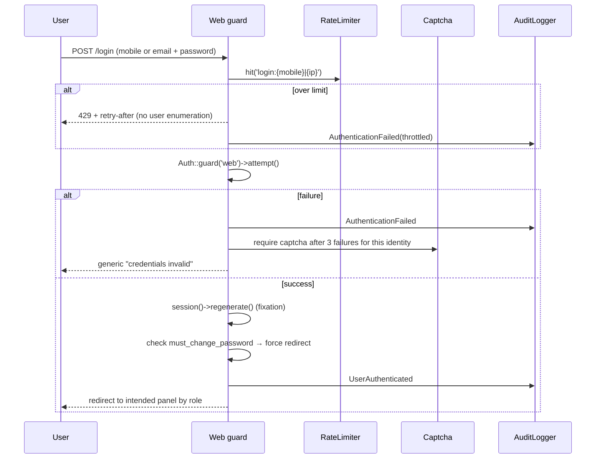
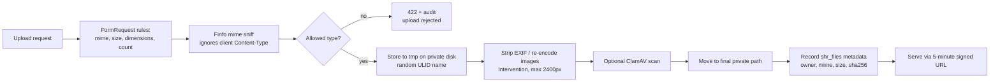

# Security Architecture

| | |
|---|---|
| **Purpose** | Fix the authentication, authorization, PII, upload, rate-limiting and audit decisions in one place, and map every OWASP control to the concrete Laravel mechanism that implements it. |
| **Audience** | Backend engineers, reviewers, the client's security reviewer, whoever runs the penetration test. |
| **Status** | Baseline v1.0. Two controls are marked as gaps with `RB-` ids rather than pretended. |
| **Owner** | Agent C (architecture). |

**Source:** contract `DK-1405-01` page 5 / پیوست ۱ clauses 7, 10 (separate admin panel on a dedicated domain/path with two-factor authentication; complete audit log of sensitive events); page 10 / پیوست ۹ clause 3 (SSL, brute-force prevention, captcha, role access control, input validation); page 3 / ماده ۴ clause 4 (user data and API keys protection, backup, SQL injection, brute force, malicious upload prevention); `docs/canonical-context.md` §5.

---

## 1. Assets and threat model

| Asset | Why it matters | Primary threats |
|---|---|---|
| Money movements (ledger, settlements, refunds) | Direct financial loss, dispute with sellers | Privilege abuse, replay, race conditions, forged callbacks |
| Identity documents and national IDs | Legal exposure, contract's confidentiality clause | Data breach, over-broad admin access, log leakage |
| Buyer PII (mobile, address, postal code) | Spam, harassment, resale | Enumeration, IDOR, export abuse |
| Marketer location trails | Physical safety of field staff | Unauthorized tracking, over-retention |
| Admin panel | Total control of the platform | Credential theft, session hijack, CSRF, phishing |
| Payment gateway credentials | Can move money | Secret leakage in git, logs, error pages |
| Order/invoice records | Tax and legal evidence | Tampering, deletion |

Assumed adversary: opportunistic automated attacks (credential stuffing, scanners), a malicious authenticated user (a store trying to read a competitor's orders), and a curious insider with limited admin rights. Not assumed: a compromised host with root, or a nation-state. Those are handled by infrastructure controls outside this document (`deployment-topology.md` §7).

## 2. Authentication

### 2.1 Guards

| Guard | Driver | Provider | Used by | Cookie | Lifetime |
|---|---|---|---|---|---|
| `web` | `session` | `iam_users` (Eloquent) | Storefront, customer/store/supplier/marketer panels | `dekolife_session` | 120 min idle, 12 h absolute |
| `admin` | `session` | `iam_users` + `is_admin` scope | Admin host only | `dekolife_admin_session` | 30 min idle, 8 h absolute |
| `sanctum` | token | `iam_personal_access_tokens` | `/api/v1/*` | — | 30 days, revocable |

Three separate guards, three separate cookie names, three separate route groups. A customer session cookie is never accepted on the admin host: `config/auth.php` gives the admin guard its own provider constraint and the admin routes run behind `auth:admin`, not `auth`.

The admin panel is served from a **separate host** (`admin.<domain>`) per پیوست ۱ بند ۷ — a separate nginx server block and a separate session cookie domain. Same application codebase, same database, different entry point. If the client insists on a path instead of a domain (`/admin`), the fallback is documented in `deployment-topology.md` §6.4 with the trade-off (no cookie isolation; CSRF and XSS blast radius increase).

### 2.2 Login flow



Rules:

- **No user enumeration.** Wrong password, unknown user and disabled account produce the same message and timing (the password hash is verified against a dummy hash when the user does not exist).
- **Session fixation**: `session()->regenerate()` on login, on privilege change, and on 2FA success.
- **Password policy**: minimum 10 characters, mixed case + digit, checked against a local list of the 10k most common passwords (shipped, no external API call), rejected if it contains the user's mobile or name. Argon2id hashing (`ARGON_MEMORY=65536`, `ARGON_THREADS=1`, `ARGON_TIME=4`).
- **First login for marketer-registered accounts** forces a password change before any other route (`must_change_password`, پیوست ۵ بند ۲; پیوست ۶ بند ۸).
- **Registration** requires SMS OTP verification of the mobile (پیوست ۲ بند ۸); OTP is 6 digits, 2-minute TTL, max 3 attempts, max 3 sends per 10 minutes per mobile and per IP.
- **Logout everywhere** bumps `iam_users.session_version`, invalidating all sessions and revoking all Sanctum tokens.

### 2.3 Admin two-factor authentication

TOTP (RFC 6238), 30-second window, ±1 step drift, secret stored encrypted in `iam_two_factor_secrets` (never in the session, never in logs).

| Aspect | Decision |
|---|---|
| Enrolment | Mandatory before first admin action; QR generated server-side (`bacon/bacon-qr-code`) plus manual key; confirmation requires a valid code |
| Recovery | 8 single-use recovery codes, hashed (Argon2id), shown once, regenerable with a password + code re-check |
| Enforcement | `RequireTwoFactor` middleware on every admin route; a user with `admin` role and no confirmed 2FA is routed to enrolment, nothing else |
| Step-up | High-risk actions (settlement approval, gateway activation, role grant to `admin`, impersonation, bulk export) require a code re-entry within the last 5 minutes (`two_factor_confirmed_at` in session) |
| Reset | Only another admin with `admin.security.2fa.reset` can reset, with a written reason, and the reset is audited and notified to the affected admin |
| Failure | 5 failed codes → 15-minute lockout of the 2FA challenge, audited |

Enforcement middleware sketch:

```php
final class RequireTwoFactor
{
    public function handle(Request $request, Closure $next): Response
    {
        $user = $request->user('admin');

        if (! $user?->hasConfirmedTwoFactor()) {
            return redirect()->route('admin.2fa.enrol');
        }

        if ($this->isHighRisk($request) && ! $request->session()->get('2fa.step_up_at')?->isAfter(now()->subMinutes(5))) {
            $request->session()->put('2fa.intended', $request->fullUrl());

            return redirect()->route('admin.2fa.challenge', ['step_up' => 1]);
        }

        return $next($request);
    }
}
```

## 3. Authorization

### 3.1 Model

- **Roles are rows, many-to-many** (`iam_roles`, `iam_role_user`). The five contractual levels are `consumer`, `store`, `supplier`, `marketer`, `admin` (پیوست ۳). A user may hold a **secondary** role only when an admin-created `iam_role_grants` row is `approved` (پیوست ۷ بند ۶) — e.g. a store that is also a marketer (پیوست ۱۲ بند ۱۱).
- **Permissions** are fine-grained strings (`orders.suborder.ship`, `finance.settlement.approve`) attached to roles; code checks permissions, not role names, except where the contract names a role explicitly.
- **Policies** are the enforcement point for entity access (`OrderPolicy`, `MerchantPolicy`, `SettlementPolicy`, `ListingPolicy`, …). A policy method receives the actor and the entity, never a request.
- **Scopes** narrow queries so that a permitted user cannot list what they may not see: `AccessScope::ownNetwork($user)`, `ownCatalog($merchant)`, `ownOrders($user)`, `ownVisits($marketer)`.
- **One active role per session.** A user holding two granted roles (store + marketer, marketer + consumer — پیوست ۱۲ بند ۱۱) carries an `active_role_id` in the session. A validated switcher changes it; the default on login is the highest-privilege granted role. Price resolution, dashboards, menus and scopes read the active role, so the two price lists never bleed into one screen. Switching regenerates the session id and writes an audit row (`role.switched`).
- **Route-level** middleware (`can:ship,subOrder`) is a first line, never the only line: the application action re-asserts the permission through `Gate::forUser($actor)` so queue jobs, console commands and future API clients get the same decision.

```php
final class SubOrderPolicy
{
    public function view(User $user, SubOrder $subOrder): bool
    {
        return $user->hasPermission('orders.suborder.view')
            && ($subOrder->sellerId === $user->merchantId() || $user->hasPermission('orders.suborder.view.any'));
    }

    public function ship(User $user, SubOrder $subOrder): bool
    {
        return $subOrder->sellerId === $user->merchantId()
            && $subOrder->status === SubOrderStatus::Preparing
            && $user->hasPermission('orders.suborder.ship');
    }
}
```

### 3.2 Role capability map

| Capability area | consumer | store | supplier | marketer | admin |
|---|---|---|---|---|---|
| Browse catalog, cart, own orders | ✔ | ✔ | ✔ | ✔ | ✔ |
| Tier/wholesale prices | — | ✔ | ✔ | — | ✔ |
| Manage own products/prices/stock | — | ✔ | ✔ | — | ✔ |
| Accept/ship own sub-orders | — | ✔ | ✔ | — | ✔ |
| Request settlement, see own statement | — | ✔ | ✔ | ✔ (commission) | ✔ |
| Register stores in the field | — | — | — | ✔ | ✔ |
| See attributed stores/invoices | — | — | — | ✔ (own only) | ✔ |
| Tenders: bid | — | ✔ | ✔ | — | ✔ |
| Classifieds / patogh / samples | ✔ | ✔ | ✔ | ✔ | ✔ |
| Admin panel | — | — | — | — | ✔ |
| Money movement, settlement approval | — | — | — | — | ✔ + step-up |

The table is a summary; the source of truth is the seeded permission matrix, and every row has a positive and a negative test.

### 3.3 Impersonation

Admins can impersonate a non-admin user for support. Rules: requires `admin.users.impersonate` plus a step-up code; a persistent banner shows the impersonated identity; money-moving routes are blocked (`AbortIfImpersonating`); the start and end are audited with both actor ids; the impersonated session is separate and ends automatically after 30 minutes.

### 3.4 Mandatory negative tests

For every scoped resource, CI must contain a test that a *different* principal gets 403/404:

- store A cannot read or ship store B's sub-order;
- marketer A cannot list marketer B's visits or referrals;
- consumer cannot read another consumer's addresses, invoices or wallet;
- a non-participant cannot read a message thread;
- a supplier cannot bid on its own tender's competitor view;
- a deactivated merchant's tokens stop working immediately;
- an API token without the required ability is rejected even when the user has the role.

## 4. Sessions and tokens

| Aspect | Web session | Admin session | API token |
|---|---|---|---|
| Storage | `iam_sessions` (database) | `iam_sessions` (same table, different cookie) | `iam_personal_access_tokens` |
| Cookie flags | `Secure`, `HttpOnly`, `SameSite=Lax`, host-only | `Secure`, `HttpOnly`, `SameSite=Strict`, admin host only | n/a |
| Idle timeout | 120 min | 30 min | 30 days absolute |
| Absolute lifetime | 12 h | 8 h | 30 days |
| Rotation | `session()->regenerate()` on login/privilege change | same | token rotation on password change |
| Revocation | logout, session_version bump, admin force-logout | same | `tokens()->delete()` on password change, role revoke, deactivation |
| Concurrency | unlimited (single device reality for B2B users) | max 3, oldest evicted | per-client, max 5 tokens |

Sanctum abilities mirror permission strings (`orders.read`, `orders.write`, `wallet.read`). A token can never exceed its owner's current permissions: every request resolves abilities ∩ live permissions, so revoking a role immediately downgrades existing tokens.

`SameSite=Strict` on the admin cookie means an admin clicking a link from an email lands logged-out — acceptable and deliberate; the admin host has no cross-site entry points worth keeping.

## 5. PII: classification, encryption, masking

| Data | Class | Storage | Access | Masking in UI | Retention |
|---|---|---|---|---|---|
| Mobile number | sensitive | `usr_profiles.mobile` encrypted + `mobile_hash` unique | owner, admin (audited), order counterparty (masked) | `0912***4567` | account life + 90 days |
| National ID (کدملی) | sensitive | encrypted + `national_id_hash` | owner, admin finance (audited) | `***4567` last 4 never shown, only "verified" badge | account life |
| Postal code | confidential | encrypted + `postal_code_hash` (duplicate detection, پیوست ۵ بند ۳) | owner, merchant fulfilling the order | full to merchant only while order is open | order life |
| Address | confidential | `usr_addresses` (encrypted line fields) | owner, merchant during fulfilment, admin | street masked until order paid | order life + 5 years for tax |
| IBAN / Sheba | financial | encrypted + `iban_hash` | owner, finance admin | `IR••••••••••••1234` | 7 years |
| Identity documents (photos) | restricted | private disk, random filename, `usr_documents` metadata | owner upload, admin verification only | thumbnail watermarked, "verified" badge | until verification + 1 year, then purge |
| Location trail | sensitive | `geo_agent_positions` DECIMAL(10,7) | the marketer, admin (audited) | city-level only in reports | 90 days |
| Message content | confidential | `msg_messages` (not encrypted at rest; access-controlled) | participants, admin on complaint | — | 2 years |
| Password | secret | Argon2id hash | nobody | never rendered | — |
| 2FA secret | secret | encrypted | nobody (server only) | never rendered | until disabled |

Mechanism:

- Laravel `encrypted` cast (AES-256-GCM via `APP_KEY`); a separate `PII_KEY` is used for the blind-index HMAC (`hash_hmac('sha256', normalized, config('pii.hash_key'))`) so that a leaked `APP_KEY` alone does not let an attacker brute-force matching hashes without the second key.
- Normalisation before hashing: mobile → `+989xxxxxxxxx`; national ID → digits only; IBAN → uppercase, no spaces.
- `PII_KEY` and `APP_KEY` live in the environment file on the server, never in git; rotation procedure in `deployment-topology.md` §8.
- Masking happens in API Resources and Blade components (`$user->maskedMobile()`), never by trusting the view to hide a field.
- Admin views of PII require a permission and write an audit row (`pii.viewed`, entity, field list). Bulk export of PII requires step-up 2FA.
- Data belongs to the client (ماده ۷): export and deletion are admin operations with audit, and financial records are retained even after account closure (anonymised, not deleted).

## 6. Upload pipeline

Every upload passes the same pipeline; there is no second path.



Rules:

- Allowed: `jpg`, `jpeg`, `png`, `webp` (images), `pdf` (documents, no embedded JS), `mp3`, `m4a`, `ogg` (voice notes, ≤ 2 minutes per پیوست ۵ بند ۴۱), `xlsx` (admin import only). **SVG is rejected** — it is an XSS vector and the platform has no legitimate need for it.
- Size limits: images 8 MB, documents 10 MB, audio 10 MB, per-request total 24 MB (`post_max_size`). Per-user quota: 200 uploads/day, 2 GB.
- Storage: private disk, path `uploads/{module}/{yyyy}/{mm}/{ulid}.{ext}`, served only through `Storage::temporaryUrl(..., now()->addMinutes(5))`. `nginx` denies any `\.php` execution under the storage root and there is no directory listing.
- Images are re-encoded (strips EXIF/GPS from buyer photos — an accidental location leak) and resized to a max edge of 2400 px; thumbnails generated on demand.
- Voice notes are transcoded to a single format where `ffmpeg` is available; if not, the original is kept and the mime type is strictly enforced (`RB-SEC-02` if the client's host cannot run ffmpeg).
- Filenames are never trusted: the stored name is a ULID, the original name is metadata only and escaped on render.
- Uploads from unauthenticated users (e.g. contact form attachment) are limited to images and one file per request, rate-limited by IP.

## 7. Rate limiting, brute force, captcha

Named limiters in `AppServiceProvider`/`RouteServiceProvider`, all keyed on a stable identity plus IP:

| Limiter | Key | Limit | Response |
|---|---|---|---|
| `login` | normalised mobile/email + IP | 5/min, 20/hour | 429 + `Retry-After`, captcha after 3 failures |
| `otp-send` | mobile + IP | 3 per 10 min, 10/day per mobile | 429, audit |
| `otp-verify` | mobile + IP | 5 attempts per code, then code invalidated | 429 |
| `password-reset` | email + IP | 3/hour | 429, generic message |
| `register` | IP | 10/hour | 429 + captcha |
| `checkout` | user + IP | 10/min | 429 |
| `search` | user/IP | 120/min | 429 |
| `upload` | user | 20/hour | 429 |
| `api` | token | 60/min (default), 300/min for report endpoints | 429 JSON envelope |
| `gateway-callback` | gateway + IP | 120/min | 429 (gateway retries) |
| `webhook` | source | 60/min | 429 |

Brute force: `iam_login_attempts` records every attempt (identity hash, IP, user agent, outcome, captcha-challenged flag). After 10 failures in an hour the identity is soft-locked for 30 minutes regardless of IP; after 50 failures from one IP in an hour the IP is blocked at nginx for 24 hours (`limit_req` + a generated deny list refreshed every 5 minutes).

Captcha (پیوست ۹ بند ۳): a self-hosted challenge (no third-party dependency that can be blocked or leak data) is used on registration, password reset, the contact form, and after 3 failed logins. The challenge is signed with a short-lived HMAC token so it cannot be replayed.

Anti-enumeration: registration checks for an existing mobile/national ID but always answers "a code was sent" and sends a different SMS for "you already have an account".

## 8. Audit logging

`adm_audit_logs` is append-only and hash-chained.

| Column | Content |
|---|---|
| `id` | bigint |
| `occurred_at` | UTC datetime, indexed |
| `actor_id`, `actor_role`, `actor_label` | snapshot; survives user deletion |
| `action` | stable string, e.g. `price.changed`, `settlement.approved`, `role.assigned` |
| `entity_type`, `entity_id` | polymorphic, indexed |
| `before`, `after` | JSON diff with secrets/PII redacted |
| `ip`, `user_agent`, `request_id` | request context |
| `prev_hash`, `hash` | `sha256(prev_hash || canonical_json(row))` |

Mandatory events (contract پیوست ۱ بند ۱۰ plus our own additions):

| Category | Events |
|---|---|
| Auth | login success/failure, logout, password change, password reset, 2FA enable/disable/reset, role grant/revoke, secondary-role approval, impersonation start/end |
| Money | price change, discount/price-list change, payment captured/refunded, ledger adjustment, wallet freeze/unfreeze, settlement approve/pay, bank export, commission adjust, payout account change |
| Access | permission change, admin created/disabled, PII viewed, bulk export |
| Content | product publish/archive, gateway activation, settings change, feature flag toggle |
| Order | status transitions by an admin, forced cancel, penalty applied |

Enforcement:

- `Auditable` trait on models + explicit `AuditLogger::record()` in commands; the trait writes inside the same transaction as the change, so an audit row cannot be missing for a committed change.
- DB-level: `UPDATE`/`DELETE` on `adm_audit_logs` blocked by triggers; the application has no update/delete path.
- Hash chain verified by a daily job (`audit:verify`); a broken link raises a critical alert to the admin and the operator.
- Retention: 7 years recommended (`AMB-FIN-003`); the viewer paginates and filters by actor/entity/date, and access to it is itself audited.
- Redaction: the logger never writes raw PII — masked values and field names only, plus a `pii_viewed` flag when the actor actually saw unmasked values.

## 9. Transport, headers, browser-side controls

| Control | Implementation |
|---|---|
| TLS | TLS 1.2+ only (1.3 preferred), HSTS `max-age=31536000; includeSubDomains`, redirect 80→443, certificate auto-renewal monitored (`deployment-topology.md` §7) |
| CSP | nonce-based `script-src 'self' 'nonce-…'`, no `unsafe-inline`; Livewire/Alpine compatible via nonce propagation; `frame-ancestors 'self'` |
| Other headers | `X-Content-Type-Options: nosniff`, `Referrer-Policy: strict-origin-when-cross-origin`, `Permissions-Policy: geolocation=(self)`, `X-Frame-Options: SAMEORIGIN` (legacy) |
| CSRF | Laravel `VerifyCsrfToken` on every state-changing web route; gateway callbacks excluded by design and protected by signature/IP instead |
| CORS | `api` allows only the platform's own origins; no wildcard, no credentials for cross-origin |
| XSS | Blade auto-escaping; CMS HTML sanitised through an allowlist (no `script`, no event handlers, no `javascript:` URLs); user content never rendered raw |
| Clickjacking | `frame-ancestors` + `X-Frame-Options` |
| Open redirect | `redirect()->intended()` restricted to same-host paths; a `SafeRedirect` helper validates |
| SSRF | no user-supplied URL is fetched server-side; gateway endpoints come from config; map/geocode calls use fixed hosts |
| Deserialisation | no `unserialize()` on user input; queue payloads are signed by Laravel |

## 10. OWASP Top 10 (2021) mapping

| Risk | Concrete mechanism in Dekolife | Verification |
|---|---|---|
| A01 Broken access control | Policies + scopes + route middleware + action-level re-check; ownership checks in query builders; impersonation guards | Mandatory negative tests per resource; `NoCrossModuleWriteTest`; review checklist |
| A02 Cryptographic failures | TLS 1.2+, Argon2id passwords, AES-256-GCM encrypted casts, HMAC blind indexes, no secrets in logs | `composer audit`, secret scan in CI, key-rotation runbook |
| A03 Injection | Eloquent bindings only; no string-concatenated SQL; `DB::raw` requires a review note; FormRequest validation; Blade escaping | PHPStan rule banning `DB::raw` outside reporting; SQL review in PR |
| A04 Insecure design | Explicit state machines, append-only ledger, idempotency keys, separation of payment capture from settlement | State-machine table tests; ledger invariant tests |
| A05 Security misconfiguration | Separate admin host, `APP_DEBUG=false` in staging/prod, `config:cache`, directory listing off, PHP execution blocked outside `public/`, default admin routes absent | Deploy smoke test asserts headers and that `/admin` on the storefront host 404s |
| A06 Vulnerable components | Lockfiles, Dependabot, `composer audit`/`npm audit` in CI, quarterly image refresh | CI gate fails on high severity |
| A07 Identification/auth failures | Rate limits, lockout, captcha, 2FA for admin, session regeneration, token revocation on role change | Auth feature tests + a nightly brute-force simulation |
| A08 Software/data integrity | Signed gateway callbacks, hash-chained audit log, checksummed bank exports, lockfile-pinned builds, CI-built artifacts only | `audit:verify` daily; export sha256 compared at payment |
| A09 Logging/monitoring failures | Audit log + failed-login log + reconciliation alerts + queue failure alerts; no PII in logs | Log review in the incident runbook; redaction test |
| A10 SSRF | No user-controlled outbound URLs; gateway hosts from config; allowlisted map/geocode endpoints | Code review; `Http::` calls only inside `Infrastructure/` |

## 11. Secrets and configuration

- Secrets live in `.env` on the server (owned by the deploy user, mode 600), never in git, never in the database, never in a Livewire property.
- `config/*.php` reads `env()`; application code reads `config()` only (`canonical-context.md` §7).
- Gateway credentials: one config block per driver (`config/payments.php`), each key named `PAYMENTS_{GATEWAY}_{MERCHANT_ID|TERMINAL_ID|SECRET}`; a driver is only registered if its keys are present, so a half-configured gateway cannot be activated.
- Rotation: `APP_KEY` rotation requires re-encrypting PII (a command does it in batches, with a maintenance window); gateway keys rotate without deploy (config cache clear + queue restart); Sanctum tokens are invalidated on rotation.
- Error pages in production never expose stack traces, SQL, or file paths; the `request_id` is the only correlation the user sees.

## 12. Security review gates

| Gate | When | Owner |
|---|---|---|
| Threat review of a new module | Before its first migration merges | Author + reviewer |
| Negative authorization tests | Every PR touching a scoped resource | CI (fails the build) |
| Dependency audit | Every PR + nightly | CI |
| Secret scan (gitleaks) | Every push | CI |
| Upload pipeline test | Any change to `Files`/`Http/Request` with file rules | CI |
| Penetration test | Before final delivery (`پیوست ۱۰`) | External, coordinated by the client |
| Restore drill | Monthly | Operator |

## 13. Known gaps

| Gap | Impact | Mitigation | Tracking |
|---|---|---|---|
| No WAF in front of the app on the client's single host | Layer-7 attacks limited to nginx `limit_req` + app rate limits | nginx rate limits, fail2ban-style deny list, monitoring | `RB-SEC-03` |
| No malware scanning unless ClamAV is installed on the client host | A malicious PDF could be stored (never executed) | Strict mime allowlist, private storage, no inline rendering | `RB-SEC-01` |
| Single admin host means a compromised admin credential is high impact | Full platform control | 2FA + step-up + audit + IP allowlist (config-gated) | Accepted risk, reviewed with the client |
| Audit retention beyond 7 years undecided | Compliance ambiguity | Configurable retention | `AMB-FIN-003` |
