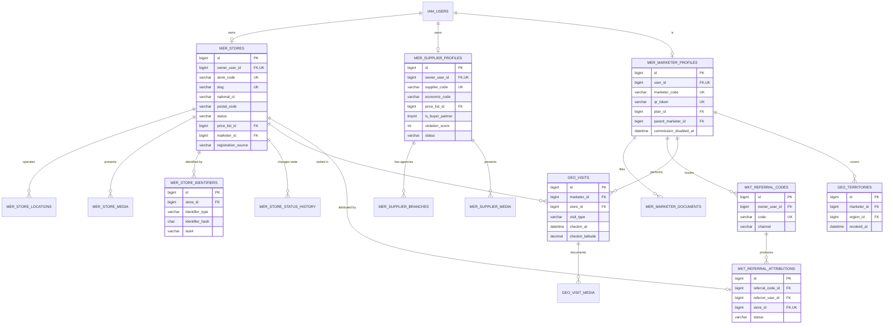
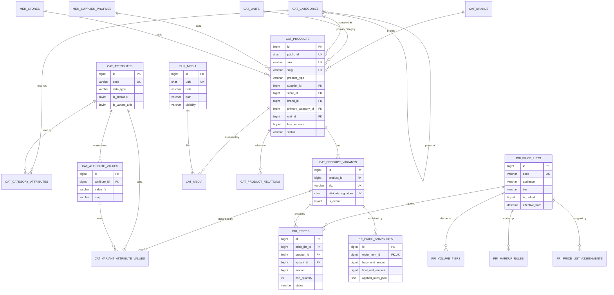
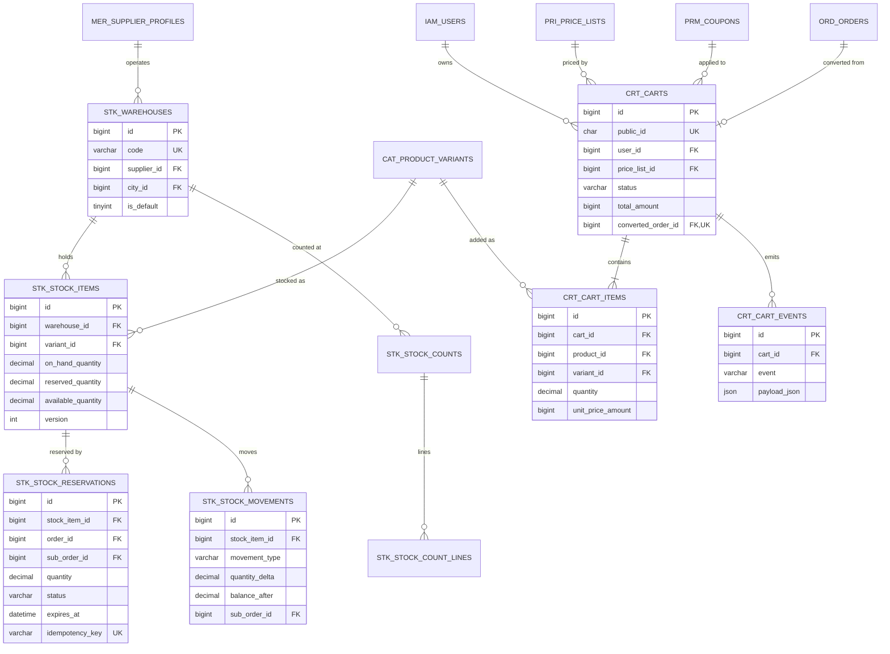
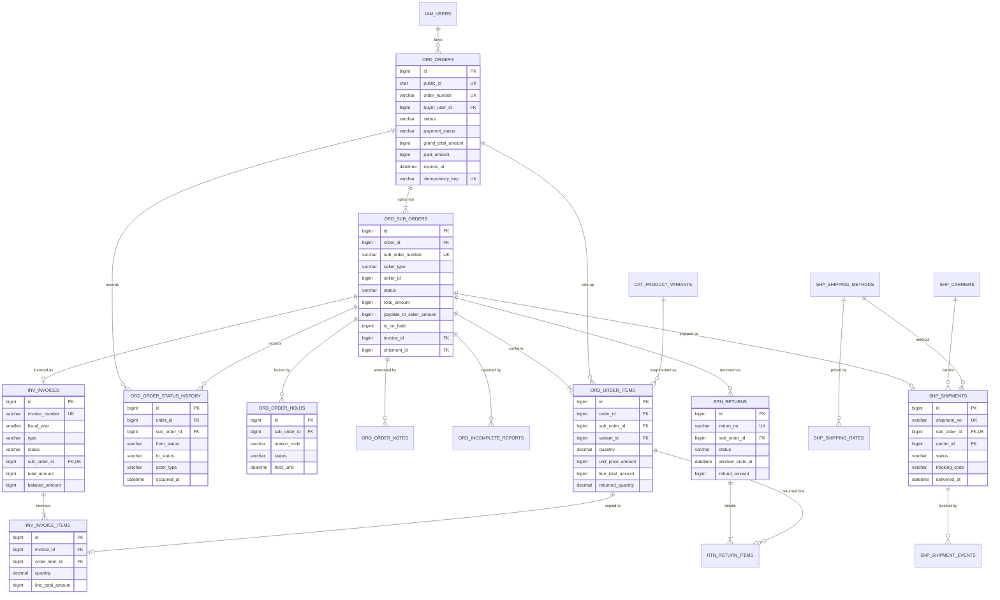
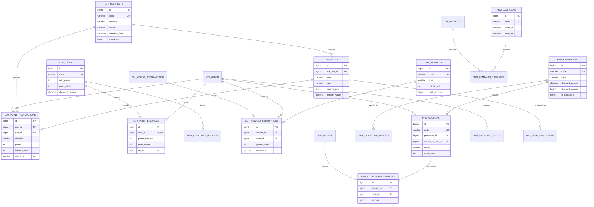
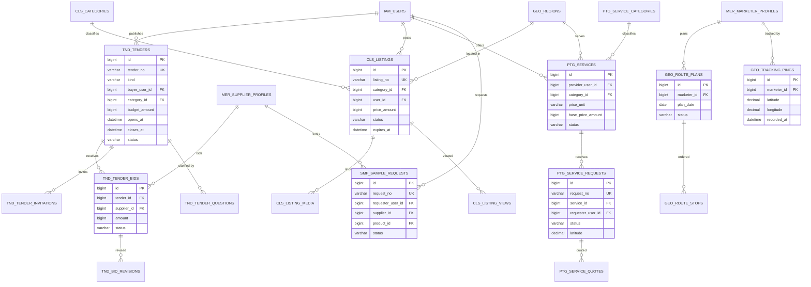

# Entity–Relationship Diagrams — Dekolife Platform

**Purpose:** Show how the entities of the domain model relate, cluster by cluster, with
cardinalities and the foreign key that implements each relationship.
**Audience:** Backend engineers, reviewers, anyone onboarding onto the schema.
**Status:** Baseline (v1), derived from [`domain-model.md`](./domain-model.md). Column-level
detail is in [`data-dictionary.md`](./data-dictionary.md).
**Source:** `docs/canonical-context.md` §3 (bounded contexts) and §5 (orders, ledger, prices,
points); contract appendices 3–7, 11–13.

---

## 1. How to read the diagrams

- Each diagram covers one cluster and stays under 25 entities so it renders without scrolling
  into a wall. Financial and transactional hubs (`iam_users`, `ord_orders`, `shr_media`) appear
  in more than one diagram; they are the same table, not duplicates.
- Cardinality is the standard Mermaid/crow's-foot notation:

  | Notation | Meaning |
  |---|---|
  | `||--o{` | one to zero-or-many |
  | `||--|{` | one to one-or-many |
  | `||--o|` | one to zero-or-one |
  | `||--||` | exactly one to exactly one |
  | `}o--o{` | many-to-many (via a link table, shown as two 1–N edges) |

- `PK` / `FK` / `UK` mark primary, foreign and unique keys. Money columns end in `_amount` and
  hold integer Toman; all timestamps are UTC.
- Every edge is backed by a real constraint named `fk_<table>_<column>` (conventions §3–4).
  Edges marked *(logical)* are enforced in the application because a hard FK would create a
  cross-module delete cycle; those are listed explicitly in §11.
- Enum values quoted in the diagrams are the lifecycle values; the full transition rules are in
  [`order-state-machine.md`](./order-state-machine.md).

---

## 2. Cluster: Identity and users

```mermaid
erDiagram
    IAM_USERS ||--o{ IAM_USER_ROLES : "holds"
    IAM_ROLES ||--o{ IAM_USER_ROLES : "granted as"
    IAM_ROLES ||--o{ IAM_ROLE_PERMISSIONS : "grants"
    IAM_PERMISSIONS ||--o{ IAM_ROLE_PERMISSIONS : "included in"
    IAM_USERS ||--o| IAM_TWO_FACTOR_SECRETS : "enrols"
    IAM_USERS ||--o{ IAM_LOGIN_EVENTS : "authenticates"
    IAM_USERS ||--o{ IAM_INVITATIONS : "invites"
    IAM_USERS ||--o| USR_PROFILES : "has"
    IAM_USERS ||--o| USR_CONSUMER_PROFILES : "has consumer state"
    IAM_USERS ||--o{ USR_ADDRESSES : "saves"
    IAM_USERS ||--o{ USR_FAVORITES : "bookmarks"
    IAM_USERS ||--o{ USR_IDENTITY_DOCUMENTS : "uploads"
    IAM_USERS ||--o{ USR_CONSENTS : "accepts"
    IAM_USERS ||--o| USR_SETTINGS : "configures"
    GEO_REGIONS ||--o{ USR_PROFILES : "located in"
    GEO_REGIONS ||--o{ USR_ADDRESSES : "located in"

    IAM_USERS {
        bigint id PK
        char public_id UK
        varchar mobile UK
        varchar status
        bigint primary_role_id FK
        char invite_code UK
        datetime anonymized_at
    }
    IAM_ROLES {
        bigint id PK
        varchar key UK
        varchar level
        tinyint is_secondary_allowed
    }
    IAM_USER_ROLES {
        bigint id PK
        bigint user_id FK
        bigint role_id FK
        tinyint is_primary
        datetime revoked_at
    }
    IAM_LOGIN_EVENTS {
        bigint id PK
        bigint user_id FK
        varchar result
        varbinary ip_address
        datetime occurred_at
    }
    USR_PROFILES {
        bigint id PK
        bigint user_id FK,UK
        varchar national_id UK
        date birth_date
        bigint province_id FK
        tinyint is_public
    }
    USR_CONSUMER_PROFILES {
        bigint id PK
        bigint user_id FK,UK
        bigint tier_id FK
        int stars_count
        bigint lifetime_points
    }
    USR_ADDRESSES {
        bigint id PK
        bigint user_id FK
        bigint city_id FK
        varchar postal_code
        tinyint is_default
    }
    USR_FAVORITES {
        bigint id PK
        bigint user_id FK
        bigint product_id FK
        bigint store_id FK
        bigint supplier_id FK
    }
    USR_IDENTITY_DOCUMENTS {
        bigint id PK
        bigint user_id FK
        bigint media_id FK
        varchar status
    }
    GEO_REGIONS {
        bigint id PK
        bigint parent_id FK
        varchar level
        varchar code UK
    }
```

**Relationships**

| Parent | Child | FK | Cardinality | Rule |
|---|---|---|---|---|
| `iam_users` | `iam_user_roles` | `user_id` | 1–N | At most one active row may be `is_primary = 1` |
| `iam_roles` | `iam_user_roles` | `role_id` | 1–N | A role in use is deactivated, never deleted |
| `iam_roles` | `iam_role_permissions` | `role_id` | 1–N | Composite unique `(role_id, permission_id)` |
| `iam_permissions` | `iam_role_permissions` | `permission_id` | 1–N | Dead permissions fail the policy-coverage test |
| `iam_users` | `iam_two_factor_secrets` | `user_id` | 1–1 | Mandatory for the `admin` role |
| `iam_users` | `iam_login_events` | `user_id` | 1–N | Append-only; `user_id` nullable for unknown-user attempts |
| `iam_users` | `iam_invitations` | `inviter_user_id` | 1–N | Single use; acceptance creates `accepted_user_id` |
| `iam_users` | `usr_profiles` | `user_id` | 1–1 | Created lazily on first profile write |
| `iam_users` | `usr_consumer_profiles` | `user_id` | 1–1 | Only for users holding the `consumer` role |
| `iam_users` | `usr_addresses` | `user_id` | 1–N | Exactly one default; soft delete |
| `iam_users` | `usr_favorites` | `user_id` | 1–N | Exactly one target per row |
| `iam_users` | `usr_identity_documents` | `user_id` | 1–N | Private disk, signed URLs only |
| `iam_users` | `usr_consents` | `user_id` | 1–N | Versioned; marketing consent gates notifications |
| `iam_users` | `usr_settings` | `user_id` | 1–1 | `default_role_key` must be an active role |
| `geo_regions` | `usr_profiles`, `usr_addresses` | `province_id`, `city_id` | 1–N | Region master data is never stored as free text |

---

## 3. Cluster: Merchants and marketing

**Relationships**

| Parent | Child | FK | Cardinality | Rule |
|---|---|---|---|---|
| `iam_users` | `mer_stores` | `owner_user_id` | 1–0..1 | A user owns at most one store account |
| `iam_users` | `mer_supplier_profiles` | `owner_user_id` | 1–0..1 | A user owns at most one supplier account |
| `iam_users` | `mer_marketer_profiles` | `user_id` | 1–0..1 | A marketer may also hold a consumer role (appendix 12 clause 11) |
| `mer_stores` | `mer_store_locations` | `store_id` | 1–N | One `is_primary` branch |
| `mer_stores` | `mer_store_media` | `store_id` | 1–N | `kind='owner'` is PII |
| `mer_stores` | `mer_store_identifiers` | `store_id` | 1–N | Unique for `national_id`/`mobile`; indexed only for `postal_code` |
| `mer_stores` | `mer_store_status_history` | `store_id` | 1–N | Append-only justification of status |
| `mer_supplier_profiles` | `mer_supplier_branches` | `supplier_id` | 1–N | Public, coordinates required |
| `mer_supplier_profiles` | `mer_supplier_media` | `supplier_id` | 1–N | Gallery/video/catalogue |
| `mer_marketer_profiles` | `mer_marketer_documents` | `marketer_id` | 1–N | Private disk; expiry blocks new attributions |
| `mer_marketer_profiles` | `mkt_referral_codes` | `owner_user_id` | 1–N | Max one active per channel |
| `mer_marketer_profiles` | `geo_visits` | `marketer_id` | 1–N | Scoped: a marketer sees only own visits |
| `mer_stores` | `geo_visits` | `store_id` | 1–N | Nullable for a lead that is not yet a store |
| `geo_visits` | `geo_visit_media` | `visit_id` | 1–N | Private until the store is approved |
| `mkt_referral_codes` | `mkt_referral_attributions` | `referral_code_id` | 1–N | First touch wins |
| `mer_stores` | `mkt_referral_attributions` | `store_id` | 1–0..1 | `UNIQUE (store_id)`: one marketer per store, forever |
| `mer_marketer_profiles` | `geo_territories` | `marketer_id` | 1–N | One owner per region while `revoked_at IS NULL` |

---

## 4. Cluster: Catalog and pricing

**Relationships**

| Parent | Child | FK | Cardinality | Rule |
|---|---|---|---|---|
| `cat_categories` | `cat_categories` | `parent_id` | 1–N | Max depth 4, materialised `path` |
| `cat_categories` | `cat_category_attributes` | `category_id` | 1–N | Drives required attributes and filters |
| `cat_attributes` | `cat_category_attributes` | `attribute_id` | 1–N | Composite unique `(category_id, attribute_id)` |
| `cat_attributes` | `cat_attribute_values` | `attribute_id` | 1–N | Unique `(attribute_id, slug)` |
| `cat_brands` | `cat_products` | `brand_id` | 1–N | Brand may exist with no supplier |
| `cat_units` | `cat_products` | `unit_id` | 1–N | Governs allowed quantity precision |
| `cat_categories` | `cat_products` | `primary_category_id` | 1–N | Mandatory before `active` |
| `mer_supplier_profiles` | `cat_products` | `supplier_id` | 1–N | Exactly one of `supplier_id` / `store_id` |
| `mer_stores` | `cat_products` | `store_id` | 1–N | Same XOR rule (AMB-CAT-001) |
| `cat_products` | `cat_product_variants` | `product_id` | 1–N (≥1) | One default variant; unique attribute signature |
| `cat_product_variants` | `cat_variant_attribute_values` | `variant_id` | 1–N | One value per attribute axis |
| `cat_attributes` / `cat_attribute_values` | `cat_variant_attribute_values` | `attribute_id`, `attribute_value_id` | 1–N | Value must belong to the attribute |
| `cat_products` | `cat_media` | `product_id` | 1–N | One primary image; `alt_text` required |
| `cat_products` | `cat_product_relations` | `product_id`, `related_product_id` | 1–N | No self-reference |
| `shr_media` | `cat_media` | `media_id` | 1–N | Files are shared; catalog only orders them |
| `pri_price_lists` | `pri_prices` | `price_list_id` | 1–N | One open active row per list+variant+band |
| `cat_product_variants` | `pri_prices` | `variant_id` | 1–N | Price never lives on the product |
| `pri_price_lists` | `pri_volume_tiers` | `price_list_id` | 1–N | Non-overlapping bands, most specific wins |
| `pri_price_lists` | `pri_markup_rules` | `price_list_id` | 1–N | One active rule per scope |
| `pri_price_lists` | `pri_price_list_assignments` | `price_list_id` | 1–N | Overrides the role default |
| `cat_product_variants` | `pri_price_snapshots` | via `ord_order_items` | 1–N | Snapshot is written once, never recalculated |

---

## 5. Cluster: Inventory and cart

**Relationships**

| Parent | Child | FK | Cardinality | Rule |
|---|---|---|---|---|
| `mer_supplier_profiles` | `stk_warehouses` | `supplier_id` | 1–N | Exactly one default warehouse |
| `stk_warehouses` | `stk_stock_items` | `warehouse_id` | 1–N | Unique `(warehouse_id, variant_id)` |
| `cat_product_variants` | `stk_stock_items` | `variant_id` | 1–N | Stock is per variant, never per product |
| `stk_stock_items` | `stk_stock_reservations` | `stock_item_id` | 1–N | Held → committed/released/expired |
| `stk_stock_items` | `stk_stock_movements` | `stock_item_id` | 1–N | Append-only ledger |
| `stk_warehouses` | `stk_stock_counts` | `warehouse_id` | 1–N | Posting writes adjustment movements |
| `stk_stock_counts` | `stk_stock_count_lines` | `count_id` | 1–N | Zero-variance lines kept |
| `iam_users` | `crt_carts` | `user_id` | 1–N (one active) | Guest cart has `session_token` instead |
| `crt_carts` | `crt_cart_items` | `cart_id` | 1–N (≥1 to check out) | Unique `(cart_id, variant_id)` |
| `cat_product_variants` | `crt_cart_items` | `variant_id` | 1–N | Unavailable variants block checkout |
| `pri_price_lists` | `crt_carts` | `price_list_id` | 1–N | A cart never mixes price lists |
| `prm_coupons` | `crt_carts` | `coupon_id` | 1–N | Reserved at checkout, consumed on payment |
| `ord_orders` | `crt_carts` | `converted_order_id` | 1–0..1 | Checkout is idempotent: one order per cart |
| `crt_carts` | `crt_cart_events` | `cart_id` | 1–N | Analytics only, never money |

---

## 6. Cluster: Orders and fulfilment

**Relationships**

| Parent | Child | FK | Cardinality | Rule |
|---|---|---|---|---|
| `iam_users` | `ord_orders` | `buyer_user_id` | 1–N | Buyer may be consumer or store (`buyer_role`) |
| `ord_orders` | `ord_sub_orders` | `order_id` | 1–N (≥1) | One per seller; `SUM(total) = grand_total` |
| `ord_orders` | `ord_order_items` | `order_id` | 1–N | Denormalised rollup for reporting |
| `ord_sub_orders` | `ord_order_items` | `sub_order_id` | 1–N (≥1) | All items share the seller |
| `cat_product_variants` | `ord_order_items` | `variant_id` | 1–N | Title/SKU/attributes are snapshotted |
| `ord_orders` / `ord_sub_orders` | `ord_order_status_history` | `order_id`, `sub_order_id` | 1–N | Append-only, one row per transition |
| `ord_sub_orders` | `ord_order_holds` | `sub_order_id` | 1–N | `is_on_hold` is a cache of active holds |
| `ord_sub_orders` | `ord_order_notes` | `sub_order_id` | 1–N | Buyer-visible notes freeze on ship |
| `ord_sub_orders` | `ord_incomplete_reports` | `sub_order_id` | 1–N | Moves sub-order to `incomplete_reported` |
| `ord_sub_orders` | `inv_invoices` | `sub_order_id` | 1–0..1 (type `sale`) | Exactly one sale invoice per sub-order |
| `inv_invoices` | `inv_invoice_items` | `invoice_id` | 1–N (≥1) | `SUM(line_total) = subtotal` |
| `ord_order_items` | `inv_invoice_items` | `order_item_id` | 1–0..1 per invoice | Nullable for manual invoice lines |
| `ord_sub_orders` | `shp_shipments` | `sub_order_id` | 1–0..1 | One shipment per sub-order in v1 |
| `shp_shipments` | `shp_shipment_events` | `shipment_id` | 1–N | Out-of-order events take highest progress |
| `shp_carriers` | `shp_shipments` | `carrier_id` | 1–N | Carrier deactivation blocks new shipments |
| `shp_shipping_methods` | `shp_shipments` | `method_id` | 1–N | Cost snapshotted on the sub-order |
| `shp_shipping_methods` | `shp_shipping_rates` | `method_id` | 1–N | City beats province beats national |
| `ord_sub_orders` | `rtn_returns` | `sub_order_id` | 1–N | Only inside the return window |
| `rtn_returns` | `rtn_return_items` | `return_id` | 1–N (≥1) | `SUM(refund) = refund_amount` |
| `ord_order_items` | `rtn_return_items` | `order_item_id` | 1–N | Quantity ≤ delivered − already returned |

---

## 7. Cluster: Payments, finance and compensation

```mermaid
erDiagram
    IAM_USERS ||--o{ PAY_PAYMENTS : "pays"
    ORD_ORDERS ||--o{ PAY_PAYMENTS : "settled by"
    PAY_GATEWAYS ||--o{ PAY_PAYMENTS : "processes"
    PAY_GATEWAYS ||--o{ PAY_WEBHOOK_EVENTS : "calls back"
    PAY_PAYMENTS ||--o{ PAY_PAYMENT_ATTEMPTS : "attempts"
    PAY_PAYMENTS ||--o{ PAY_REFUNDS : "refunded by"
    PAY_GATEWAYS ||--o{ PAY_RECONCILIATIONS : "reconciled"
    FIN_ACCOUNTS ||--o{ FIN_LEDGER_ENTRIES : "posted to"
    FIN_LEDGER_BATCHES ||--|{ FIN_LEDGER_ENTRIES : "groups"
    FIN_LEDGER_ENTRIES ||--o| FIN_LEDGER_ENTRIES : "reversed by"
    IAM_USERS ||--o| FIN_WALLETS : "owns"
    FIN_WALLETS ||--o{ FIN_WALLET_TRANSACTIONS : "statements"
    FIN_LEDGER_ENTRIES ||--o| FIN_WALLET_TRANSACTIONS : "projects to"
    MER_SUPPLIER_PROFILES ||--o{ FIN_SETTLEMENTS : "paid by"
    MER_MARKETER_PROFILES ||--o{ FIN_SETTLEMENTS : "paid by"
    FIN_SETTLEMENTS ||--|{ FIN_SETTLEMENT_ITEMS : "covers"
    FIN_BANK_ACCOUNTS ||--o{ FIN_SETTLEMENTS : "receives"
    FIN_SETTLEMENTS ||--o{ FIN_BANK_TRANSFERS : "batched in"
    CMP_COMMISSION_PLANS ||--o{ CMP_COMMISSION_ENTRIES : "accrues"
    FIN_SETTLEMENTS ||--o{ CMP_COMMISSION_ENTRIES : "settles"
    MER_MARKETER_PROFILES ||--o{ CMP_COMMISSION_ENTRIES : "earns"

    PAY_PAYMENTS {
        bigint id PK
        char public_id UK
        varchar reference UK
        bigint order_id FK
        bigint user_id FK
        bigint gateway_id FK
        bigint amount
        varchar status
        bigint captured_amount
        bigint refunded_amount
    }
    PAY_PAYMENT_ATTEMPTS {
        bigint id PK
        bigint payment_id FK
        smallint attempt_no
        varchar status
        json response_payload_json
    }
    PAY_REFUNDS {
        bigint id PK
        bigint payment_id FK
        bigint amount
        varchar destination
        varchar status
        varchar idempotency_key UK
    }
    FIN_ACCOUNTS {
        bigint id PK
        varchar code UK
        varchar type
        varchar owner_type
        bigint owner_id
    }
    FIN_LEDGER_BATCHES {
        bigint id PK
        varchar batch_no UK
        bigint total_debit_amount
        bigint total_credit_amount
        tinyint is_balanced
    }
    FIN_LEDGER_ENTRIES {
        bigint id PK
        bigint batch_id FK
        bigint account_id FK
        varchar direction
        bigint amount
        varchar reference UK
        bigint reverses_entry_id FK
    }
    FIN_WALLETS {
        bigint id PK
        bigint user_id FK,UK
        bigint balance_amount
        bigint available_amount
        int version
    }
    FIN_WALLET_TRANSACTIONS {
        bigint id PK
        bigint wallet_id FK
        bigint ledger_entry_id FK,UK
        varchar direction
        bigint amount
        bigint balance_after
    }
    FIN_SETTLEMENTS {
        bigint id PK
        varchar settlement_no UK
        varchar payee_type
        bigint payee_id
        bigint net_amount
        varchar status
        bigint approved_by_id FK
    }
    FIN_SETTLEMENT_ITEMS {
        bigint id PK
        bigint settlement_id FK
        varchar source_type
        bigint source_id
        bigint amount
    }
    FIN_BANK_ACCOUNTS {
        bigint id PK
        varchar owner_type
        bigint owner_id
        varbinary iban_encrypted
        varchar status
    }
    CMP_COMMISSION_PLANS {
        bigint id PK
        varchar code UK
        varchar basis
        decimal percent_rate
        bigint requires_plan_id FK
    }
    CMP_COMMISSION_ENTRIES {
        bigint id PK
        bigint plan_id FK
        varchar beneficiary_type
        bigint beneficiary_id
        bigint base_amount
        bigint amount
        varchar reference UK
    }
```

**Relationships**

| Parent | Child | FK | Cardinality | Rule |
|---|---|---|---|---|
| `iam_users` | `pay_payments` | `user_id` | 1–N | Payer; also set for admin-created payments |
| `ord_orders` | `pay_payments` | `order_id` | 1–N | One active payment per order |
| `pay_gateways` | `pay_payments` | `gateway_id` | 1–N | One gateway per payment in v1 |
| `pay_gateways` | `pay_webhook_events` | `gateway_id` | 1–N | Unique `(gateway_id, event_id)` |
| `pay_payments` | `pay_payment_attempts` | `payment_id` | 1–N | Unique `(payment_id, attempt_no)` |
| `pay_payments` | `pay_refunds` | `payment_id` | 1–N | `SUM(refund) ≤ captured_amount` |
| `pay_gateways` | `pay_reconciliations` | `gateway_id` | 1–N | One row per gateway per business date |
| `fin_accounts` | `fin_ledger_entries` | `account_id` | 1–N | Append-only; no balance column |
| `fin_ledger_batches` | `fin_ledger_entries` | `batch_id` | 1–N (≥2) | Debits must equal credits |
| `fin_ledger_entries` | `fin_ledger_entries` | `reverses_entry_id` | 1–0..1 | Corrections are reversals |
| `iam_users` | `fin_wallets` | `user_id` | 1–0..1 | Created on first credit |
| `fin_wallets` | `fin_wallet_transactions` | `wallet_id` | 1–N | Projection of the ledger |
| `fin_ledger_entries` | `fin_wallet_transactions` | `ledger_entry_id` | 1–0..1 | One projection row per entry |
| `mer_supplier_profiles` / `mer_marketer_profiles` | `fin_settlements` | `payee_type` + `payee_id` | 1–N | Logical FK (two possible parents) |
| `fin_settlements` | `fin_settlement_items` | `settlement_id` | 1–N (≥1) | Source document settled at most once |
| `fin_bank_accounts` | `fin_settlements` | `bank_account_id` | 1–N | Only verified accounts |
| `fin_settlements` | `fin_bank_transfers` | via `fin_bank_transfers.batch_no` | N–1 | A settlement is in at most one open transfer |
| `cmp_commission_plans` | `cmp_commission_entries` | `plan_id` | 1–N | One entry per source+beneficiary |
| `mer_marketer_profiles` | `cmp_commission_entries` | `beneficiary_id` | 1–N | Logical FK (`beneficiary_type`) |
| `fin_settlements` | `cmp_commission_entries` | `settlement_id` | 1–N | Settled only through a settlement item |

---

## 8. Cluster: Loyalty and promotions

**Relationships**

| Parent | Child | FK | Cardinality | Rule |
|---|---|---|---|---|
| `loy_rule_sets` | `loy_rules` | `rule_set_id` | 1–N (≥1) | Immutable once active |
| `loy_rules` | `loy_point_transactions` | `rule_id` | 1–N | Rule may be retired; history keeps the id |
| `loy_rule_sets` | `loy_point_transactions` | `rule_set_id` | 1–N | Explains which version awarded |
| `iam_users` | `loy_point_balances` | `user_id` | 1–0..1 | Balance never negative |
| `iam_users` | `loy_point_transactions` | `user_id` | 1–N | Append-only; `balance_after` chains |
| `loy_tiers` | `loy_point_balances` | `tier_id` | 1–N | Contiguous, non-overlapping bands |
| `loy_tiers` | `usr_consumer_profiles` | `tier_id` | 1–N | Denormalised for panel display |
| `loy_rewards` | `loy_reward_redemptions` | `reward_id` | 1–N | `per_user_limit` enforced by count |
| `iam_users` | `loy_reward_redemptions` | `user_id` | 1–N | Points debited in the same transaction |
| `fin_wallet_transactions` | `loy_reward_redemptions` | `wallet_transaction_id` | 1–0..1 | Cash rewards credit the wallet |
| `loy_rules` | `loy_rule_evaluations` | `rule_id` | 1–N | Replay must reproduce them exactly |
| `prm_promotions` | `prm_coupons` | `promotion_id` | 1–N | Coupons inherit the promotion's terms |
| `prm_promotions` | `prm_promotion_targets` | `promotion_id` | 1–N | Empty for order-scope promotions |
| `prm_campaigns` | `prm_campaign_products` | `campaign_id` | 1–N | Unique `(campaign, product, variant)` |
| `cat_products` | `prm_campaign_products` | `product_id` | 1–N | Campaign price is optional |
| `iam_users` | `prm_coupons` | `issued_to_user_id` | 1–N | Nullable = public code |
| `prm_coupons` | `prm_coupon_redemptions` | `coupon_id` | 1–N | Unique `(coupon_id, order_id)` |
| `ord_orders` | `prm_coupon_redemptions` | `order_id` | 1–N | Released on cancellation |
| `iam_users` | `prm_discount_grants` | `user_id` | 1–N | One active grant per reason |

---

## 9. Cluster: Content, messaging and reviews

```mermaid
erDiagram
    IAM_USERS ||--o{ CMS_POSTS : "authors"
    CMS_POST_CATEGORIES ||--o{ CMS_POSTS : "categorises"
    CMS_SURVEYS ||--|{ CMS_SURVEY_QUESTIONS : "asks"
    CMS_SURVEYS ||--o{ CMS_SURVEY_RESPONSES : "collects"
    CMS_SURVEY_RESPONSES ||--|{ CMS_SURVEY_ANSWERS : "contains"
    CMS_SURVEY_QUESTIONS ||--o{ CMS_SURVEY_ANSWERS : "answered by"
    SHR_MEDIA ||--o{ CMS_BANNERS : "displayed as"
    IAM_USERS ||--o{ MSG_CONVERSATIONS : "opens"
    MSG_CONVERSATIONS ||--|{ MSG_PARTICIPANTS : "includes"
    MSG_CONVERSATIONS ||--o{ MSG_MESSAGES : "contains"
    MSG_MESSAGES ||--o{ MSG_ATTACHMENTS : "attaches"
    MSG_CONVERSATIONS ||--o| MSG_TICKETS : "escalates to"
    MSG_TICKETS ||--o{ MSG_TICKET_EVENTS : "logs"
    ORD_ORDERS ||--o| MSG_CONVERSATIONS : "discussed in"
    NTF_TEMPLATES ||--o{ NTF_NOTIFICATIONS : "renders"
    IAM_USERS ||--o{ NTF_NOTIFICATIONS : "receives"
    NTF_NOTIFICATION_JOBS ||--o{ NTF_DELIVERIES : "sends"
    NTF_NOTIFICATIONS ||--o{ NTF_DELIVERIES : "delivered by"
    IAM_USERS ||--o{ NTF_PREFERENCES : "opts in"
    IAM_USERS ||--o{ RVW_REVIEWS : "writes"
    RVW_REVIEWS ||--o{ RVW_REVIEW_SCORES : "scores"
    RVW_REVIEW_CRITERIA ||--o{ RVW_REVIEW_SCORES : "defines"

    MSG_CONVERSATIONS {
        bigint id PK
        char public_id UK
        varchar kind
        bigint order_id FK
        varchar participant_key UK
        datetime last_message_at
    }
    MSG_PARTICIPANTS {
        bigint id PK
        bigint conversation_id FK
        bigint user_id FK
        bigint last_read_message_id FK
    }
    MSG_MESSAGES {
        bigint id PK
        bigint conversation_id FK
        bigint sender_id FK
        varchar type
        varchar client_message_id
        bigint media_id FK
    }
    MSG_TICKETS {
        bigint id PK
        bigint conversation_id FK,UK
        varchar ticket_no UK
        varchar status
        datetime sla_due_at
    }
    NTF_NOTIFICATIONS {
        bigint id PK
        bigint user_id FK
        varchar channel
        varchar dedupe_key UK
        varchar status
        datetime read_at
    }
    NTF_NOTIFICATION_JOBS {
        bigint id PK
        varchar job_no UK
        varchar audience_type
        int recipient_count
        bigint price_amount
        bigint payment_id FK
        varchar status
    }
    NTF_DELIVERIES {
        bigint id PK
        bigint notification_id FK
        bigint notification_job_id FK
        varchar channel
        varchar status
    }
    CMS_POSTS {
        bigint id PK
        varchar slug UK
        varchar status
        datetime published_at
        varchar seo_title
    }
    CMS_SURVEYS {
        bigint id PK
        varchar status
        tinyint is_anonymous
        int response_count
    }
    RVW_REVIEWS {
        bigint id PK
        bigint reviewer_user_id FK
        varchar subject_type
        bigint subject_id
        bigint order_item_id FK
        tinyint rating
        varchar status
    }
    RVW_REVIEW_SCORES {
        bigint id PK
        bigint review_id FK
        bigint criterion_id FK
        tinyint score
    }
```

Blog taxonomy (`cms_post_categories`, `cms_tags`, `cms_post_tags`) is omitted from this
diagram to stay within 25 entities; it is documented in
[`domain-model.md`](./domain-model.md) §25.

**Relationships**

| Parent | Child | FK | Cardinality | Rule |
|---|---|---|---|---|
| `iam_users` | `cms_posts` | `author_user_id` | 1–N | Author may be deactivated; post survives |
| `cms_post_categories` | `cms_posts` | `category_id` | 1–N | Max depth 2 |
| `cms_surveys` | `cms_survey_questions` | `survey_id` | 1–N (≥1) | Type drives answer shape |
| `cms_surveys` | `cms_survey_responses` | `survey_id` | 1–N | One per user unless anonymous |
| `cms_survey_responses` | `cms_survey_answers` | `response_id` | 1–N (≥1) | Exactly one value column set |
| `cms_survey_questions` | `cms_survey_answers` | `question_id` | 1–N | Unique `(response_id, question_id)` |
| `shr_media` | `cms_banners` | `image_media_id` | 1–N | Slot count enforced per placement |
| `iam_users` | `msg_conversations` | `created_by_id` | 1–N | Direct threads unique per pair |
| `msg_conversations` | `msg_participants` | `conversation_id` | 1–N (≥2) | Unique `(conversation_id, user_id)` |
| `msg_conversations` | `msg_messages` | `conversation_id` | 1–N | Unique `(conversation_id, client_message_id)` |
| `msg_messages` | `msg_attachments` | `message_id` | 1–N | Max 5 per message |
| `msg_conversations` | `msg_tickets` | `conversation_id` | 1–0..1 | A ticket always has a conversation |
| `msg_tickets` | `msg_ticket_events` | `ticket_id` | 1–N | Append-only timeline |
| `ord_orders` | `msg_conversations` | `order_id` | 1–N | Order thread created on first message |
| `ntf_templates` | `ntf_notifications` | `template_key` | 1–N | Variables validated at save |
| `iam_users` | `ntf_notifications` | `user_id` | 1–N | `dedupe_key` unique |
| `ntf_notification_jobs` | `ntf_deliveries` | `notification_job_id` | 1–N | Frozen recipient count |
| `ntf_notifications` | `ntf_deliveries` | `notification_id` | 1–N | 3 retries, then suppressed |
| `iam_users` | `ntf_preferences` | `user_id` | 1–N | Unique per channel+category |
| `iam_users` | `rvw_reviews` | `reviewer_user_id` | 1–N | Verified purchase only |
| `rvw_reviews` | `rvw_review_scores` | `review_id` | 1–N | 5–10 criteria |
| `rvw_review_criteria` | `rvw_review_scores` | `criterion_id` | 1–N | Score inside the criterion range |

---

## 10. Cluster: Community surfaces (tenders, classifieds, patogh, samples, field)

**Relationships**

| Parent | Child | FK | Cardinality | Rule |
|---|---|---|---|---|
| `iam_users` | `tnd_tenders` | `buyer_user_id` | 1–N | Store, consumer or admin buyer |
| `tnd_tenders` | `tnd_tender_bids` | `tender_id` | 1–N | Unique `(tender_id, supplier_id)` |
| `tnd_tenders` | `tnd_tender_invitations` | `tender_id` | 1–N | Unique `(tender_id, supplier_id)` |
| `tnd_tenders` | `tnd_tender_questions` | `tender_id` | 1–N | Public answers visible to all bidders |
| `mer_supplier_profiles` | `tnd_tender_bids` | `supplier_id` | 1–N | Bid amount > 0 |
| `tnd_tender_bids` | `tnd_bid_revisions` | `bid_id` | 1–N | Append-only |
| `cls_categories` | `cls_listings` | `category_id` | 1–N | Posting impossible without a category |
| `iam_users` | `cls_listings` | `user_id` | 1–N | Contact mobile masked in lists |
| `cls_listings` | `cls_listing_media` | `listing_id` | 1–N | `max_images` from the category |
| `cls_listings` | `cls_listing_views` | `listing_id` | 1–N | One count per IP per day |
| `iam_users` | `ptg_services` | `provider_user_id` | 1–N | Admin approval before listing |
| `ptg_service_categories` | `ptg_services` | `category_id` | 1–N | Admin-managed taxonomy |
| `ptg_services` | `ptg_service_requests` | `service_id` | 1–N | Visible to the selected provider only |
| `ptg_service_requests` | `ptg_service_quotes` | `request_id` | 1–N | At most one accepted quote |
| `iam_users` | `smp_sample_requests` | `requester_user_id` | 1–N | Rate-limited |
| `mer_supplier_profiles` | `smp_sample_requests` | `supplier_id` | 1–N | Respond within SLA or auto-expire |
| `geo_regions` | `cls_listings`, `ptg_services` | `province_id`, `city_id` | 1–N | Location is mandatory |
| `mer_marketer_profiles` | `geo_route_plans` | `marketer_id` | 1–N | One plan per day |
| `geo_route_plans` | `geo_route_stops` | `plan_id` | 1–N | Unique `(plan_id, sequence)` |
| `mer_marketer_profiles` | `geo_tracking_pings` | `marketer_id` | 1–N | Monthly partitions, 90-day retention |

---

## 11. Cross-cluster relationships and logical foreign keys

These edges cross a module boundary. Where a hard FK exists it is listed as a real constraint;
where it cannot exist (two possible parents, or an append-only log that must survive deletes)
the relationship is enforced by the application and covered by tests.

| From | To | Column | Type | Why not a hard FK |
|---|---|---|---|---|
| `ord_sub_orders` | supplier **or** store | `seller_type` + `seller_id` | logical | Two parent tables; a `CHECK` guarantees one shape, a test guarantees existence |
| `ord_order_items` | supplier **or** store | `seller_type` + `seller_id` | logical | Copied from the sub-order for reporting |
| `fin_settlements` | supplier/store/marketer | `payee_type` + `payee_id` | logical | Three parent tables |
| `fin_ledger_entries` | any source | `source_type` + `source_id` | logical | Ledger must outlive its source; no cascade possible |
| `fin_bank_accounts` | user/supplier/store/marketer | `owner_type` + `owner_id` | logical | Polymorphic payout owner |
| `cmp_commission_entries` | marketer **or** store | `beneficiary_type` + `beneficiary_id` | logical | Same reason as settlements |
| `rvw_reviews` | product/supplier/store/service/order | `subject_type` + `subject_id` | logical | Five parent tables; moderation must survive target archival |
| `rtn_complaints` | order/invoice/supplier/store/user/product/delivery | `subject_type` + `subject_id` | logical | Complaint must outlive the target |
| `rtn_violation_reports` | supplier/store/product/user/content | `target_type` + `target_id` | logical | Evidence retention |
| `cls_listings`, `ptg_services` | `geo_regions` | `province_id`, `city_id` | hard FK | — |
| `stk_stock_reservations` | `ord_orders`, `ord_sub_orders` | `order_id`, `sub_order_id` | hard FK | Inventory depends on Orders existing; `RESTRICT` |
| `pri_price_snapshots` | `ord_order_items` | `order_item_id` | hard FK, unique | Snapshot belongs to the line |
| `mkt_referral_attributions` | `mer_stores` | `store_id` | hard FK, unique | Attribution is part of onboarding |
| `ntf_notification_jobs` | `pay_payments` | `payment_id` | hard FK | A paid job references its capture |
| `cms_banners` | `mer_supplier_profiles` | `supplier_id` | hard FK | Supplier-requested banners |
| `geo_visits` | `mer_stores` | `store_id` | hard FK, nullable | A visit may precede store creation |
| `usr_consumer_profiles` | `loy_tiers` | `tier_id` | hard FK | Denormalised tier for display |
| `mer_stores` | `pri_price_lists` | `price_list_id` | hard FK | Determines what the store pays |
| `mer_stores` | `mer_marketer_profiles` | `marketer_id` | hard FK, nullable | Set at attribution, write-once |

**Delete behaviour across clusters**

1. `RESTRICT` everywhere on `ord_*`, `inv_*`, `pay_*`, `fin_*`, `loy_*`, `cmp_*` and `stk_*`.
   Nothing financial is ever cascaded away.
2. `CASCADE` only on pure children: `crt_cart_items`, `msg_attachments`,
   `cat_variant_attribute_values`, `rvw_review_scores`, `cms_survey_answers`,
   `geo_visit_media`, `tnd_bid_revisions`.
3. `SET NULL` only on optional attribution: `mer_stores.marketer_id`,
   `mkt_referral_attributions.referred_user_id`.
4. Soft-deleted parents stay resolvable: history joins never see a missing row, and reporting
   uses `withTrashed()` explicitly.

---

## 12. Consistency assertions tied to the diagrams

| Assertion | Where the shape comes from |
|---|---|
| Every order has ≥1 sub-order and every sub-order has ≥1 item | `ord_orders → ord_sub_orders → ord_order_items` |
| Every paid sub-order has exactly one `sale` invoice | `ord_sub_orders → inv_invoices` (unique on `sub_order_id` for `type='sale'`) |
| Every settlement item points at a document that is not in another settlement | `fin_settlement_items` unique `(source_type, source_id)` |
| Every ledger batch balances | `fin_ledger_batches` → `fin_ledger_entries` |
| Every wallet balance equals its ledger projection | `fin_wallets` ↔ `fin_wallet_transactions` ↔ `fin_ledger_entries` |
| Every stock reservation maps to a live order state | `stk_stock_reservations` → `ord_sub_orders` |
| A store is attributed once | `mkt_referral_attributions.store_id` unique |
| A review exists only for a purchased item | `rvw_reviews → ord_order_items` |
