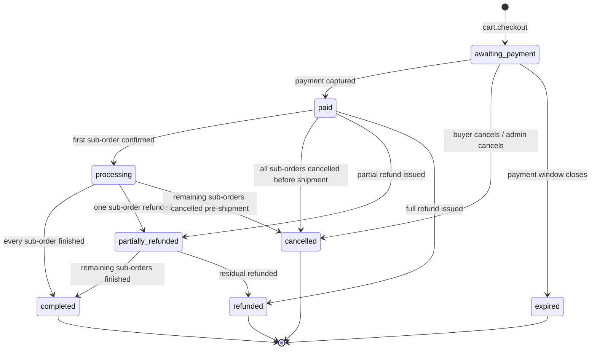
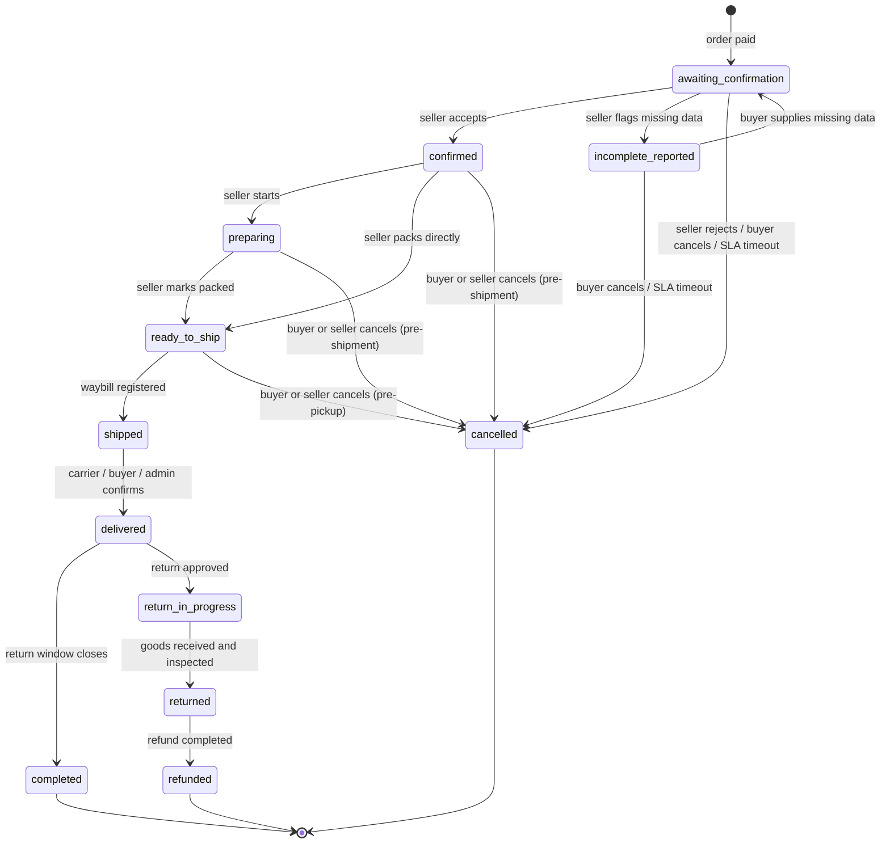
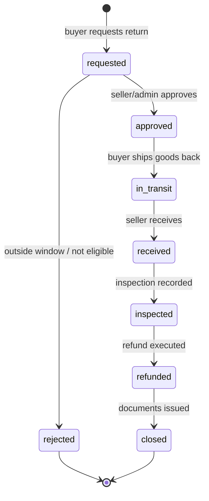

# Order and Sub-order State Machine — Dekolife Platform

**Purpose:** The normative lifecycle of `ord_orders` and `ord_sub_orders`: every state, every
allowed transition, who may trigger it, the guards that must pass, and the side effects on
stock, ledger, invoices, points, commission and notifications.
**Audience:** Backend engineers, QA, operations, anyone implementing an order endpoint.
**Status:** Baseline (v1). Any new transition requires an ADR and a test in
`tests/Feature/Orders/StateMachineTest.php`.
**Source:** `docs/canonical-context.md` §5 (parent order + per-seller sub-orders, explicit state
machine); contract appendix 4 clauses 15–16 (stop preparation, cancellation and refund with
seller approval), appendix 5 clauses 15, 41 (order rejection, refund to IBAN, audio notes),
appendix 11 clauses 12–15 (incomplete order, cancellation, delay damages), appendix 12 clauses
13–14 (deposit payment, returns).

---

## 1. Actors and invariants

| Actor | May trigger |
|---|---|
| `system` | Payment capture, payment expiry, SLA timeouts, auto-completion, delay assessment |
| `buyer` (consumer or store) | Cancel before shipment, pay, confirm delivery, request return, respond to an incomplete report |
| `seller` (supplier or store) | Accept, reject, start preparing, mark ready, ship, report incomplete, request cancellation |
| `admin` | Cancel, hold/release, force-complete, resolve disputes, create returns on behalf |
| `gateway` | Payment outcome only (never a fulfilment transition) |

Invariants that hold in every state:

1. `ord_orders.status` is **derived** from its sub-orders by `OrderStateProjector`; no request
   handler writes it. The parent is a roll-up, the sub-orders are the truth.
2. Every transition writes exactly one `ord_order_status_history` row with `from_status`,
   `to_status`, actor and (when relevant) `reason_code`.
3. A transition either happens completely — status, history, stock, ledger, invoice, points,
   outbox event — or not at all (single database transaction).
4. While `ord_sub_orders.is_on_hold = 1`, every transition is rejected except
   `cancelled` (admin/dispute) and `hold release`. The error is
   `409 order_on_hold`.
5. `lock_version` is checked on every write; a stale write returns `409 state_conflict`, never
   a silent overwrite.
6. Money is never moved by a status change alone: ledger posting is an explicit, idempotent
   command keyed by `reference` (`order:{id}:capture`, `suborder:{id}:delivery`, …).

---

## 2. Vocabulary

### 2.1 Order states (`ord_orders.status`)

| State | Meaning | Terminal |
|---|---|---|
| `awaiting_payment` | Created from a cart; stock held; payment not completed | no |
| `paid` | Payment (or the required deposit) captured; invoices issued; sub-orders awaiting seller confirmation | no |
| `processing` | At least one sub-order is being fulfilled (confirmed → shipped, or delivered) | no |
| `completed` | Every sub-order is finished (completed/cancelled/refunded) and at least one completed | yes |
| `cancelled` | Cancelled before any shipment; no sub-order is in fulfilment | yes |
| `expired` | Payment window closed with nothing captured | yes |
| `partially_refunded` | Money returned on part of the order; remaining sub-orders continue | no |
| `refunded` | All captured money returned; no active sub-order remains | yes |

### 2.2 Sub-order states (`ord_sub_orders.status`)

| State | Meaning | Terminal |
|---|---|---|
| `awaiting_confirmation` | Paid; waiting for the seller to accept | no |
| `incomplete_reported` | Seller flagged missing information and returned it to the buyer | no |
| `confirmed` | Seller accepted; stock committed; preparing | no |
| `preparing` | Seller is assembling/packing | no |
| `ready_to_ship` | Packed; awaiting carrier pickup / waybill | no |
| `shipped` | Handed to the carrier with a tracking code | no |
| `delivered` | Carrier or buyer confirms delivery; return window and delay assessment start | no |
| `completed` | Return window closed and money owed to the seller is releasable | yes |
| `cancelled` | Cancelled by buyer, seller, admin or system before shipment | yes |
| `return_in_progress` | An approved return is in transit back to the seller | no |
| `returned` | Goods received and inspected; refund owed | no |
| `refunded` | Refund completed; the sub-order is financially closed | yes |

### 2.3 Orthogonal flags (not states)

`is_on_hold`, `hold_reason_code`, `hold_until` (mirror of `ord_order_holds`), and
`promised_ship_at`. Treating "hold" as a flag rather than a state means a held order keeps its
progress and resumes where it stopped (appendix 4 clause 15 requires stopping preparation
*after* the invoice exists, which a state would lose).

---

## 3. Order lifecycle

### 3.1 Order transitions

| # | From → To | Trigger | Actor | Guards | Side effects |
|---|---|---|---|---|---|
| O-01 | — → `awaiting_payment` | `PlaceOrder` from a cart | buyer | Cart non-empty; every line re-priced server-side; stock reservation succeeds for every line; coupon valid and reserved; shipping resolved; `Idempotency-Key` unused | `ord_orders` + sub-orders (one per seller) + items + price snapshots; stock `held`; status history; `OrderPlaced` outbox event; SMS/email "order registered" to buyer, "new order" to each seller |
| O-02 | `awaiting_payment` → `paid` | `PaymentCaptured` | gateway/system | Captured + wallet applied ≥ `deposit_amount` (full total when no deposit); payment belongs to this order | `paid_at`; `payment_status='paid'` (or `partially_paid` for deposit orders); **sale invoice issued per sub-order**; reservations `committed`; ledger batch `order:{id}:capture`; notifications to buyer and sellers (appendix 7 clause 3) |
| O-03 | `awaiting_payment` → `cancelled` | `CancelOrder` | buyer, admin | No captured money (or refund already completed) | Reservations `released`; coupon redemption released; status history; `OrderCancelled`; notifications |
| O-04 | `awaiting_payment` → `expired` | `ExpireUnpaidOrders` (every 5 min) | system | `expires_at < now()` and no captured money | Reservations `released`; cart may be restored; notification "payment window expired" |
| O-05 | `paid` → `processing` | `SubOrderConfirmed` | seller/system | At least one sub-order enters `confirmed`/`preparing`/`ready_to_ship`/`shipped`/`delivered` | Parent `fulfilment_status` recomputed; no money movement (already posted at O-02) |
| O-06 | `paid` → `cancelled` | `CancelOrder` | buyer, seller (all), admin | Every sub-order cancelled and none shipped | Refund path R-01 executed for any captured money; ledger reversal |
| O-07 | `processing` → `completed` | `CompleteOrder` | system, admin | Every sub-order terminal; at least one `completed` | `completed_at`; `SubOrderCompleted` effects already applied per sub-order; final notification |
| O-08 | `processing` → `cancelled` | `CancelOrder` | admin | Remaining sub-orders all cancelled pre-shipment | As O-06 |
| O-09 | `paid`/`processing`/`partially_refunded` → `partially_refunded` | `RefundCompleted` with `refunded_amount < paid_amount` | system | Refund completed and balance remains | `refunded_amount` updated; ledger reversal batch; invoice `partially_paid`; notification |
| O-10 | any non-terminal → `refunded` | `RefundCompleted` with `refunded_amount = paid_amount` | system | All money returned | Parent terminal; sub-orders `refunded`; notification with the IBAN/wallet destination |

**Derivation rules (not transitions)**

- `payment_status`: `unpaid` while `paid_amount = 0`; `partially_paid` while
  `0 < paid_amount + wallet_applied < grand_total` (deposit orders); `paid` when the required
  amount is captured; `partially_refunded` / `refunded` from refund totals.
- `fulfilment_status`: `unfulfilled` when no sub-order has shipped; `partial` when some have;
  `fulfilled` when all sub-orders are terminal in `completed`/`returned`/`refunded`.

---

## 4. Sub-order lifecycle

### 4.1 Sub-order transitions

| # | From → To | Trigger | Actor | Guards | Stock | Money / documents | Notifications |
|---|---|---|---|---|---|---|---|
| S-01 | — → `awaiting_confirmation` | created with the order, after payment capture | system | Order `paid`; invoice issued; reservation `committed`; seller active | `held` → `committed` | Sale invoice issued (`inv_invoices.type='sale'`); ledger `order:{id}:capture` | Buyer "paid"; seller "new order, confirm within SLA" |
| S-02 | `awaiting_confirmation` → `confirmed` | `AcceptSubOrder` | seller | Not on hold; invoice exists; reservation committed; items in stock | unchanged | `confirmed_at`; `promised_ship_at` set from the seller's lead time | Buyer "seller confirmed" |
| S-03 | `awaiting_confirmation` → `incomplete_reported` | `ReportIncomplete` | seller | Not shipped; `missing_fields_json` non-empty; not already open for the same field set | unchanged (`held`/`committed` preserved) | `ord_incomplete_reports` row (`open`); `promised_ship_at` paused | Buyer "action needed: order information incomplete"; admin digest |
| S-04 | `incomplete_reported` → `awaiting_confirmation` | `RespondIncomplete` | buyer | Provides the missing fields | unchanged | Report `buyer_responded` → `resolved`; `promised_ship_at` recalculated | Seller "buyer responded" |
| S-05 | `awaiting_confirmation` → `cancelled` | `RejectSubOrder` | seller | Not shipped; no return in progress | `committed` → `released`; goods back to available | Refund R-02 (IBAN or wallet per buyer choice, appendix 5 clause 15); invoice `void`; ledger reversal of the capture share; `cmp_commission_entries` none (nothing accrued yet) | Buyer "seller could not fulfil, refund initiated"; admin alert if repeated |
| S-06 | `awaiting_confirmation` → `cancelled` | `CancelSubOrder` | buyer, admin | Not shipped; no shipment created | `committed` → `released` | Refund R-02; invoice `void` | Seller "buyer cancelled" |
| S-07 | `awaiting_confirmation` → `cancelled` | `ExpireUnconfirmedSubOrders` (hourly) | system | `created_at + accept_sla < now()` (default 48 h) | `committed` → `released` | Refund R-02; invoice `void`; seller reliability metric decremented | Both parties "order auto-cancelled: no seller response" |
| S-08 | `confirmed` → `preparing` | `StartPreparing` | seller | Not on hold | unchanged | `preparing_at` (history only) | Buyer "being prepared" (optional, config) |
| S-09 | `confirmed`/`preparing` → `ready_to_ship` | `MarkReadyToShip` | seller | Not on hold; packing complete | unchanged | Shipping label may be issued (`shp_shipments.status='label_issued'`) | Buyer "ready to ship"; carrier pickup request |
| S-10 | `ready_to_ship` → `shipped` | `ShipSubOrder` | seller | Waybill/tracking code present; carrier assigned; not on hold | `committed` → `issue` (on-hand decremented) | `shp_shipments` created/updated with `shipped_at`; `shipped_at` on sub-order; delivery delay clock starts | Buyer "shipped" + tracking link; push/SMS |
| S-11 | `shipped` → `delivered` | `MarkDelivered` | carrier webhook, buyer, admin | Shipment status `delivered` or buyer confirmation after `auto_deliver_days` (default 10) | unchanged | `delivered_at`; `return_window_ends_at = delivered_at + return_window_days`; `shp_delivery_delays` assessed; **points accrued**; **commission accrued** | Buyer "delivered — rate your purchase"; seller "delivered, payable accrued" |
| S-12 | `delivered` → `completed` | `CompleteSubOrder` (daily job or buyer confirm) | system, buyer | `now() ≥ return_window_ends_at` and no open return/complaint/hold | unchanged | `completed_at`; `payable_to_seller_amount` becomes releasable (settlement eligible); points become spendable | Buyer "order completed"; seller "funds available for settlement" |
| S-13 | `delivered` → `return_in_progress` | `ApproveReturn` | seller, admin | Return requested inside the window; quantities valid | unchanged until inspection | `rtn_returns.status='approved'`; sub-order frozen from completion | Both parties "return approved" |
| S-14 | `return_in_progress` → `returned` | `ReceiveReturn` | seller, admin | Goods received; inspection recorded | `return` movement for restockable quantity only | `rtn_returns.status='inspected'`; refund amount confirmed; `return` invoice prepared | Buyer "return received, refund processing" |
| S-15 | `returned` → `refunded` | `RefundCompleted` | system | Refund executed (wallet or IBAN) | unchanged | `pay_refunds` completed; ledger reversal; return invoice issued; points and commission reversed | Buyer "refund completed"; seller "refund debited from payable" |
| S-16 | `confirmed`/`preparing`/`ready_to_ship` → `cancelled` | `CancelSubOrder` | buyer, seller, admin | Not shipped; no pickup booked (or pickup cancelled) | `committed` → `released` | Refund R-02; invoice `void`; commission not accrued | Both parties with reason |
| S-17 | any non-terminal → `cancelled` | `CancelSubOrder` forced | admin | Reason code + note required; if shipped, a return must exist instead | as above | Refund R-02/R-03; audit log entry | Both parties; admin audit |

**Deliberately absent transitions**

| Not allowed | Why | Correct path |
|---|---|---|
| `shipped` → `cancelled` | Goods are with the carrier; cancelling would orphan the shipment and the money | Create a return (`rtn_returns`) → `return_in_progress` → `returned` → `refunded`; admin may create the return on the buyer's behalf |
| `delivered` → `cancelled` | Same reason | Return path |
| `completed` → anything | Terminal; settlement and points are already posted | Admin adjustment + `fin_adjustments`, or a goodwill coupon |
| `cancelled` → `confirmed` | Terminal | Place a new order |
| `awaiting_confirmation` → `shipped` | Skips acceptance; seller must own the commitment | Accept first (`confirmed`), then `ready_to_ship`, then `shipped` |
| Any → `delivered` without `shipped` | Delivery implies a dispatch record | `ShipSubOrder` then `MarkDelivered` |

---

## 5. Side-effect matrix

| Event | Stock (`stk_`) | Ledger (`fin_`) | Invoice (`inv_`) | Points (`loy_`) | Commission (`cmp_`) | Notifications (`ntf_`) |
|---|---|---|---|---|---|---|
| Order placed | `held` +`reserved_quantity` | — | — | — | — | buyer + sellers |
| Payment captured | `held` → `committed` | Dr `gateway_clearing` / Cr `order_deposit_liability` (or Cr `wallet_liability` for the wallet portion) | sale invoice `issued` per sub-order | — | — | buyer + sellers + admin report |
| Deposit captured (partial) | as above | same, for the deposit amount | invoice `partially_paid` | — | — | buyer "deposit received, balance due on delivery" |
| Seller accepts | — | — | — | — | — | buyer |
| Incomplete reported | — | — | — | negative on abuse only | — | buyer + admin |
| Shipped | `committed` → `issue` (`on_hand` −qty) | — | — | — | — | buyer + tracking |
| Delivered | — | Dr `order_deposit_liability` / Cr `supplier_payable` (`payable_to_seller`) + Cr `platform_revenue` (`commission_amount`) | — | earn points from the invoice (source `invoice`) | `cmp_commission_entries` accrued (status `accrued`) | buyer (rate prompt) + seller |
| Delivery delayed | — | Dr `supplier_payable` / Cr `wallet_liability` (penalty) | — | — | commission base reduced to the net payable | buyer + seller + admin |
| Completed | — | — | `settled_at` eligible | points become spendable | commission `approved` | buyer + seller |
| Cancelled (pre-ship) | `committed`/`held` → `released` | reversal of the capture share; refund Dr `order_deposit_liability` / Cr `gateway_clearing` or `wallet_liability` | `void` | — | — | both + admin |
| Return approved | — | — | return invoice `draft` | — | commission flagged for reversal | both |
| Return received | `return` movement (restockable only) | — | return invoice `issued` | points reversed (`direction='adjust'`) | commission reversal entry | both |
| Refund completed | — | Dr `supplier_payable` (if accrued) or `order_deposit_liability` / Cr `gateway_clearing` or `wallet_liability` | `void`/`return` invoice final | reversal if not already | `reversed` | buyer + seller |
| Settlement paid | — | Dr `supplier_payable` / Cr `bank` | `settled_at` | — | entries `settled` | seller |

Rules that fall out of the matrix:

1. **No ledger entry before capture.** Placing an order moves stock, never money.
2. **Revenue is recognised at delivery**, not at payment: the capture is a liability
   (`order_deposit_liability`) until the seller has performed. This is the conservative model
   required by `AMB-FIN-001`.
3. **Points and commission are earned at delivery**, both reversed on return. An order that
   never ships earns nothing.
4. **Stock leaves `on_hand` only at shipment**, not at order placement — reservations protect
   availability, `issue` records the physical exit.
5. Every effect is an idempotent command keyed by a deterministic reference, so replaying an
   event cannot double-post.

---

## 6. Cancellation paths

| Path | Who | When | Money | Documents | Notes |
|---|---|---|---|---|---|
| C-01 | Buyer | `awaiting_payment` | Nothing captured → nothing to refund; wallet portion released | Order `cancelled`; cart optionally restored | No seller involvement |
| C-02 | Buyer | `awaiting_confirmation` | Full refund of captured amount | Sale invoice `void`; refund to wallet (instant) or IBAN (batch) | Buyer picks the destination when an IBAN exists |
| C-03 | Seller (reject) | `awaiting_confirmation` | Full refund | Invoice `void`; reason recorded on the sub-order | Seller reliability metric; repeated rejections raise an admin alert |
| C-04 | Buyer/seller | `confirmed`/`preparing`/`ready_to_ship` | Full refund | Invoice `void` | Requires seller acknowledgement when the buyer initiates after `confirmed`; if the seller refuses, the buyer may open a complaint (`rtn_complaints`) |
| C-05 | System | `awaiting_confirmation` past SLA | Full refund | Invoice `void` | Scheduled hourly; notifies both parties |
| C-06 | Admin | Any pre-shipment state | Full or partial refund | Invoice `void` or `return` invoice | Reason + note mandatory; audited; may also release a hold |
| C-07 | Admin | `shipped`/`delivered` | Refund only through a return | Return invoice | Cancelling a shipped order is not a state transition (see §4 "deliberately absent") |

Cancellation reason codes (shared with the API and analytics):
`buyer_changed_mind`, `buyer_address_issue`, `seller_out_of_stock`, `seller_price_error`,
`seller_cannot_ship`, `incomplete_unresolved`, `payment_timeout`, `duplicate_order`,
`fraud_suspected`, `admin_decision`, `force_majeure`.

---

## 7. Return and refund paths

| # | Transition | Actor | Guards | Effects |
|---|---|---|---|---|
| R-01 | `requested` → `approved` | seller, admin | Inside `return_window_ends_at`; item is return-eligible (`rtn_return_reasons.allows_restock` or condition recorded); quantity ≤ delivered − already returned | Sub-order → `return_in_progress`; return invoice drafted; commission flagged |
| R-02 | `requested` → `rejected` | seller, admin | Outside window, used/damaged item not eligible, or quantity exceeded | Reason shown to the buyer; buyer may escalate to `rtn_complaints` |
| R-03 | `approved` → `in_transit` | buyer | — | Tracking optional; the sub-order stays `return_in_progress` |
| R-04 | `in_transit` → `received` | seller, admin | — | Sub-order → `returned`; stock `return` movement only for restockable quantities |
| R-05 | `received` → `inspected` | seller | Inspection recorded (condition, restock quantity) | Refund amount finalised; return invoice issued |
| R-06 | `inspected` → `refunded` | system | Refund executed to wallet or IBAN | Ledger reversal; points reversed; commission reversed; sub-order → `refunded` |
| R-07 | `refunded` → `closed` | system | All documents issued | Terminal |

Rules:

1. A return can only be requested **after delivery** and **inside the window**
   (`orders.return_window_days`, default 7 per appendix 12 clause 9). Requests after the
   window are rejected with `422 return_window_closed`.
2. A return is per item, not per order: a buyer may return one line of a multi-line sub-order.
3. Restocking is a business decision per reason code; damaged goods never re-enter sellable
   stock and are recorded as a `damage` movement.
4. Refunds never exceed `captured_amount − refunded_amount` for the payment, and never exceed
   the returned lines' value plus their shipping share.
5. A sub-order with an open complaint or dispute cannot be completed or settled; the return and
   the complaint can coexist, and the dispute decision is authoritative on money.

---

## 8. Holds (stop preparation / stop payment)

`ord_order_holds` is how the contract's "stop the order" rights are implemented without
inventing a state (appendix 4 clauses 15–16, appendix 11 clause 12).

| Reason code | Created by | Default duration | Blocks | Released by |
|---|---|---|---|---|
| `complaint` | Buyer complaint | 7 days from delivery (configurable) | `ready_to_ship`, `shipped`, `completed`, settlement release | Admin decision, or expiry with auto-release |
| `dispute` | Escalated complaint | Until decided | Same, plus any refund | Dispute decision |
| `incomplete` | Supplier report | Until buyer responds | `confirmed`, `shipped` | Buyer response or auto-close |
| `fraud_review` | Admin/risk rule | Until reviewed | All transitions except admin cancel | Admin |
| `payment_review` | Gateway mismatch | Until reconciled | `shipped`, settlement | Finance |

Mechanics:

1. Creating a hold sets `ord_sub_orders.is_on_hold = 1` and mirrors `hold_reason_code`,
   `hold_until` (denormalised for list queries).
2. Releasing a hold sets `status='released'`, clears the cache columns and writes a history row
   with `reason_code='hold_released'` (the lifecycle state does **not** change).
3. An expired hold (`hold_until < now()`) is released by the `ReleaseExpiredHolds` job and the
   action is recorded as `system`.
4. A held sub-order still appears in the seller's queue, marked as on hold, so the seller does
   not ship by mistake.

---

## 9. Timers and scheduled jobs

| Job | Cadence | Effect | Config key |
|---|---|---|---|
| `ExpireUnpaidOrders` | 5 min | `awaiting_payment` past `expires_at` → `expired`, stock released | `orders.payment_window_minutes` (30) |
| `ExpireUnconfirmedSubOrders` | hourly | `awaiting_confirmation` past acceptance SLA → `cancelled` + refund | `orders.seller_accept_sla_hours` (48) |
| `ExpireIncompleteReports` | hourly | `incomplete_reported` past buyer SLA → `cancelled` + refund | `orders.incomplete_response_hours` (72) |
| `AutoDeliverShipments` | hourly | `shipped` with no carrier event after N days → `delivered` (buyer confirmation prompt) | `orders.auto_deliver_days` (10) |
| `CompleteDeliveredSubOrders` | daily 02:00 Tehran | `delivered` past return window with no open return/complaint → `completed` | `orders.return_window_days` (7) |
| `ReleaseExpiredHolds` | hourly | expired holds → `released` | `orders.hold_default_days` (7) |
| `AssessDeliveryDelays` | on delivery | creates `shp_delivery_delays` and applies the penalty | `orders.delay_penalty_percent_per_day` |
| `ExpireStockReservations` | 5 min | `held` reservations past `expires_at` → `expired`, stock returned | `inventory.reservation_minutes` (30) |
| `ReconcileOrderTotals` | daily 03:00 | asserts I-01…I-04 and I-13, alerts on drift | — |

All jobs are idempotent and safe to run twice: they select by state + timestamp and write
through the same state-machine commands as user actions.

---

## 10. Error contract for illegal transitions

Every rejected transition returns the standard error envelope with a stable code (see
[`../api/error-model.md`](../api/error-model.md)):

| Situation | HTTP | Code | Persian message key |
|---|---|---|---|
| Transition not in the table above | 409 | `order_transition_not_allowed` | `errors.order.transition_not_allowed` |
| Sub-order is on hold | 409 | `order_on_hold` | `errors.order.on_hold` |
| Concurrent write (stale `lock_version`) | 409 | `state_conflict` | `errors.common.state_conflict` |
| Actor lacks the role for this transition | 403 | `forbidden_transition_actor` | `errors.order.actor_not_allowed` |
| Seller tries to act on another seller's sub-order | 403 | `forbidden` | `errors.auth.forbidden` |
| Return requested outside the window | 422 | `return_window_closed` | `errors.return.window_closed` |
| Payment captured for an expired order | 409 | `order_expired` | `errors.order.expired` (the payment is refunded automatically) |
| Cancel after shipment | 409 | `order_already_shipped` | `errors.order.already_shipped` |

---

## 11. Test obligations

1. **Transition coverage**: every row in §3.1 and §4.1 has a feature test that starts in
   `from`, performs the action as the stated actor, and asserts `to` + history + side effects.
2. **Negative matrix**: for each state, every transition not listed is attempted and must
   return `409 order_transition_not_allowed` — generated from the same table the code uses.
3. **Money invariants** after every transition: order/sub-order totals, ledger balance and
   wallet projection (I-01…I-06).
4. **Idempotency**: replaying `PaymentCaptured`, `MarkDelivered` and `RefundCompleted` twice
   produces one invoice, one point transaction, one commission entry and one ledger batch.
5. **Hold semantics**: a held sub-order rejects `ready_to_ship` and `shipped`, and resumes
   normally after release.
6. **Return path**: full and partial returns, with and without restock, including the points
   and commission reversal.
7. **Timer jobs**: time-travel tests for each row in §9, asserting exactly one transition and
   one notification.
