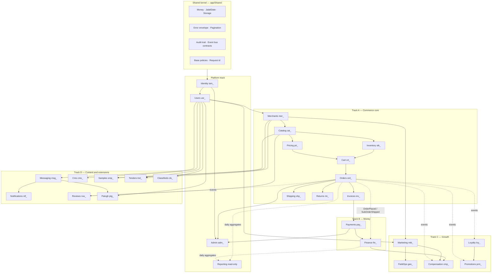

# Dependency Map — Modules, Build Order and Parallel Work Tracks

**Purpose:** Fix the module dependency graph, the order in which modules may be built, which modules can be built concurrently, the shared contracts that must land before parallel work is safe, and the exact file paths each agent owns.
**Audience:** Orchestrator, all engineering agents, the independent reviewer.
**Status:** Baseline v1 (Phase 0 output). Binding for parallel work; changes require an orchestrator note here plus a `progress.md` decision row.
**Source:** Module list, table prefixes and baseline engineering decisions from `docs/canonical-context.md` §3 and §5; scope and functional edges from contract appendices 1–13 (see `phases-and-milestones.md` for the phase mapping and citations).

---

## 1. Dependency rules

1. **One direction only.** A module may call another module's *application service* or *domain event*; it may never read or write another module's tables. Table prefixes (`cat_`, `ord_`, `pay_`, …) are ownership boundaries, not naming preferences.
2. **Shared kernel is a leaf.** `app/Shared/` depends on nothing in `app/Modules/`. If a shared class needs a module, it belongs in that module.
3. **Events over calls for reverse flow.** Downstream modules (Finance, Compensation, Loyalty, Notifications) react to upstream domain events (`OrderPlaced`, `SubOrderShipped`, `InvoiceIssued`, `PaymentCaptured`) instead of being called inline. This keeps the checkout request short and makes replay possible.
4. **No cycles.** If two modules appear to need each other, one direction becomes an event or a read-model projection. The reviewer blocks any PR that introduces a cycle.
5. **Contracts before consumers.** The four shared contract sets in §4 must be merged and tagged before a consumer module starts, otherwise parallel agents invent incompatible types.

---

## 2. Module dependency graph

Solid arrows = compile-time dependency (service call, interface, DTO). Dotted arrows = event consumption (runtime, one-way).

`Admin` and `Reporting` sit at the end of the graph on purpose: they are surfaces over other modules' application services and read-only projections, never a place to put business rules. `Reporting` has no owned tables; it reads daily aggregates produced by Finance and Orders.

---

## 3. Build order (waves)

Waves are merge order, not calendar phases. A wave may only start when the previous wave's *contract surface* is merged and tagged, even if some of its internals are still in review.

| Wave | Modules | Why here | Tag |
|---|---|---|---|
| W0 | Shared kernel, `compose.yaml`, CI, ADRs | every later class compiles against these | `v0.1.0` |
| W1 | Identity, Users | actor + role set + policies gate every scoped resource | `v0.2.0` |
| W2 | Merchants, Catalog, Pricing, Inventory | first client-visible data; `PriceQuote` contract unlocks cart | `v0.3.0` |
| W3 | Cart, Orders, Shipping, Returns | order state machine + snapshotting unlock money and commission | `v0.4.0` |
| W4 | Invoices, Payments, Finance | ledger and idempotent payment commands | `v0.5.0` |
| W5 | Marketing, FieldOps, Compensation | needs invoice/payment events for the commission base | `v0.6.0` |
| W6 | Loyalty, Promotions | needs invoices, wallet and role pricing | `v0.6.1` |
| W7 | Messaging, Notifications, Cms, Reviews, Samples | needs users and order events only | `v0.7.0` |
| W8 | Tenders, Classifieds, Patogh | needs users, merchants, taxonomy, messaging | `v0.7.1` |
| W9 | Admin, Reporting, PWA, SEO/perf hardening | surfaces everything; must not be built before its subjects exist | `v0.9.0` |
| W10 | Acceptance fixes, training material | — | `v1.0.0` |

---

## 4. Shared contracts that must land first

These are the only objects that cross module boundaries. They are frozen at a tag; changing one after freeze requires a PR to the owning agent plus a note in `progress.md`, because every parallel track breaks at once otherwise.

### 4.1 Shared kernel — `app/Shared/` (frozen at `v0.1.0`)

| Contract | Namespace | Shape / rule |
|---|---|---|
| Money | `App\Shared\Money\Money` | integer Toman, `BIGINT *_amount` columns, `add/subtract/multiplyByRate/allocate`, throws on float input |
| Error envelope | `App\Shared\Http\ApiResponse` | `{ data, meta{request_id, pagination}, errors[{code, field, message}] }` — one shape for web JSON and API |
| Pagination | `App\Shared\Http\Paginated` | page, per_page (max 100), total, last_page |
| Audit | `App\Shared\Audit\Auditable` + `AuditLogger` | actor id, event, subject type/id, old/new JSON, ip, request id; writes `adm_audit_logs` only through this |
| Event bus | `App\Shared\Events\DomainEvent` | immutable, `occurredAt`, `aggregateId`, versioned payload |
| Storage | `App\Shared\Storage\FileStore` | private disk default, signed URL for identity documents |
| Jalali | `App\Shared\Time\JalaliDate` | store UTC, render `Asia/Tehran`, Jalali at presentation only |
| Request id | `App\Shared\Http\RequestId` | reads `X-Request-Id`, generates if absent, propagates to logs and error envelope |
| Result | `App\Shared\Support\Result` | `ok()/fail(code)` — no exceptions for expected business rejections |

### 4.2 Identity contracts — `app/Modules/Identity` (frozen at `v0.2.0`)

| Contract | Namespace | Shape / rule |
|---|---|---|
| Actor | `Identity\Application\Actor` | `id`, `roles[]`, `activeRole`, `scopes[]`, `isAdmin` |
| Role set | `Identity\Domain\RoleSet` | `consumer`, `store`, `supplier`, `marketer`, `admin` + secondary role switch |
| Scope | `Identity\Application\Scope` | `own`, `network`, `merchant:{id}`, `global` — enforced server-side by policies |
| Actor resolver | `Identity\Application\ActorResolver` | web session guard and Sanctum token both resolve to the same `Actor` |
| 2FA gate | `Identity\Http\Middleware\RequireTwoFactor` | admin routes only |

### 4.3 Catalog contracts — `app/Modules/Catalog` (frozen at `v0.3.0`)

| Contract | Namespace | Shape / rule |
|---|---|---|
| ProductRef | `Catalog\Contracts\ProductRef` | `id`, `sku`, `title`, `merchantId`, `categoryId`, `brandId`, `attributes[]` |
| PriceQuery | `Catalog\Contracts\PriceQuery` | `productId`, `quantity`, `actor`, `at` |
| PriceQuote | `Catalog\Contracts\PriceQuote` | `unitAmount`, `baseAmount`, `appliedRules[]`, `currency` — **the only price a consumer may receive** |
| StockGateway | `Inventory\Contracts\StockGateway` | `reserve(items): ReservationId`, `release(id)`, `commit(id)` |
| CatalogReader | `Catalog\Contracts\CatalogReader` | read-only list/detail queries for Cart, Tenders, Reporting |

### 4.4 Commerce and money contracts (frozen at `v0.4.0` / `v0.5.0`)

| Contract | Namespace | Shape / rule |
|---|---|---|
| OrderTotal | `Orders\Contracts\OrderTotal` | subtotal, discount, shipping, tax, payable — integer Toman |
| InvoiceRef | `Invoices\Contracts\InvoiceRef` | `id`, `number`, `subOrderId`, `amount`, `status` |
| PaymentIntent | `Payments\Contracts\PaymentIntent` | `invoiceId`, `amount`, `gateway`, `reference` (unique), `status` |
| LedgerCommand | `Finance\Contracts\LedgerCommand` | `reference` (unique, idempotency key), debit/credit legs, `reason` |
| PayoutEligibility | `Finance\Contracts\PayoutEligibility` | asks Orders/Returns whether a sub-order is under hold before scheduling payout |

**Freeze discipline.** From `v0.3.0` onward, `PriceQuote`, `OrderTotal` and `LedgerCommand` may not change shape without a reviewer-approved PR that updates every consumer in the same merge. New *optional* fields are the only cheap change.

---

## 5. Parallel work tracks

Six streams. Four engineering tracks own disjoint module trees; the platform stream owns cross-cutting files; QA/review is independent and never authors feature code.

| Track | Mission | Owned phases | Agent |
|---|---|---|---|
| **P — Platform** | Shared kernel, Identity, Users, Admin, Reporting, CI, compose, config, docs | 0, 1, 9 | Platform agent |
| **A — Commerce core** | Merchants, Catalog, Pricing, Inventory, Cart, Orders, Invoices, Shipping, Returns | 2, 3 | Agent A |
| **B — Money** | Payments, Finance (ledger, settlement, reconciliation) | 4 | Agent B |
| **C — Growth** | Marketing, FieldOps, Compensation, Loyalty, Promotions | 5, 6 | Agent C |
| **D — Content & extensions** | Messaging, Notifications, Cms, Reviews, Samples, Tenders, Classifieds, Patogh | 7, 8 | Agent D |
| **Q — QA/Review** | Independent PR review, acceptance-scenario authoring, negative authorization tests, restore drills | all | Reviewer |

### 5.1 What can be built simultaneously

| Window | Concurrent, safe | Blocked until |
|---|---|---|
| W1 | Identity ∥ Users schema (two agents, contract-first) | W0 tag |
| W2 | Catalog+search ∥ Merchants+onboarding ∥ Pricing ∥ Inventory (4 agents) | `Actor` frozen; `PriceQuote` drafted |
| W3 | Cart ∥ Orders state machine ∥ Shipping ∥ Returns (4 agents) | `PriceQuote`, `StockGateway` frozen |
| W3–W4 | Payments driver work ∥ Finance ledger (2 agents) — both consume `InvoiceRef` only | `OrderTotal` frozen |
| W5–W6 | Marketing+FieldOps ∥ Compensation ∥ Loyalty ∥ Promotions (4 agents, event-consumers) | money events published |
| W7–W8 | Messaging+Ntf ∥ Cms+Reviews ∥ Tenders ∥ Classifieds+Patogh (4 agents) | `Actor` + event bus frozen |
| W9 | Admin screens ∥ Reporting aggregates ∥ PWA/SEO ∥ security hardening (4 agents) | all functional modules merged |

### 5.2 What must never run in parallel

- Two agents editing `compose.yaml`, `config/*`, `bootstrap/app.php`, `routes/web.php` or `.github/workflows/*` — platform agent only, everyone else opens a request.
- Two migrations touching the same module prefix.
- Any change to a frozen contract in §4 while a consumer track is mid-PR — the contract owner merges first, then consumers rebase.
- `Admin` screens and the module they expose, in the same PR from different agents; the module merges first.

---

## 6. File ownership boundaries

Paths are repository-relative. An agent may **read** anything and may **write** only its own paths. Cross-boundary changes go through the owner.

| Track | Writes | Must not touch |
|---|---|---|
| **P — Platform** | `app/Shared/**`, `app/Modules/Identity/**`, `app/Modules/Users/**`, `app/Modules/Admin/**`, `app/Modules/Reporting/**`, `config/**`, `bootstrap/**`, `routes/web.php`, `routes/api.php`, `routes/console.php`, `compose.yaml`, `docker/**`, `.github/**`, `scripts/**`, `docs/**`, `phpunit.xml`, `phpstan.neon`, `pint.json`, `composer.json`, `package.json`, `vite.config.*` | feature module internals |
| **A — Commerce core** | `app/Modules/{Merchants,Catalog,Pricing,Inventory,Cart,Orders,Invoices,Shipping,Returns}/**`, `database/migrations/*_{mer,cat,pri,stk,crt,ord,inv,shp,rtn}_*`, `database/seeders/Catalog*`, `tests/Feature/{Catalog,Pricing,Inventory,Cart,Orders,Invoices,Shipping,Returns,Merchants}/**`, `resources/views/{catalog,cart,checkout,orders}/**` | `app/Shared/**`, `Identity`, `Payments`, `Finance` |
| **B — Money** | `app/Modules/Payments/**`, `app/Modules/Finance/**`, `database/migrations/*_{pay,fin}_*`, `tests/Feature/{Payments,Finance}/**`, `tests/Fixtures/gateways/**`, `resources/views/{payments,finance}/**` | `Orders`, `Invoices` (consume contracts only), `app/Shared/Money` |
| **C — Growth** | `app/Modules/{Marketing,FieldOps,Compensation,Loyalty,Promotions}/**`, `database/migrations/*_{mkt,geo,cmp,loy,prm}_*`, `tests/Feature/{Marketing,FieldOps,Compensation,Loyalty,Promotions}/**`, `resources/views/{marketer,loyalty}/**` | `Orders`, `Finance`, `Users` tables |
| **D — Content & extensions** | `app/Modules/{Messaging,Notifications,Cms,Reviews,Samples,Tenders,Classifieds,Patogh}/**`, `database/migrations/*_{msg,ntf,cms,rvw,smp,tnd,cls,ptg}_*`, `tests/Feature/{Messaging,Notifications,Cms,Reviews,Samples,Tenders,Classifieds,Patogh}/**`, `resources/views/{cms,classifieds,patogh,tenders,blog}/**` | `Orders`, `Catalog`, `app/Shared/**` |
| **Q — QA/Review** | `tests/Acceptance/**`, `docs/testing/**`, review comments only | all production code (review only) |

### 6.1 Cross-boundary request protocol

1. The requester writes the ask in the PR description: which signature it needs, why, and the failing test.
2. The owner lands the change (or an interface) on `main` behind the existing tag discipline.
3. The requester rebases; nobody edits another owner's file "just this once".
4. If the owner disagrees, the Orchestrator decides and records the decision in `progress.md`.

### 6.2 Shared-file hotspots and their owner

| File | Owner | Change mechanism |
|---|---|---|
| `app/Shared/Money/*` | P | PR + reviewer; any rounding change needs a ledger-impact note |
| `routes/web.php`, `routes/api.php` | P | module route files are auto-included from `app/Modules/*/routes/*.php`; only P edits the registrar |
| `compose.yaml` | P | request via PR; changes announced before merge |
| `config/*.php` | P | new config keys added by P after a module owner requests them |
| `database/seeders/DatabaseSeeder.php` | P | calls module seeders by class name |
| `.github/workflows/ci.yml` | P | no ad-hoc edits from feature tracks |

---

## 7. Migration and merge discipline for parallel work

- **Naming:** `YYYY_MM_DD_HHMMSS_<prefix>_<verb>_<subject>.php`; the prefix must match the owning module (`cat_`, `pay_`…). A CI check rejects a migration whose table prefix does not belong to the branch's module directory.
- **One migration per module per PR.** Squash before merge; the reviewer checks for accidental cross-module DDL.
- **No editing merged migrations.** Corrections are new migrations, except before a tag is cut on the same branch.
- **Foreign keys point only at `iam_`/`usr_`/`mer_` identity columns** — downstream modules may not add FKs into another module's business tables; they store the id and resolve through the contract.
- **Merge order inside a wave:** contracts → schema → services → HTTP/UI → tests. CI must be green at each step; `main` stays releasable at every tag.
- **Branch naming:** `feat/<area>/<task>`, `fix/…`, `docs/…`, `chore/…`; squash merge; head branch deleted after merge (see `release-plan.md` §4).

---

## 8. Release-to-phase traceability

| Wave | Release | Phase | Contract headings covered |
|---|---|---|---|
| W0–W1 | v0.1.0, v0.2.0 | 0–1 | `پیوست ۱` بند ۱–۳, ۷, ۱۰; `پیوست ۳`; `پیوست ۷` بند ۶ |
| W2 | v0.3.0 | 2 | `پیوست ۲` بند ۲–۵, ۱۰; `پیوست ۷` بند ۴; `پیوست ۹` بند ۴; `پیوست ۱۱` بند ۱ |
| W3 | v0.4.0 | 3 | `پیوست ۲` بند ۶, ۱۱; `پیوست ۱۱` بند ۱۲–۱۵, ۱۸; `پیوست ۱۲` بند ۱۲–۱۴ |
| W4 | v0.5.0 | 4 | `پیوست ۱` بند ۵; `پیوست ۷` بند ۲; `پیوست ۱۳` بند ۱–۳, ۶–۷ |
| W5 | v0.6.0 | 5 | `پیوست ۵` بند ۱–۳; `پیوست ۶` بند ۱–۱۲; `پیوست ۴` بند ۲۳–۲۴ |
| W6 | v0.6.1 | 6 | `پیوست ۴` بند ۱–۱۴, ۲۰–۲۲; `پیوست ۵` بند ۴۳; `پیوست ۱۲` بند ۴, ۱۰ |
| W7 | v0.7.0 | 7 | `پیوست ۲` بند ۱۰, ۱۲; `پیوست ۴` بند ۱۷; `پیوست ۵` بند ۹–۱۰, ۲۳, ۲۸; `پیوست ۱۱` بند ۹ |
| W8 | v0.7.1 | 8 | `پیوست ۵` بند ۴–۶, ۱۳; `پیوست ۱۱` بند ۱۰ |
| W9 | v0.9.0 | 9 | `پیوست ۱` بند ۴; `پیوست ۷` بند ۱, ۹–۱۰; `پیوست ۹` بند ۱–۳ |
| W10 | v1.0.0 | 10 | `پیوست ۱۰` بند ۱–۶ |
